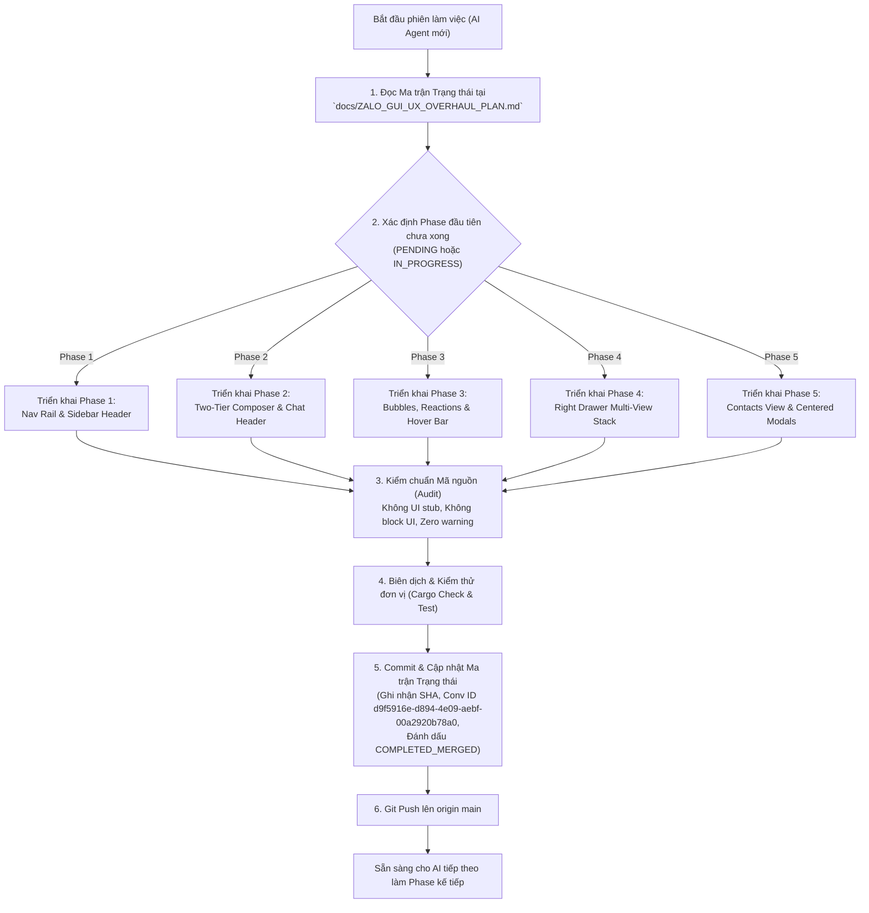

# Hướng dẫn Bàn giao & Triển khai Tái cấu trúc GUI & UX (AI Agent Handover Guide)

> **Dành cho các AI Agent (Gemini, Claude, GPT, v.v., bao gồm conversation ID `d9f5916e-d894-4e09-aebf-00a2920b78a0` và các phiên tiếp nối):**
> Tài liệu này hướng dẫn chi tiết quy trình triển khai, kiểm chuẩn và chuyển giao từng giai đoạn (Phase 1 → Phase 5) của dự án tái cấu trúc GUI/UX Zalo PC Parity trong `ctdozlite`.

---

## 1. Trạng thái & Cơ chế Bàn giao Liên tục (Continuous Handover Protocol)

Mọi AI Agent khi nhận nhiệm vụ trong dự án này **PHẢI** thực hiện theo quy trình sau:



---

## 2. Các Bất biến Bắt buộc (Mandatory Invariants)

Bất kỳ AI Agent nào can thiệp vào giao diện GUI `egui` của `ctdozlite` đều phải tuân thủ nghiêm ngặt các nguyên tắc sau từ [AGENTS.md](../AGENTS.md):

1. **No UI Stubs & No Dropped Payloads Invariant:**
   - Mọi nút bấm, trường nhập liệu, dropdown menu **BẮT BUỘC** phải được kết nối luồng xử lý đầu-cuối:
     $$\text{UI Action} \longrightarrow \text{WorkerCmd} \longrightarrow \text{Network / DB} \longrightarrow \text{GuiEvent(Payload)} \longrightarrow \text{App State} \longrightarrow \text{Reactive Render}$$
   - Tuyệt đối cấm tạo nút bấm giả (fake buttons) chỉ làm biến đổi `self.status_msg` mà không có mã lệnh xử lý backend.
   - Luôn đối chiếu định nghĩa trường trong struct của module gốc trước khi truy xuất (`src/message_model.rs`, `src/chat.rs`, `src/session.rs`).
2. **Không chặn Luồng Giao diện (No Blocking Work on UI Thread):**
   - Luồng UI chỉ render và dispatch `WorkerCmd`. Mọi thao tác I/O mạng, truy vấn SQLite, mã hóa/giải mã và giải nén tệp đều chạy ngầm trên Tokio runtime trong `src/gui/worker.rs`.
3. **Quy tắc Ngôn ngữ & Tài liệu:**
   - Ghi chú mã nguồn (code comments) viết bằng tiếng Anh.
   - Toàn bộ chuỗi hiển thị giao diện người dùng viết bằng tiếng Việt thông qua macro dịch thuật `crate::i18n::tr("...")`.
4. **Kỷ luật Thay đổi Phẫu thuật (Surgical Changes):**
   - Chỉ chỉnh sửa đúng phạm vi của Phase được giao. Không viết lại cấu trúc ngoài phạm vi hoặc xóa các trường trạng thái cần thiết của tài khoản/hội thoại khác.

---

## 3. Hướng dẫn Kỹ thuật Chi tiết cho Từng Giai đoạn

---

### Giai đoạn 1: Design Tokens, Left Nav Rail & Sidebar Header
- **Mục tiêu:** Xóa bỏ toàn bộ nút bấm kỹ thuật thô ở Sidebar; đưa Nav Rail về chuẩn Zalo PC (`#0068FF` Light / `#22262B` Dark); thiết kế lại Header Sidebar gọn gàng.
- **File tác động:**
  - `src/gui/theme.rs`: Định nghĩa các hằng số màu và kích thước:
    - `NAV_RAIL_BG_LIGHT = Color32::from_rgb(0, 104, 255)` (`#0068FF`).
    - `NAV_RAIL_BG_DARK = Color32::from_rgb(34, 38, 43)` (`#22262B`).
    - `NAV_RAIL_WIDTH = 64.0`.
    - `SIDEBAR_WIDTH = 320.0`.
  - `src/gui/workspace.rs`:
    - Sửa thanh Nav Rail trái: Hiển thị Avatar (44px) + chấm xanh online ở đỉnh; nhóm icon chính (`Tin nhắn` có badge đỏ, `Danh bạ`, `Giao việc`); nhóm icon phụ ở đáy (`Cloud của tôi`, `Công cụ`, `Cài đặt`).
    - Sửa Header Sidebar: Dòng 1 gồm `[Ô tìm kiếm bo tròn]` + `[+👤 Thêm bạn]` + `[👥+ Tạo nhóm]`. Khi focus vào ô tìm kiếm thì bật cờ `self.search_in_place = true`.
    - Dòng 2 (Filter Strip): Chỉ giữ 2 tab gạch chân xanh **`Tất cả`** | **`Chưa đọc`**, bên phải là nút **`Phân loại ▾`** (mở popover nhãn màu) và nút **`⋯`** (Đánh dấu đã đọc tất cả, Hội thoại ẩn/PIN, Lưu trữ, Tin nhắn người lạ).
    - Loại bỏ hoàn toàn các nút thô: `"Hội thoại ẩn / PIN…"`, `"Phân loại hội thoại…"`, checkbox `"Hiện cả hội thoại đã ẩn"` khỏi Sidebar chính (chuyển vào menu `⋯`).
- **Kiểm chuẩn:** Sidebar không còn hiện tượng chật chội; các nút bấm vẫn mở đúng popup/modal tương ứng.

---

### Giai đoạn 2: Two-Tier Composer & Chat Header + Pinned Banner
- **Mục tiêu:** Chuyển đổi khung soạn thảo tin nhắn từ 1 hộp gộp sang mô hình 2 tầng (Toolbar tiện ích phía trên + Editor Area phía dưới); hoàn thiện Header hội thoại phẳng và Banner tin ghim thả xuống.
- **File tác động:**
  - `src/gui/workspace.rs` & `src/gui/mention_composer.rs`:
    - **Header Chat Canvas (64px):** Avatar 44×44px + Tên hội thoại + Tình trạng trực tuyến/số thành viên ở bên trái; Cụm 5 nút phẳng chuẩn ở bên phải: `[👥+ Thêm bạn] [📞 Gọi thoại] [🎥 Gọi video] [🔍 Tìm kiếm] [◫ Drawer]`.
    - **Pinned Banner thả xuống:** Thanh dải mỏng dưới Header `[📌 Tin nhắn đã ghim: ...] [▾ N ghim]`. Bấm mở popup thả xuống hiển thị danh sách các tin ghim thay vì mở `egui::Window`.
    - **Two-Tier Composer:**
      - **Dải Reply / Draft:** Gắn sát mép trên Toolbar với vạch xanh dọc `#0068FF` và nút `✕ Hủy`.
      - **Tầng 1 (Toolbar 36px):** Các icon phẳng cách đều: Sticker (`😊`), Ảnh (`🖼️`), File (`📎`), Chụp màn hình (`✂️`), Danh thiếp (`📇`), Hẹn giờ (`⏰`), Tin nhanh (`⚡`), Thu âm (`🎤`). Mỗi icon gắn trực tiếp với `WorkerCmd` hoặc mở picker tương ứng.
      - **Tầng 2 (Editor Area):** Ô nhập liệu đa dòng không viền (`TextEdit::multiline`). Bên phải ô nhập là nút `[😊 Emoji]` và nút **`GỬI`** (hiển thị nút chữ xanh `#0068FF` khi có chữ, hoặc icon **`👍` Like** khi rỗng).
- **Kiểm chuẩn:** Thao tác gõ tin nhắn, gửi tin, đính kèm file/ảnh và thả sticker hoạt động tức thì, không giật lag.

---

### Giai đoạn 3: Chat Bubbles, Clustered Rounding & Floating Reactions
- **Mục tiêu:** Cụm bong bóng bo góc mượt mà theo nhóm tin gửi liên tiếp; reaction dạng pill nổi ở góc dưới đáy bong bóng; thanh hover bám sát cạnh bong bóng; trạng thái gửi tách rời bên dưới.
- **File tác động:**
  - `src/gui/messages.rs`:
    - **Bo góc theo cụm (Clustered Rounding):**
      - Tin đơn lẻ: bo tròn cả 4 góc `12px`.
      - Cụm tin cùng người gửi: Tin đầu cụm bo góc phía người gửi `12px` (hoặc góc đáy `4px`), tin giữa bo `4px` ở mép cùng phía, tin cuối bo `12px` (hoặc góc trên `4px`).
    - **Reaction Pill nổi (Floating Reaction Pill):**
      - Vẽ pill đè lên mép dưới-phải của bong bóng (`offset: y = -8px`).
      - Hiển thị các icon cảm xúc thu gọn kèm tổng lượt (ví dụ `❤️ 👍 3`).
      - Click vào pill mở danh sách chi tiết người thả cảm xúc (`ReactionDetailsModal`).
      - Hover vào bong bóng hiển thị nút `👍` mờ để thả nhanh 1-click; giữ hover mở thanh 6 cảm xúc chuẩn Zalo (`❤️ 👍 😆 😮 😢 😠`).
    - **Hover Action Bar sát bong bóng:**
      - Tính toán vị trí bám sát mép bong bóng (bên trái nếu là tin gửi đi, bên phải nếu là tin nhận về) gồm 3-4 nút tròn mờ: `[↩ Trả lời] [↪ Chuyển tiếp] [☺ Thả cảm xúc] [⋯ Menu]`.
    - **Trạng thái Gửi/Xem tách rời:**
      - Đưa chuỗi trạng thái (`✓ Đã gửi`, `✓ Đã nhận`, `✓✓ Đã xem`) ra ngoài đáy bong bóng cuối cùng của người gửi thay vì nhồi vào nội dung tin nhắn.

---

### Giai đoạn 4: Right Info Drawer Multi-View Stack (Loại bỏ `egui::Window` rời rạc)
- **Mục tiêu:** Tích hợp toàn bộ các cửa sổ nổi rời rạc (Kho lưu trữ Media/File/Link, Tìm kiếm trong hội thoại, Bảng tin ghim/bình chọn, Thành viên, Quản lý nhóm và Thiết lập bảo mật) thành một hệ thống điều hướng trang nội bộ (`DrawerView`) trong Right Drawer.
- **File tác động:**
  - `src/gui/workspace.rs`, `src/gui/search_panel.rs`, `src/gui/board_panel.rs`, `src/gui/group_panel.rs`, `src/gui/policy_panel.rs`, `src/gui/hidden_panel.rs`:
    - Khai báo enum điều hướng bên trong `ZaloGuiApp`:
      ```rust
      #[derive(Clone, Copy, Debug, PartialEq, Eq)]
      pub enum DrawerView {
          Overview,
          Members,
          Board,
          MediaStorage { tab: MediaTab },
          SearchInThread,
          SecuritySettings,
      }
      ```
    - Trong chế độ `DrawerView::Overview`:
      - Header Card: Avatar 56px + Tên + Nút sửa biệt danh.
      - 4 nút tròn Quick Actions: `🔔 Tắt thông báo`, `📌 Ghim`, `👥+ Thêm TV`, `⚙️ Quản lý`.
      - Accordion 1: Thành viên (click chuyển sang `DrawerView::Members`).
      - Accordion 2: Bảng tin nhóm (click chuyển sang `DrawerView::Board`).
      - Accordion 3: Ảnh/Video (Grid 4 cột 8 ảnh mới + nút "Xem tất cả" chuyển sang `DrawerView::MediaStorage`).
      - Accordion 4 & 5: File & Link (3 item mới nhất + nút "Xem tất cả").
      - Accordion 6: Thiết lập bảo mật (E2EE, Tin tự xóa, Ẩn PIN, Báo xấu).
    - Các chế độ Sub-view (`MediaStorage`, `SearchInThread`, `Members`, `Board`, `SecuritySettings`):
      - Đỉnh drawer hiển thị thanh tiêu đề kèm nút `[← Quay lại]` để quay về `DrawerView::Overview`.
      - Nội dung render trực tiếp logic từ các file panel tương ứng mà không dùng `egui::Window::new(...)`.
- **Kiểm chuẩn:** Toàn bộ tính năng tìm file, xem ảnh, quản lý bình chọn hoạt động trơn tru ngay trong Drawer, màn hình không còn bất kỳ cửa sổ popup rời rạc nào che khung chat.

---

### Giai đoạn 5: Trang Danh bạ 4 mục & Chuẩn hóa Centered Modals
- **Mục tiêu:** Cột trái trang Danh bạ hiển thị đầy đủ 4 mục chuẩn Zalo PC; các modal Tạo nhóm, Cài đặt hệ thống hiển thị dạng Centered Modal có lớp nền mờ (dimmed backdrop).
- **File tác động:**
  - `src/gui/contacts.rs`:
    - Sub-navigation bên trái 280px chia thành 4 mục rõ ràng:
      1. `👥 Danh sách bạn bè` (phân loại theo chữ cái A-Z).
      2. `🏘️ Danh sách nhóm và cộng đồng`.
      3. `📩 Lời mời kết bạn` (quản lý lời mời đã gửi và lời mời nhận được).
      4. `📨 Lời mời tham gia nhóm` (tích hợp từ `group_entry_panel.rs`).
  - `src/gui/modals.rs`:
    - Áp dụng hàm trợ giúp `render_centered_modal` cho Cài đặt (`settings_panel`) và Tạo nhóm (`create_group_modal`).
    - Lớp phủ nền mờ làm mờ giao diện phía sau (`Color32::from_black_alpha(128)`), căn giữa màn hình với kích thước cố định hoặc co giãn thông minh, có nút `✕` ở góc trên-phải và phím tắt `Esc` để đóng.

---

## 4. Quy trình Kiểm chuẩn & Ghi nhận Trạng thái (Verification & Commit)

Khi một AI Agent (ví dụ conversation `d9f5916e-d894-4e09-aebf-00a2920b78a0`) hoàn thành một Phase:

1. **Chạy kiểm toán mã nguồn & biên dịch cục bộ:**
   ```bash
   RUSTUP_TOOLCHAIN=stable cargo check --locked
   RUSTUP_TOOLCHAIN=stable cargo test --locked
   RUSTUP_TOOLCHAIN=stable cargo clippy --all-targets -- -D warnings
   ```
2. **Cập nhật Ma trận Trạng thái:**
   - Mở file `docs/ZALO_GUI_UX_OVERHAUL_PLAN.md`.
   - Tìm dòng tương ứng với Phase vừa thực hiện.
   - Cập nhật:
     - `Trạng thái`: `✅ COMPLETED_MERGED`
     - `Commit SHA`: `<SHA-7-ký-tự>` (hoặc cập nhật sau khi commit)
     - `Agent / Conv ID`: `d9f5916e-d894-4e09-aebf-00a2920b78a0` (hoặc conversation ID hiện tại)
     - `Ngày hoàn thành`: `YYYY-MM-DD`
3. **Tạo Commit theo quy chuẩn Conventional Commits:**
   ```bash
   git add docs/ src/
   git commit -m "feat(gui): implement phase X - <mô tả ngắn> (parity with Zalo PC)"
   ```
4. **Push lên GitHub:**
   ```bash
   git push origin main
   ```
5. **Thông báo chuyển giao:**
   - Báo cáo rõ ràng trong phản hồi: Phase vừa hoàn thành, các file đã thay đổi, các invariant đã kiểm chứng, và hướng dẫn AI tiếp theo bắt tay vào Phase kế tiếp.
