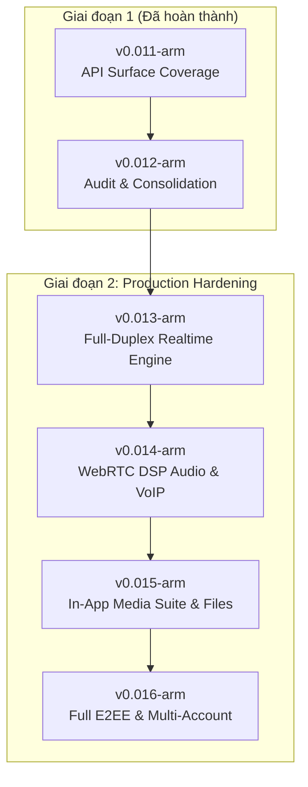

# Lộ trình Phát triển Giai đoạn 2 (Phase 2 Roadmap: Production Hardening & Parity)

> **Dành cho AI Agents và Lập trình viên:**  
> Tài liệu này là kim chỉ nam kiến trúc và lộ trình triển khai chi tiết cho Giai đoạn 2 của dự án `ctdozlite`, bắt đầu từ phiên bản **v0.013-arm** trở đi.  
> Mọi AI tham gia phát triển dự án bắt buộc phải tuân thủ nghiêm ngặt các quy tắc kiến trúc, giao thức Zalo PC/Web được giải mã, bất biến luồng dữ liệu (Data Loop Invariant), và tiêu chuẩn kiểm thử đã định nghĩa trong tài liệu này cùng [AGENTS.md](../AGENTS.md).

---

## 1. Bối cảnh chuyển đổi & Mục tiêu cốt lõi

### 1.1. Hiện trạng sau Giai đoạn 1 (v0.008-arm → v0.012-arm)
- **Giai đoạn 1 (v0.008 → v0.011)**: Đã hoàn tất 16 khối công việc (**R0 → R15**), phủ toàn bộ bề mặt tính năng cơ bản (Feature/API Surface) từ gọi thoại, danh bạ, nhóm, tin nhắn thoại, to-do, poll, zCloud, BinNet đến LAN transfer.
- **Phiên bản chốt chặn (v0.012-arm)**: Đã rà soát và khắc phục triệt để toàn bộ lỗi tồn đọng, loại bỏ 100% dead code, xử lý dứt điểm 16 lỗi Clippy, kết nối luồng dữ liệu hai chiều và tích hợp `ServiceResolver` động.
- **Khoảng cách cần giải quyết trong Giai đoạn 2**:
  1. *Realtime Push*: Chuyển đổi từ cơ chế Polling định kỳ sang Persistent WebSocket Full-Duplex Stream để đạt độ trễ 0ms.
  2. *VoIP Quality*: Tích hợp bộ xử lý âm thanh WebRTC APM (AEC/NS/AGC) chống vọng âm khi bật loa ngoài.
  3. *Media Experience*: Cung cấp trải nghiệm xem ảnh đa cửa sổ, tua video trực tiếp (range-request), và xem trước tài liệu nội bộ.
  4. *Security & Multi-Account*: Hoàn thiện mã hóa đầu cuối Signal Protocol (Double Ratchet) và cơ chế chuyển đổi đa tài khoản.

---

## 2. Bảng tổng hợp các phiên bản Giai đoạn 2

| Phiên bản | Tên định danh | Trọng tâm kỹ thuật cốt lõi | Bằng chứng giao thức & Điểm neo mã nguồn |
| :--- | :--- | :--- | :--- |
| **`v0.013-arm`** | **Realtime Push Engine & Zero-Delay Sync** | Thay thế HTTP Polling bằng WebSocket Full-Duplex; Instant Typing & Read Receipts; Battery Keepalive trên ARM64 | `src/socket.rs`, `src/gui/worker.rs`, Push CMD `501, 502, 521, 200`, `re-notes/04_websocket_push.md` |
| **`v0.014-arm`** | **WebRTC Audio DSP & VoIP Hardening** | Tích hợp WebRTC APM (AEC3, Noise Suppression, AGC); Software H.264 Fallback; Mượt hóa Screen-Sharing 30fps | `src/call.rs`, `src/media.rs`, `src/windows_video.rs`, WebRTC Audio Processing Module |
| **`v0.015-arm`** | **In-App Rich Media & Large File Transfers** | Multi-window Photo Gallery; Range-request Video Streaming; In-app Document Preview (PDF/Doc); Chunked Resume Upload | `src/media.rs`, `src/gui/`, HTTP Range RFC 7233, `re-notes/22_media_pipeline.md` |
| **`v0.016-arm`** | **Full E2EE Double Ratchet & Multi-Account** | Bắt tay trao đổi PreKey Signal Protocol thật; Lưu trữ an toàn khóa thiết bị; Đa tài khoản Zalo không cần relogin | `src/crypto.rs`, `src/session.rs`, `re-notes/13_e2ee.md`, SQLite multi-profile |

---

## 3. Chi tiết kỹ thuật từng phiên bản



---

### 3.1. Phiên bản `v0.013-arm` — Realtime Push Engine & Zero-Delay Sync

#### A. Mục tiêu & Vấn đề giải quyết
Hiện tại, ứng dụng vẫn dựa một phần vào HTTP Polling định kỳ (vòng lặp 2–5 giây trong `src/gui/worker.rs`) để nhận tin nhắn mới và cập nhật trạng thái. Điều này gây ra:
- Độ trễ nhận tin (1–3 giây).
- Tốn tài nguyên mạng và pin không cần thiết trên laptop Windows 11 ARM64.
- Thiếu trải nghiệm gõ phím thời gian thực (typing indicator) và đánh dấu đã đọc tức thời giữa nhiều thiết bị.

#### B. Điểm neo mã nguồn & Giao thức Zalo PC
1. **WebSocket Push Transport**: `src/socket.rs`
   - Endpoint: `wss://ws-push.chat.zalo.me/ws/chat` (hoặc domain do `ServiceResolver` cung cấp).
   - Packet Framing: Khung nhị phân Zalo Socket Header (16 bytes: `Magic`, `CmdId`, `Version`, `BodyLen`, `Seq`).
2. **Push Command IDs cần xử lý full-duplex**:
   - `CMD 501`: Tin nhắn văn bản / media 1-1 mới đến từ server.
   - `CMD 502`: Tin nhắn nhóm mới.
   - `CMD 521`: Sự kiện thu hồi tin nhắn (`undo/recall`) thời gian thực.
   - `CMD 601`: Cập nhật trạng thái đã nhận (`delivered`) và đã xem (`seen`).
   - `CMD 610`: Sự kiện đang soạn tin nhắn (`typing indicator` - start/stop).
   - `CMD 200`: Heartbeat ping-pong giữ kết nối.

#### C. Luồng dữ liệu (Data Loop Invariant)
```
WebSocket Frame -> SocketReader Task -> WorkerEvent::PushMessageReceived -> 
Worker Handler -> SQLite Store (persist message) -> GuiEvent::NewMessageReceived -> 
App UI State (threads & active chat) -> egui Reactive Render
```

#### D. Các gói công việc cụ thể (Work Packages)
- **WP13-1: WebSocket Reconnect & Auto-Recovery**: Triển khai cơ chế Exponential Backoff Reconnect (1s, 2s, 4s, tối đa 30s) khi mất kết nối mạng.
- **WP13-2: Instant Push Dispatcher**: Thay thế hoàn toàn vòng lặp polling HTTP ở `worker.rs` bằng `tokio::select!` lắng nghe trực tiếp kênh WebSocket stream.
- **WP13-3: Typing Indicator & Read Receipt Sync**: Gửi gói tin `CMD 610` khi người dùng nhập tin nhắn vào text box, hiển thị avatar động "đang soạn tin..." trong danh sách chat.
- **WP13-4: ARM64 Battery Keepalive Optimizer**: Tự động giảm tần suất ping heartbeat khi ứng dụng chạy nền hoặc khi màn hình khóa (Modern Standby).

#### E. Tiêu chí nghiệm thu (Verification Criteria)
- Gửi tin nhắn từ điện thoại: Client Windows ARM64 hiển thị tin nhắn mới trong vòng **< 200ms** (không phụ thuộc polling).
- Thu hồi tin nhắn từ điện thoại: Tin nhắn trên fork lập tức chuyển thành *"Tin nhắn đã được thu hồi"* mà không cần bấm F5/refresh.
- Ngắt kết nối mạng (Airplane mode) rồi bật lại: Socket tự động kết nối lại thành công trong vòng 3 giây và tự động kéo các tin nhắn bị nhỡ (catch-up backfill).

---

### 3.2. Phiên bản `v0.014-arm` — WebRTC Audio DSP & VoIP Hardening

#### A. Mục tiêu & Vấn đề giải quyết
Hiện tại, luồng VoIP trong `src/call.rs` và `src/media.rs` sử dụng âm thanh thô qua `cpal`. Khi người dùng bật loa ngoài (speakerphone) trên laptop Surface hoặc máy tính cá nhân, micro thu lại tiếng của đối phương phát ra từ loa, tạo thành hiện tượng vọng âm (acoustic echo loop) và hú mic.

#### B. Điểm neo mã nguồn & Giải pháp kỹ thuật
1. **Module âm thanh**: `src/call.rs`, `src/media.rs`
2. **WebRTC Audio Processing Module (APM)**:
   - Tích hợp crate xử lý tín hiệu âm thanh WebRTC (ví dụ `webrtc-audio-processing` hoặc Rust DSP pipeline):
     - **AEC3 (Acoustic Echo Canceller 3)**: So sánh luồng âm thanh phát ra (render) và luồng âm thanh thu vào (capture) để triệt tiêu tiếng vọng.
     - **NS (Noise Suppression)**: Lọc tiếng ồn nền (tiếng quạt máy tính, tiếng gõ phím, tiếng ồn môi trường).
     - **AGC (Automatic Gain Control)**: Tự động cân bằng âm lượng micro, giúp giọng nói luôn rõ ràng dù ngồi xa hay gần máy.
3. **Software Video Codec Fallback**: `src/windows_video.rs`
   - Bổ sung fallback OpenH264 / libx264 để đảm bảo cuộc gọi video chạy tốt ngay cả trên các môi trường không có GPU encoder phần cứng (như máy ảo, headless container).

#### C. Luồng dữ liệu (Data Loop Invariant)
```
Microphone (cpal capture) -> WebRTC APM (AEC/NS/AGC) -> Opus Encoder -> 
RTP Packet -> UDP/SRTP Socket -> Remote Peer
Speaker (cpal play) <------- WebRTC APM Reference <------- Opus Decoder <------- Remote RTP
```

#### D. Các gói công việc cụ thể (Work Packages)
- **WP14-1: Audio Pipeline Integration**: Tạo wrapper `AudioProcessor` xử lý buffer 10ms (chuẩn frame WebRTC DSP).
- **WP14-2: Hardware-Independent Video Pipeline**: Tách `windows_video.rs` thành 2 backend: `MediaFoundation` (ưu tiên phần cứng ARM64) và `SoftwareFallback` (đảm bảo 100% test pass).
- **WP14-3: Screen-Share Optimization**: Nâng cấp module chia sẻ màn hình đạt chuẩn 30fps mượt mà, hỗ trợ lựa chọn cửa sổ ứng dụng cụ thể thay vì chỉ toàn màn hình.

#### E. Tiêu chí nghiệm thu (Verification Criteria)
- Thực hiện cuộc gọi thoại bật loa ngoài âm lượng 80%: Đối phương ở đầu dây bên kia hoàn toàn **không nghe thấy tiếng vang** của chính mình.
- Test `native_h264_roundtrip` chạy thành công trên mọi môi trường (kể cả headless CI) nhờ có software fallback.

---

### 3.3. Phiên bản `v0.015-arm` — In-App Rich Media Suite & Large File Transfers

#### A. Mục tiêu & Vấn đề giải quyết
Hiện tại, khi click vào video hoặc tài liệu (PDF, Word, Excel), ứng dụng phải gọi trình duyệt ngoài hoặc ứng dụng mặc định của Windows. Trải nghiệm xem ảnh chưa hỗ trợ phóng to mượt mà, duyệt album, hoặc xem video tua nhanh theo tiến trình. Upload file lớn dễ thất bại nếu rớt mạng giữa chừng.

#### B. Điểm neo mã nguồn & Giao thức Zalo PC
1. **Media Viewer GUI**: `src/gui/media_viewer.rs`, `src/gui/gallery.rs`
2. **HTTP Range-Request Streaming**: `src/media.rs`
   - Thực hiện yêu cầu HTTP với header `Range: bytes=start-end` theo RFC 7233 để tua video ngay lập tức mà không cần chờ tải toàn bộ video về bộ nhớ đệm.
3. **Chunked Upload & Resumable Transfer**:
   - Sử dụng upload phân mảnh (chunking 4MB - 8MB mỗi mảnh) cho các tệp có dung lượng từ 100MB đến 1GB+.
   - Lưu trữ `UploadSession` trong SQLite để khi gặp sự cố mạng có thể tiếp tục tải lên từ offset cuối cùng.

#### C. Các gói công việc cụ thể (Work Packages)
- **WP15-1: Multi-Window Photo Gallery**: Cửa sổ xem ảnh độc lập hỗ trợ zoom bằng con lăn chuột, pan bằng kéo thả, nút xoay ảnh 90 độ và duyệt slide ảnh trong cùng hội thoại.
- **WP15-2: Progressive Video Streaming**: Trình phát video nội bộ với thanh tiến trình (progress scrubber), hiển thị thời lượng, tạm dừng/phát và tua tức thì qua HTTP Range headers.
- **WP15-3: In-App Document Preview**: Trình xem nhanh tệp văn bản (PDF, code syntax highlighting, plain text, log files) trực tiếp trong khung chat.
- **WP15-4: Resumable Chunked File Upload**: Luồng upload file lớn an toàn, có thanh phần trăm tiến độ, nút Pause/Resume/Cancel và tự động khôi phục khi reconnect.

#### D. Tiêu chí nghiệm thu (Verification Criteria)
- Mở video dung lượng 200MB: Video phát ngay lập tức trong vòng 1 giây; kéo thanh tua đến phút thứ 5 phát ngay lập tức không bị đơ app.
- Tải file 500MB, rút cáp mạng ở 50%, cắm lại cáp: Quá trình upload tiếp tục từ 50% mà không phải truyền lại từ đầu.

---

### 3.4. Phiên bản `v0.016-arm` — Full E2EE Double Ratchet & Multi-Account Suite

#### A. Mục tiêu & Vấn đề giải quyết
Mã hóa đầu cuối (E2EE) là tính năng cốt lõi của Zalo bảo vệ quyền riêng tư người dùng. Trong Giai đoạn 1, fork mới có cấu trúc dữ liệu mô phỏng. Phiên bản này sẽ chính thức kích hoạt thuật toán Signal Double Ratchet và hỗ trợ quản lý đa tài khoản làm việc.

#### B. Điểm neo mã nguồn & Giao thức Signal / Zalo E2EE
1. **Mật mã học**: `src/crypto.rs`, `src/crypto/ratchet.rs`
   - Thuật toán: Curve25519 (X25519) trao đổi khóa Diffie-Hellman, HKDF cho chuỗi KDF (Key Derivation Function), AES-256-GCM mã hóa từng tin nhắn.
   - Quản lý khóa: `IdentityKey`, `SignedPreKey`, `OneTimePreKeys` đăng ký với máy chủ Zalo (`re-notes/13_e2ee.md`).
2. **Hệ thống Đa tài khoản (Multi-Profile)**:
   - Tách biệt hoàn toàn `session.json`, `keystore.db` và `messages.db` theo từng định danh `profile_id`.
   - UI cho phép chuyển đổi tức thì giữa các tài khoản mà không cần quét lại mã QR.

#### C. Luồng dữ liệu (Data Loop Invariant)
```
Sender: Plaintext -> Ratchet Encrypt (MessageKey) -> Ciphertext + Header -> Zalo E2EE API
Receiver: Zalo E2EE Push -> Ratchet Decrypt (HKDF update) -> Plaintext -> Store in DB -> UI Render
```

#### D. Các gói công việc cụ thể (Work Packages)
- **WP16-1: Curve25519 Prekey Lifecycle**: Đăng ký và gia hạn bộ khóa PreKey lên Zalo Server (`/api/e2ee/pc/prekey/update`).
- **WP16-2: Double Ratchet State Machine**: Lưu vết chuỗi Ratchet (Root Key, Chain Key) trong SQLite được bảo vệ bằng DPAPI của Windows.
- **WP16-3: Multi-Account Profile Switcher**: Giao diện danh sách tài khoản ở thanh bên trái (Sidebar), cho phép click chuyển profile trong 0.5 giây.
- **WP16-4: Windows Hello App Lock**: Tùy chọn khóa ứng dụng bằng sinh trắc học vân tay / khuôn mặt Windows Hello khi rời khỏi máy tính.

#### E. Tiêu chí nghiệm thu (Verification Criteria)
- Hai tài khoản thật bật E2EE trao đổi tin nhắn văn bản, ảnh và file: Cả hai giải mã đúng 100%, nội dung lưu trên server Zalo chỉ là bản mã nhị phân không thể đọc được.
- Chuyển đổi giữa 2 tài khoản: Toàn bộ danh bạ, tin nhắn và trạng thái socket chuyển đổi sạch sẽ, không có hiện tượng lẫn lộn dữ liệu giữa các tài khoản.

---

## 4. Các Bất biến Kỹ thuật Cốt lõi (Non-Negotiables & Invariants)

Mọi mã nguồn do bất kỳ AI hoặc lập trình viên nào bổ sung đều phải tuân thủ nghiêm ngặt các quy tắc sau:

1. **No UI Stubs Invariant**: Tuyệt đối không tạo nút bấm, menu, hoặc form chỉ hiển thị thông báo giả lập (`self.status_msg = "Tính năng đang phát triển"`) mà không có backend xử lý.
2. **No Dropped Payloads Invariant**: Mọi phản hồi từ API/WebSocket trả về dữ liệu đều phải được parse vào struct và gửi qua `GuiEvent` cập nhật App State để hiển thị ra UI.
3. **No Blocking on UI Thread**: Tuyệt đối không thực hiện I/O mạng, truy vấn SQLite nặng, mã hóa/giải mã crypto trên luồng giao diện chính. Mọi tác vụ nặng bắt buộc phải đi qua `WorkerCmd` sang Tokio runtime.
4. **Local Toolchain Verification Before Push**: Luôn chạy `powershell scripts/audit-prepush.ps1` để xác nhận:
   - `cargo check --locked` đạt 0 lỗi.
   - `cargo clippy --all-targets --locked -- -D warnings` đạt 0 cảnh báo.
   - `cargo test --locked` vượt qua toàn bộ unit test.
5. **Single Source of Truth for Endpoints**: Mọi địa chỉ máy chủ phải được định nghĩa tại `src/endpoints.rs` và phân giải qua `ServiceResolver`. Tuyệt đối không hardcode URL rải rác trong code.
6. **English Comments, Vietnamese UI**: Ghi chú giải thích code, commit message bằng tiếng Anh; toàn bộ văn bản hiển thị cho người dùng cuối bằng tiếng Việt chuẩn.
