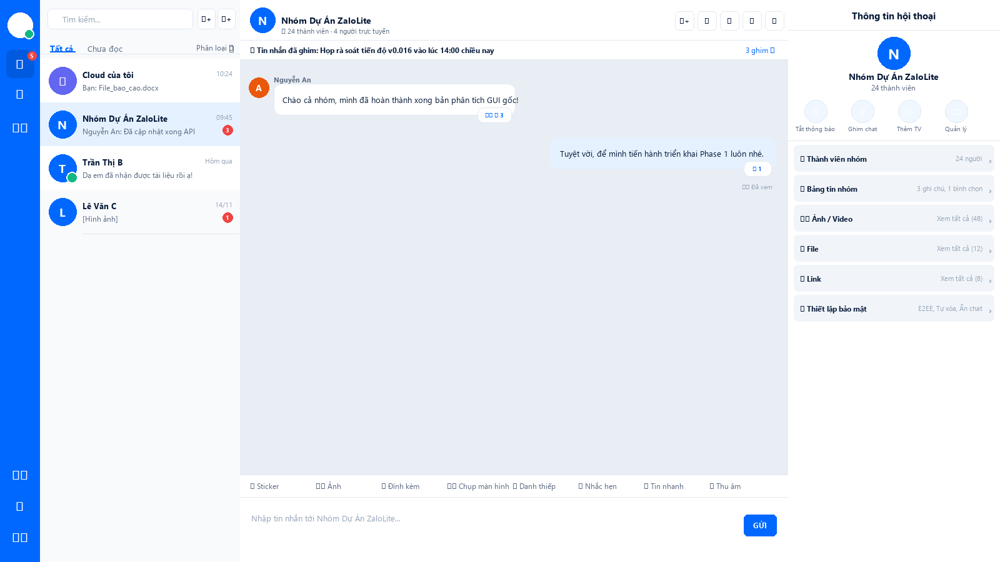
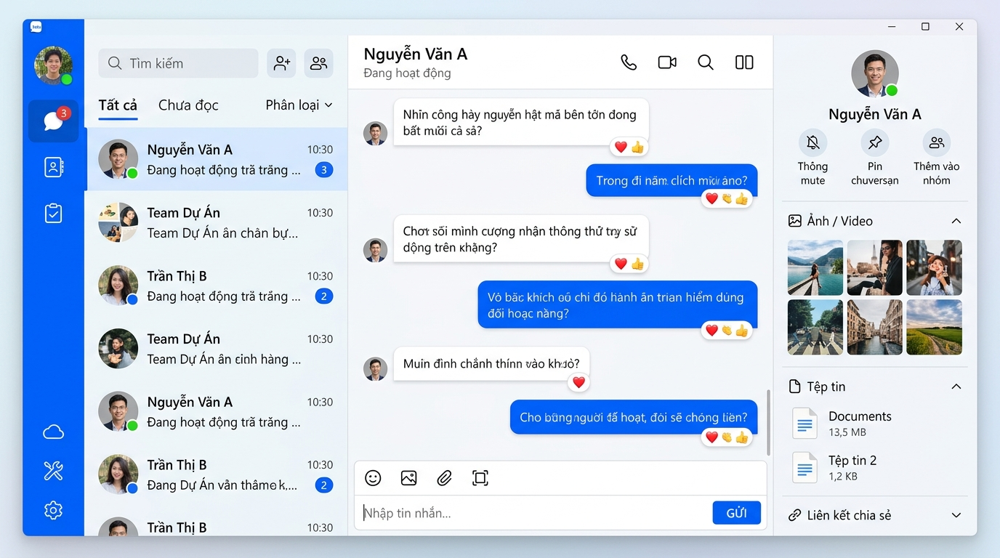
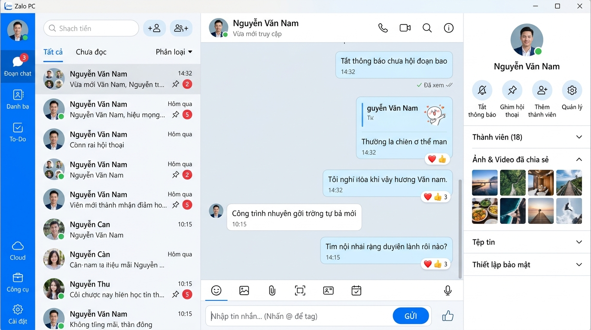
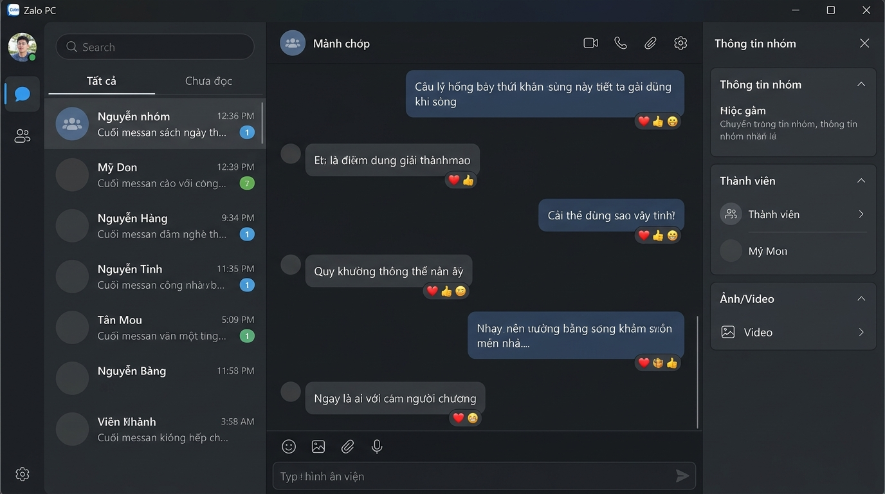
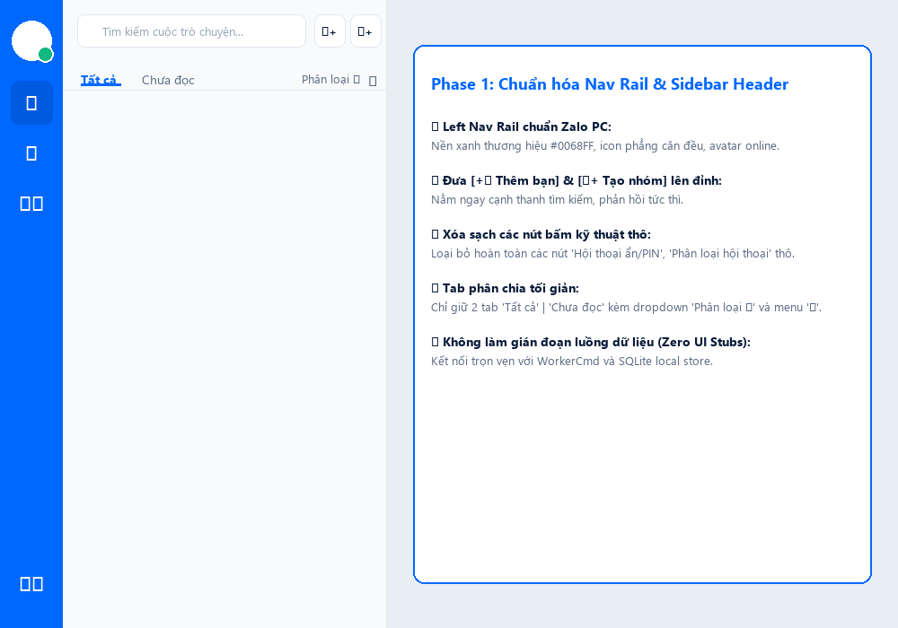
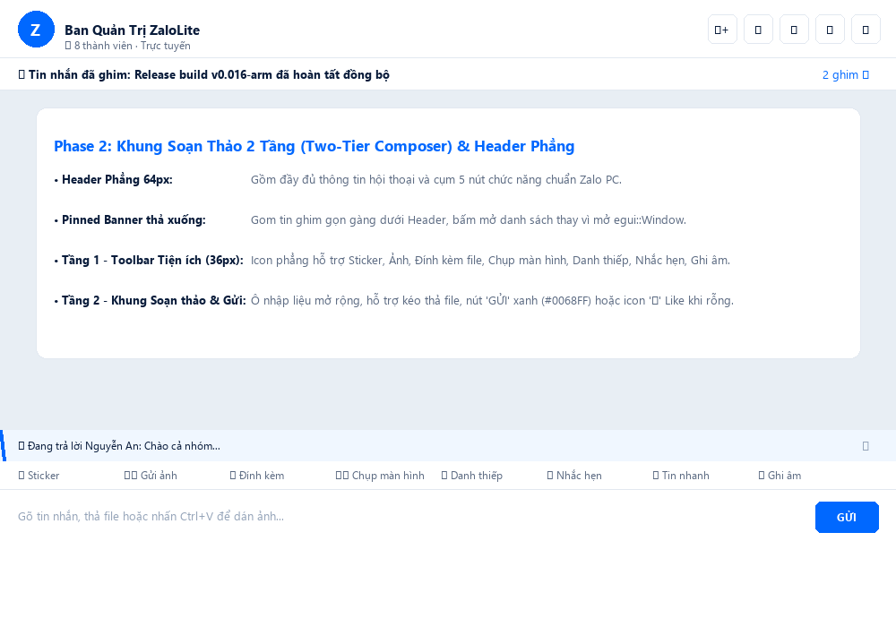
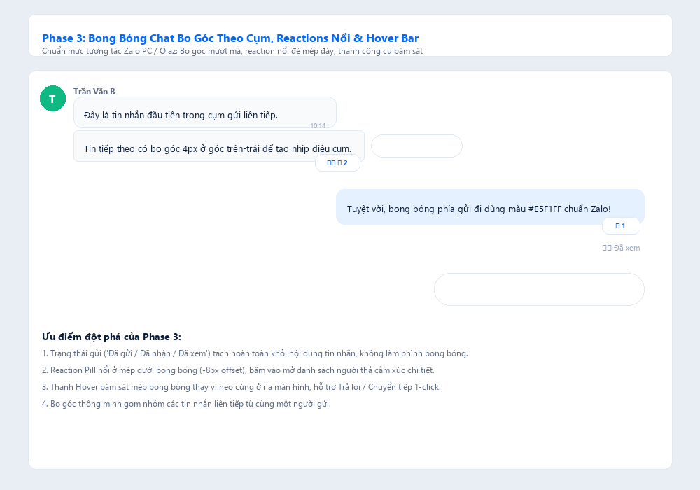
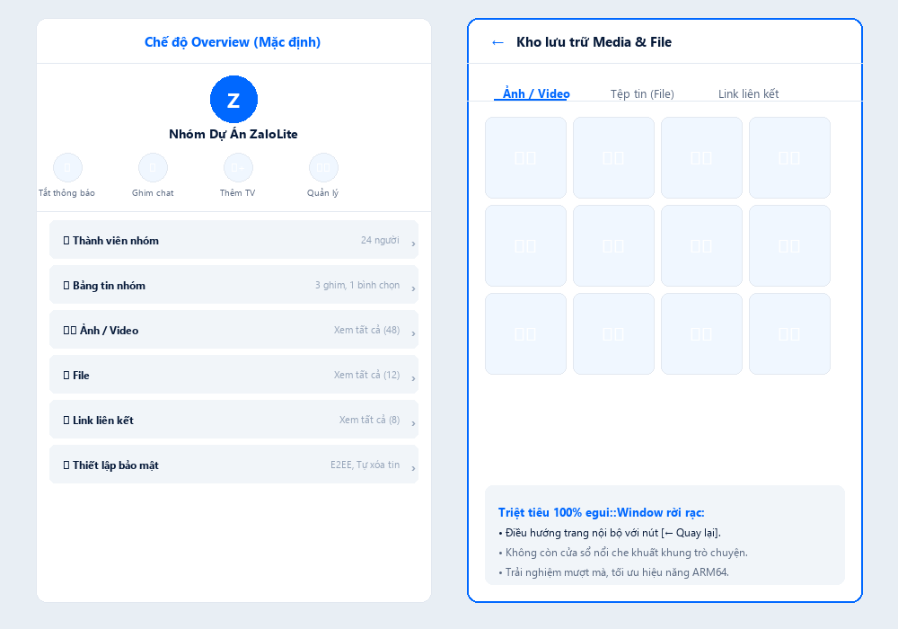
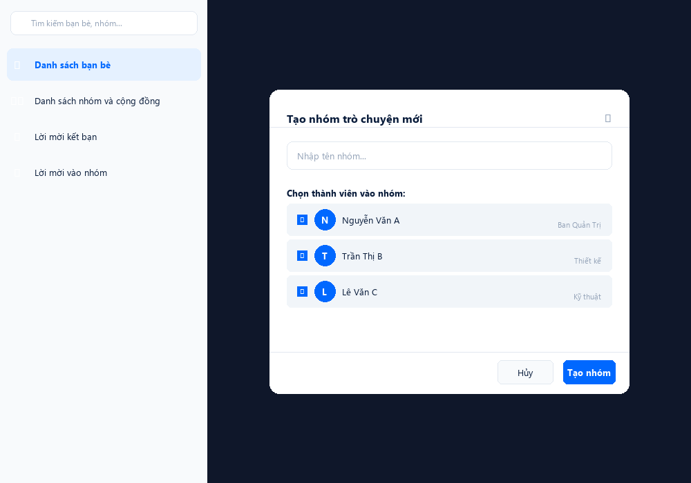

# Kế hoạch Tái cấu trúc Toàn diện GUI & UX (`ctdozlite` → Zalo PC Parity)

> [!IMPORTANT]
> Tài liệu này chuẩn hóa và định hướng tái cấu trúc toàn diện giao diện đồ họa (GUI) và trải nghiệm người dùng (UX) của `ctdozlite` nhằm đạt mức tương đương chuẩn mực với **Zalo PC 26.11.10 / 26.11.12**, **Zalo Web (`chat.zalo.me`)** và **Olaz (`zalo-swift-re`)** (tham khảo bố cục/UX, tuyệt đối không sao chép mã nguồn GPL-3.0).
> Mọi thay đổi tuân thủ nghiêm ngặt [AGENTS.md](../AGENTS.md) và [docs/standards/](standards/).

---

## 1. Tuyên ngôn Tính Nhất Quán Toàn Diện (Anti-Patchwork Philosophy)

> [!CAUTION]
> **Cấm tuyệt đối sự chắp vá cục bộ:** Không chấp nhận kiểu thiết kế chỗ làm mới chỗ giữ nguyên nút thô kiểu debug. Toàn bộ ứng dụng từ Header, Sidebar, Canvas, Composer, Drawer cho đến Modal phải tuân theo một hệ quy chiếu thiết kế đồng nhất (Design Cohesion) về:
> 1. **Bảng màu Design Tokens:** Dùng chung hệ màu Zalo PC (`#0068FF` Brand, `#E8EEF4` Canvas Light, `#F8FAFC` Sidebar Light, `#081B3A` Text Ink, `#22262B` Dark Base).
> 2. **Nhịp điệu khoảng cách (Spacing & Padding):** Chuẩn 4px, 8px, 12px, 16px, 20px. Không còn khoảng cách ngẫu nhiên.
> 3. **Bo góc (Rounding):** Bong bóng cụm 12px/4px, Pill/Avatar tròn hoàn toàn, Nút/Thẻ bo 6px/8px.
> 4. **Triệt tiêu 100% cửa sổ nổi (`egui::Window`):** Chuyển toàn bộ vào Right Info Drawer (với nút `← Quay lại`) hoặc Centered Backdrop Modal (nền mờ căn giữa màn hình).
> 5. **Zero UI Stubs Invariant:** Mọi tương tác UI đều phải kết nối luồng dữ liệu thật (`UI -> WorkerCmd -> Network/DB -> GuiEvent -> State -> Render`).

---

## 2. Thư viện Minh họa Trực quan & Demo Từng Giai đoạn

### 2.1. Hình ảnh Demo Tổng quan 4 Vùng Giao diện

| Bản vẽ Kiến trúc 4 Vùng (Design Prototype) | Bản dựng Ý niệm 3D Fluent (Concept Mockup) |
| :---: | :---: |
|  |  |

| Giao diện Chat Gốc (Light Mode) | Trạng thái Tìm kiếm In-place | Giao diện Tối Chuẩn (Dark Mode) |
| :---: | :---: | :---: |
|  |  |  |

---

### 2.2. Hình ảnh Demo Chi tiết Theo Từng Phase

```carousel

<!-- slide -->

<!-- slide -->

<!-- slide -->

<!-- slide -->

```

* **[Phase 1 Demo](assets/phase1_nav_rail_sidebar.png):** Nav Rail xanh thương hiệu `#0068FF` (64px) + Header Sidebar đưa `[+👤]` và `[👥+]` lên cạnh ô tìm kiếm; 2 tab phẳng `Tất cả | Chưa đọc` + dropdown `Phân loại ▾` & `⋯`.
* **[Phase 2 Demo](assets/phase2_two_tier_composer.png):** Khung soạn thảo 2 tầng (Toolbar tiện ích trên 36px + Editor dưới kèm nút `GỬI`/`👍`) + Header hội thoại phẳng 64px + Banner tin ghim thả xuống.
* **[Phase 3 Demo](assets/phase3_bubbles_reactions.png):** Bong bóng bo góc mượt mà theo cụm (Clustered Rounding 12px/4px); Reaction Pill nổi đè góc dưới-phải (-8px offset) kèm hover 1-click; Hover bar bám sát cạnh; Trạng thái gửi tách rời bên dưới.
* **[Phase 4 Demo](assets/phase4_drawer_multiview.png):** Right Info Drawer đa trang (`DrawerView`: Overview, Members, Board, MediaStorage, SearchInThread) với nút `[← Quay lại]`, triệt tiêu hoàn toàn 12 cửa sổ `egui::Window` nổi.
* **[Phase 5 Demo](assets/phase5_contacts_modals.png):** Sub-navigation trang Danh bạ chuẩn 4 mục (`Bạn bè`, `Nhóm`, `Lời mời kết bạn`, `Lời mời vào nhóm`); Modal Tạo nhóm & Cài đặt hiển thị căn giữa với lớp nền mờ `rgba(0,0,0,0.5)`.

---

## 3. Kiến trúc Layout 4 Vùng Chuẩn Zalo PC


---

## 4. Đặc tả Kỹ thuật Từng Phân hệ & Kế hoạch Chi tiết

### 4.1. Phân hệ 1: Left Nav Rail & Sidebar Header (Phase 1)
- **Màu nền:** Light Mode dùng `#0068FF` (icon trắng mờ `rgba(255,255,255,0.75)`, nền active `#0052CC`); Dark Mode dùng `#22262B`.
- **Bố cục Icon Rail:**
  - **Đỉnh:** Avatar 44×44px + chấm xanh online; click mở Anchored Popover hồ sơ & chuyển tài khoản.
  - **Cụm chính (Top):** `💬 Tin nhắn` (badge đỏ bo tròn), `📒 Danh bạ`, `☑️ Giao việc`.
  - **Cụm phụ (Bottom):** `☁️ Cloud`, `🧰 Công cụ`, `⚙️ Cài đặt`.
- **Sidebar Header:**
  - Ô tìm kiếm bo tròn (`#EAEDF0` Light / `#1E2125` Dark) + `[+👤 Thêm bạn]` + `[👥+ Tạo nhóm]`.
  - Dòng tab: 2 tab gạch chân xanh **`Tất cả`** | **`Chưa đọc`**, bên phải là nút **`Phân loại ▾`** và menu **`⋯`** (Đánh dấu đã đọc tất cả, Hội thoại ẩn/PIN, Lưu trữ, Tin nhắn người lạ).
  - Loại bỏ dứt điểm các nút thô: `"Hội thoại ẩn / PIN…"`, `"Phân loại hội thoại…"`, checkbox `"Hiện cả hội thoại đã ẩn"`.

### 4.2. Phân hệ 2: Two-Tier Composer & Chat Header + Banners (Phase 2)
- **Header Hội thoại (64px):**
  - Trái: Avatar 44×44px + Tên + Dòng phụ (`Vừa mới truy cập` / `👤 24 thành viên`).
  - Phải: Cụm 5 nút phẳng 36×36px: `[👥+ Thêm bạn]` `[📞 Gọi thoại]` `[🎥 Gọi video]` `[🔍 Tìm tin nhắn]` `[◫ Info Drawer]`.
- **Pinned Banner thả xuống:** Dải mỏng dưới Header `[📌 Tin nhắn đã ghim: ...] [Danh sách N ghim ▾]`. Bấm mở danh sách thả xuống.
- **Khung Soạn thảo 2 Tầng (Two-Tier Composer):**
  - **Dải Reply / Draft:** Gắn sát mép trên Toolbar với vạch xanh dọc `#0068FF` và nút `✕ Hủy`.
  - **Tầng 1 (Toolbar 36px):** Icon phẳng 32×32px: `😊 Sticker` | `🖼️ Ảnh` | `📎 Đính kèm tệp` | `✂️ Chụp màn hình (Ctrl+Alt+S)` | `📇 Danh thiếp` | `⏰ Nhắc hẹn` | `⚡ Tin nhanh` | `🎤 Thu âm`.
  - **Tầng 2 (Editor Area):** Ô nhập văn bản đa dòng không viền, bên phải là nút `[😊 Emoji]` và nút **`GỬI`** (`#0068FF` khi có chữ, hoặc icon **`👍`** khi rỗng).

### 4.3. Phân hệ 3: Chat Bubbles, Clustered Rounding & Floating Reactions (Phase 3)
- **Bo góc theo cụm (Clustered Rounding):**
  - Tin đơn lẻ: bo tròn cả 4 góc 12px.
  - Cụm tin cùng người gửi: Tin đầu cụm bo 12px/4px, tin giữa bo 4px, tin cuối bo 4px/12px kèm thời gian `HH:MM`.
- **Floating Reaction Pill:**
  - Nằm đè lên mép dưới-phải bong bóng (`offset: y = -8px`), nền trắng hoặc xám nhạt bo 10px, hiển thị icon + số lượt (`❤️ 👍 3`).
  - Click vào pill mở danh sách chi tiết người thả cảm xúc (`ReactionDetailsModal`).
  - Hover vào bong bóng hiện nút `👍` mờ để thả nhanh 1-click; hover mở dải 6 cảm xúc (`❤️ 👍 😆 😮 😢 😠`).
- **Hover Action Bar sát bong bóng:** Nổi sát cạnh bong bóng (trái với tin gửi đi, phải với tin nhận về): `[↩ Trả lời] [↪ Chuyển tiếp] [☺ Thả cảm xúc] [⋯ Menu]`.
- **Trạng thái Gửi/Xem tách rời:** Hiển thị bên dưới đáy bong bóng cuối (`✓ Đã nhận` / `✓✓ Đã xem`), không nhét vào nội dung tin nhắn.

### 4.4. Phân hệ 4: Right Info Drawer Multi-View Stack (Phase 4)
- Khai báo điều hướng stack:
  ```rust
  #[derive(Clone, Copy, Debug, PartialEq, Eq)]
  pub enum DrawerView {
      Overview,
      Members,
      Board,
      MediaStorage { tab: MediaTab },
      SearchInThread,
      SecuritySettings,
  }
  ```
- **Chế độ `DrawerView::Overview`:** Avatar card + 4 nút tròn Quick Actions (`🔔`, `📌`, `👥+`, `⚙️`) + Accordions (`Thành viên`, `Bảng tin`, `Ảnh/Video`, `File`, `Link`, `Bảo mật`).
- **Chế độ Sub-view:** Header có nút `[← Quay lại]`, tích hợp toàn bộ logic kho media, tìm kiếm trong chat, quản lý nhóm mà **không mở bất kỳ `egui::Window` nào**.

### 4.5. Phân hệ 5: Trang Danh bạ 4 mục & Chuẩn hóa Centered Modals (Phase 5)
- Sub-navigation bên trái 280px chia thành 4 mục chuẩn:
  1. `👥 Danh sách bạn bè` (A-Z).
  2. `🏘️ Danh sách nhóm và cộng đồng`.
  3. `📩 Lời mời kết bạn` (đến và đi).
  4. `📨 Lời mời vào nhóm và cộng đồng`.
- Modal Cài đặt & Tạo nhóm hiển thị dạng Centered Modal có backdrop làm mờ màn hình (`rgba(0,0,0,0.5)`), đóng bằng phím tắt `Esc` hoặc nút `✕`.

---

## 5. Ma trận Theo dõi Tiến độ 5 Giai đoạn & Đồng bộ Git Main

> [!IMPORTANT]
> **Cơ chế chuyển giao tự động cho các AI Agent:**
> 1. Mỗi khi một Phase được hoàn thành, kiểm toán thành công (`cargo check`, `cargo test`, `cargo clippy`), và commit vào nhánh `main`, AI thực hiện **PHẢI** cập nhật bảng dưới đây:
>    - Chuyển `Trạng thái` thành `✅ COMPLETED_MERGED`.
>    - Ghi nhận `Commit SHA`, `Agent / Conv ID`, và `Ngày hoàn thành`.
> 2. Các AI Agent kế tiếp khi nhận nhiệm vụ chỉ cần đọc bảng này:
>    - Bỏ qua các Phase đã có dấu `✅ COMPLETED_MERGED`.
>    - Bắt đầu triển khai ngay Phase đầu tiên có trạng thái `⏳ PENDING` hoặc `🔄 IN_PROGRESS`.

| Giai đoạn | Hạng mục Tái cấu trúc & File tác động | Trạng thái | Commit SHA | Nhánh | Agent / Conv ID | Ngày hoàn thành | Ghi chú kiểm chuẩn |
| :--- | :--- | :---: | :---: | :---: | :---: | :---: | :---: |
| **Design Prep** | **Chuẩn hóa Lộ trình & Bộ ảnh Demo Minh họa**<br>`docs/ZALO_GUI_UX_OVERHAUL_PLAN.md`, `docs/assets/` | ✅ COMPLETED_MERGED | `bb3d3d3` | main | `f2bdf9e3-292a-48bc-ad13-1ece14bf8720` | 2026-11-16 | Đã tạo đủ 6 ảnh demo (overview + 5 phases) + concept mockup, cập nhật triết lý nhất quán. |
| **Phase 1** | **Design Tokens & Left Nav Rail + Sidebar Header**<br>`src/gui/theme.rs`, `src/gui/workspace.rs` | ✅ COMPLETED_MERGED | `ac91c6e` | main | `f2bdf9e3-292a-48bc-ad13-1ece14bf8720` | 2026-11-16 | Nav Rail #0068FF, Cloud avatar đặc thù, Header [+👤][👥+], tabs Tất cả \| Chưa đọc \| Phân loại ▾ \| ⋯, 2 lần audit passed. |
| **Phase 2** | **Two-Tier Composer & Chat Header + Banners**<br>`src/gui/workspace.rs`, `src/gui/mention_composer.rs` | ✅ COMPLETED_MERGED | `b790e2b` | main | `f2bdf9e3-292a-48bc-ad13-1ece14bf8720` | 2026-11-16 | Khung soạn thảo 2 tầng (Toolbar trên + Editor dưới + `GỬI`/`👍`); Pinned Banner tương tác; 5th Header Action; 2 lần audit passed. |
| **Phase 3** | **Chat Bubbles, Floating Reactions & Hover Bar**<br>`src/gui/messages.rs` | 🔄 IN_PROGRESS | - | feature/phase3-bubbles-reactions | `f2bdf9e3-292a-48bc-ad13-1ece14bf8720` | - | Clustered bubble rounding; pill reaction nổi đáy bong bóng + hover 1-click; hover action bar sát bong bóng; pill trạng thái gửi tách rời. |
| **Phase 4** | **Right Info Drawer Multi-View (Triệt tiêu `egui::Window` rời rạc)**<br>`src/gui/workspace.rs`, `src/gui/search_panel.rs`, `src/gui/board_panel.rs`, `src/gui/group_panel.rs` | ⏳ PENDING | - | main | - | - | Kho lưu trữ, Tìm trong chat, Thành viên, Bảng tin, Bảo mật tích hợp vào Drawer navigation stack. |
| **Phase 5** | **Trang Danh bạ 4 mục & Chuẩn hóa Centered Modals**<br>`src/gui/contacts.rs`, `src/gui/group_entry_panel.rs`, `src/gui/modals.rs` | ⏳ PENDING | - | main | - | - | Danh bạ đủ 4 tab chuẩn; Cài đặt & Tạo nhóm hiển thị dạng Centered Modal có backdrop làm mờ. |

---

## 6. Tiêu chuẩn Kỹ thuật Bắt buộc (AGENTS.md Invariants)

1. **Zero UI Stubs:** Tuyệt đối không tạo nút bấm giả chỉ thay đổi `self.status_msg`. Mọi nút tương tác phải nối trọn vẹn: `UI -> WorkerCmd -> Network/DB -> GuiEvent -> App State -> Reactive Render`.
2. **Không chặn UI Thread:** Mọi thao tác I/O, mạng, giải mã và SQLite đều ủy thác qua Tokio Worker `WorkerCmd`.
3. **Quy ước ngôn ngữ:** Toàn bộ ghi chú mã nguồn (code comments) bằng tiếng Anh; chuỗi hiển thị cho người dùng (UI labels, dialogs, buttons) bằng tiếng Việt (sử dụng `crate::i18n::tr(...)`).
4. **Kiểm tra biên dịch trước khi commit/push:** Chạy `RUSTUP_TOOLCHAIN=stable cargo check --locked`, `RUSTUP_TOOLCHAIN=stable cargo test --locked`, và `RUSTUP_TOOLCHAIN=stable cargo clippy --all-targets -- -D warnings`.
