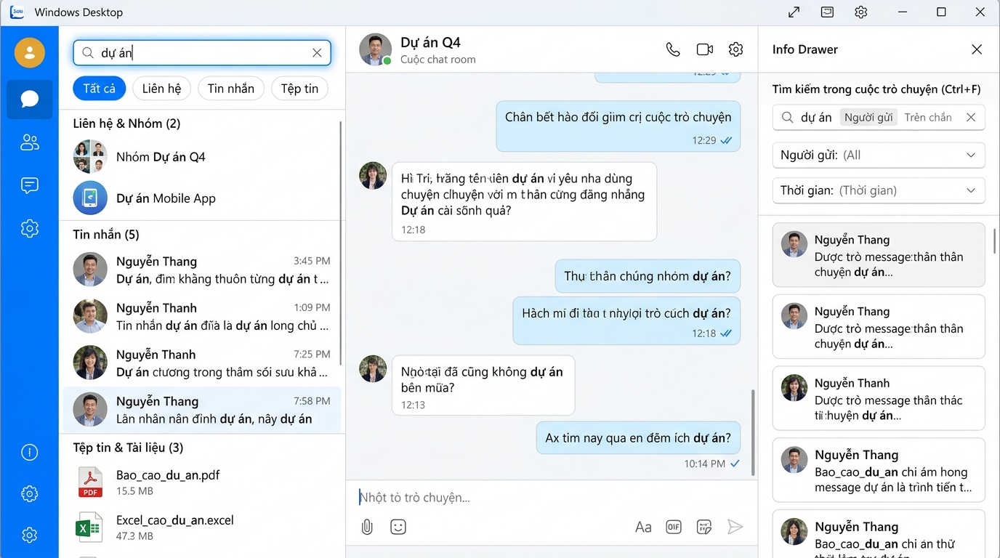
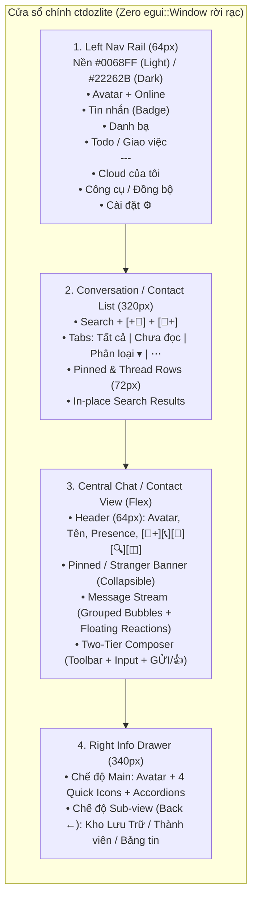

# Kế hoạch Tái cấu trúc Toàn diện GUI & UX (`ctdozlite` → Zalo PC Parity)

> [!IMPORTANT]
> Tài liệu này chuẩn hóa và định hướng tái cấu trúc toàn diện giao diện đồ họa (GUI) và trải nghiệm người dùng (UX) của `ctdozlite` nhằm đạt mức tương đương chuẩn mực với **Zalo PC 26.11.10**, **Zalo Web (`chat.zalo.me`)** và **Olaz (`zalo-swift-re`)** (tham khảo bố cục/UX, tuyệt đối không sao chép mã nguồn GPL-3.0).
> Mọi thay đổi tuân thủ nghiêm ngặt [AGENTS.md](AGENTS.md) và [docs/standards/](standards/).

---

## 1. Minh họa Trực quan Giao diện Chuẩn Zalo PC

Các bản vẽ thiết kế giao diện mục tiêu đã được chuẩn hóa vào dự án tại `docs/assets/`:

| Giao diện Chat Chính (Light Mode) | Trạng thái Tìm kiếm In-place | Giao diện Tối (Dark Mode) |
| :---: | :---: | :---: |
|  |  |  |

---

## 2. Chẩn đoán Điểm nghẽn UX Hiện tại (So sánh Mã nguồn với Zalo Gốc)

Dù [theme.rs](../src/gui/theme.rs) đã có bảng màu chuẩn Zalo PC (`#0068FF`, `#E8EEF4`, `#E5EFFF`, `#22262B`), trải nghiệm người dùng hiện tại vẫn mang cảm giác **"ứng dụng kỹ thuật `egui`"** vì 5 nguyên nhân cốt lõi:

1. **Lạm dụng cửa sổ nổi rời rạc (`egui::Window` ~ 12 cửa sổ):**
   - Các tính năng như Tìm kiếm lịch sử ([search_panel.rs](../src/gui/search_panel.rs)), Nhắc hẹn & Tin ghim ([board_panel.rs](../src/gui/board_panel.rs)), Quản lý nhóm ([group_panel.rs](../src/gui/group_panel.rs)), Phân loại ([labels_panel.rs](../src/gui/labels_panel.rs)), Hội thoại ẩn ([hidden_panel.rs](../src/gui/hidden_panel.rs)), Tin tự xóa ([policy_panel.rs](../src/gui/policy_panel.rs)) đều mở `egui::Window` có thanh tiêu đề kéo thả kiểu công cụ debug.
   - **Chuẩn Zalo PC / Web / Olaz:** Chỉ dùng **3 mẫu hiển thị cấu trúc**:
     - (a) **Sub-view trượt trong Right Info Drawer** (Kho lưu trữ Ảnh/File/Link, Thành viên, Bảng tin nhóm, Thiết lập bảo mật, Tìm kiếm trong hội thoại).
     - (b) **Popover bám neo (Anchored Popover)** (Phân loại thẻ màu, Emoji/Sticker, Menu tài khoản).
     - (c) **Centered Backdrop Modal** (Tạo nhóm, Thêm bạn, Hồ sơ cá nhân, Cài đặt tập trung).
2. **Sidebar hội thoại bị nhồi nút kỹ thuật ([workspace.rs](../src/gui/workspace.rs)):**
   - Đang hiển thị các nút thô (`"Hội thoại ẩn / PIN…"`, `"Phân loại hội thoại…"`, checkbox `"Chưa đọc"`, `"Hiện cả hội thoại đã ẩn"`) và 5 tab ngang (`Tất cả`, `Cá nhân`, `Nhóm`, `Lưu trữ`, `Người lạ`) gây chật chội và lệch chuẩn.
   - **Chuẩn Zalo PC / Web:** Header Sidebar có `[Ô tìm kiếm]` + `[+👤 Thêm bạn]` + `[👥+ Tạo nhóm]`. Dòng tab chỉ gồm **`Tất cả` | `Chưa đọc`** ở bên trái, bên phải là dropdown **`Phân loại ▾`** + menu **`⋯`** (chứa Hội thoại ẩn, Lưu trữ, Tin nhắn người lạ, Đánh dấu đã đọc tất cả).
3. **Bong bóng chat & Thanh tương tác Hover ([messages.rs](../src/gui/messages.rs)):**
   - Nút `"Xem người thả"` đang vẽ dạng button thô trong pill reaction. Ở Zalo gốc, reaction là **pill nhỏ nổi ở góc dưới-phải đáy bong bóng**, bấm vào pill mở popup danh sách người thả, và có nút `♡`/`👍` thả nhanh khi hover.
   - Thanh công cụ hover hiện neo cứng ở `rect.right_top()` của cả dòng thay vì bám sát bong bóng (`[↩ Trả lời]`, `[↪ Chuyển tiếp]`, `[☺ Thả cảm xúc]`, `[⋯ Thêm]`).
   - Trạng thái gửi (`Đã gửi / Đã nhận / Đã xem`) ở Zalo PC là **pill nhỏ hoặc avatar mini bên dưới bong bóng cuối**, không gộp chuỗi `"14:20 · Đã xem"` vào trong làm biến dạng bong bóng ngắn.
4. **Khung soạn thảo 1 hàng chật chội ([workspace.rs](../src/gui/workspace.rs)):**
   - Nhét icon công cụ + ô nhập chữ + nút hẹn giờ + nút Gửi vào chung 1 hộp bo tròn.
   - **Chuẩn Zalo PC / Web (Two-Tier Composer):**
     - **Tầng 1 (Toolbar ~36px):** Dãy icon phẳng `[Sticker] [Ảnh] [Đính kèm File] [Chụp màn hình Ctrl+Alt+S] [Danh thiếp] [Hẹn giờ / Nhắc hẹn] [Tin nhắn nhanh / Định dạng chữ] [Thu âm]`.
     - **Tầng 2 (Editor Area):** Ô nhập liệu rộng toàn chiều ngang, bên phải là `[😊 Emoji]` và nút **`GỬI`** (nút/chữ xanh `#0068FF` hoặc icon **`👍` Like** khi ô nhập rỗng).
5. **Right Info Drawer dàn trải nút bấm ([workspace.rs](../src/gui/workspace.rs)):**
   - Xếp hàng loạt `ui.button(...)` dọc nhau và hiển thị ID kỹ thuật ở đáy.
   - **Chuẩn Zalo PC:** Dưới Avatar + Tên là **4 nút tròn Quick Actions có nhãn dưới** (`Tắt thông báo`, `Ghim hội thoại`, `Tạo nhóm / Thêm thành viên`, `Quản lý nhóm`), tiếp theo là các **Accordion thu gọn** (`Thành viên nhóm`, `Bảng tin nhóm`, `Ảnh/Video`, `File`, `Link`, `Thiết lập bảo mật`).

---

## 3. Kiến trúc Layout 4 Vùng & Điều hướng Chuẩn Zalo PC

---

## 4. Thiết kế Chi tiết Từng Phân hệ

### 4.1. Thanh Điều hướng Trái (`Left Nav Rail` — 64px)
- **Màu nền:** Light Mode dùng nền xanh thương hiệu `#0068FF` (icon trắng mờ `rgba(255,255,255,0.75)`, nền active `#0052CC` hoặc `#005AE0`); Dark Mode dùng nền tối `#22262B`.
- **Bố cục Icon:**
  - **Đỉnh:** Avatar người dùng (44×44px) + chấm xanh online; click mở **Anchored Popover** (Hồ sơ của bạn, Chuyển tài khoản `account_switcher`, Nâng cấp/Bảo mật, Đăng xuất).
  - **Cụm chính (Top):** `💬 Tin nhắn` (badge tổng số tin chưa đọc đỏ), `📒 Danh bạ`, `☑️ Giao việc (To-Do)`.
  - **Cụm phụ (Bottom):** `☁️ Cloud của tôi`, `🧰 Công cụ` (Backup, Dọn dữ liệu, Tin nhắn nhanh), `⚙️ Cài đặt` (mở menu popover hoặc Centered Modal Cài đặt).

### 4.2. Cột Danh sách Hội thoại (`Sidebar` — 300–340px)
- **Thanh Tìm kiếm Đỉnh (Top Search Bar):**
  - Ô tìm kiếm bo tròn (`#EAEDF0` Light / `#1E2125` Dark) + nút `[+👤 Thêm bạn]` + nút `[👥+ Tạo nhóm]` (đưa lên cạnh ô tìm kiếm đúng chuẩn Zalo PC).
  - **Khi focus vào ô tìm kiếm:** Chuyển nội dung danh sách bên dưới thành **In-place Search Panel** (Tìm gần đây, Lọc theo Liên hệ / Tin nhắn / File) thay vì bật cửa sổ `egui::Window` che màn hình.
- **Thanh Lọc (Filter Strip):**
  - Bên trái: 2 tab gạch chân xanh **`Tất cả`** | **`Chưa đọc`**.
  - Bên phải: Nút **`Phân loại ▾`** (mở popover chọn nhãn màu từ `labels_panel`) và nút **`⋯`** (Đánh dấu đã đọc tất cả, Hội thoại ẩn/PIN, Lưu trữ, Tin nhắn từ người lạ).
- **Dòng Hội thoại (Thread Row — cao 68–72px):**
  - Avatar 48×48px (hoặc cụm 2×2 mini-avatar cho nhóm).
  - Dòng 1: `[Icon Nhóm]` + **Tên hội thoại** (in đậm nếu chưa đọc) + `[Icon 🔔̸]` + `[Icon 📌]` + Thời gian (`12 phút`, `Hôm qua`, `15/11`).
  - Dòng 2: `[Tiền tố "Bạn: " / người gửi]` + Nội dung tóm tắt + Badge đỏ số lượng chưa đọc (`1`, `5`, `99+` hoặc badge `@` khi được nhắc tên).
  - Hover vào dòng hiện nút **`⋯`** nhanh để Ghim / Tắt thông báo / Ẩn / Đánh dấu chưa đọc.

### 4.3. Khu vực Trò chuyện Trung tâm (`Central Chat Canvas`)
- **Header Hội thoại (64px):**
  - Trái: Avatar (44×44px) + Tên hội thoại (click mở hồ sơ/đổi tên gợi nhớ) + Dòng phụ (`Vừa mới truy cập` / `👤 24 thành viên`).
  - Phải: Cụm nút phẳng 36×36px chuẩn Zalo PC: `[👥+ Thêm người]` `[📞 Gọi thoại]` `[🎥 Gọi video]` `[🔍 Tìm tin nhắn]` `[◫ Đóng/mở Info Drawer]`.
- **Banner Ghim & Người lạ (Collapsible Top Banners):**
  - Gom tin ghim (`server_pins` / `board_panel` + local pin) thành 1 thanh **Pinned Bar** gọn dưới Header: `[📌 Tin nhắn đã ghim: ...] [Danh sách N ghim ▾]`. Click mở danh sách thả xuống ngay dưới Header.
- **Dòng chảy Tin nhắn (Message Stream & Bubbles):**
  - **Bo góc thông minh theo cụm (Clustered Bubble Rounding):** Tin đầu cụm bo `12px`, các tin giữa cùng người gửi cách nhau `2px` và bo góc phía người gửi `4px`, tin cuối cụm hiển thị thời gian `HH:MM` nhỏ bên trong góc dưới.
  - **Reaction Pill chuẩn Zalo/Olaz:** Nằm đè nhẹ ở rìa dưới-phải của bong bóng (`margin-top: -6px`), hiển thị icon cảm xúc + tổng số lượt (`❤️ 👍 3`). Khi hover vào bong bóng có nút `👍`/`♡` mờ để thả nhanh 1-click, giữ chuột/hover mở dải 6 cảm xúc (`❤️ 👍 😆 😮 😢 😠`).
  - **Hover Action Bar:** Nổi sát cạnh bong bóng (bên trái với tin gửi đi, bên phải với tin nhận về) gồm 3 nút tròn nhỏ: `[↩ Trả lời]` `[↪ Chuyển tiếp]` `[⋯ Thêm]`.
  - **Trạng thái Gửi/Xem nằm ngoài bong bóng:** Dưới tin gửi đi mới nhất, hiển thị pill nhỏ `✓ Đã nhận` / `✓✓ Đã xem` (hoặc hàng mini-avatar người đã xem).
- **Khung Soạn thảo 2 tầng (`Two-Tier Composer`):**
  - **Thanh Reply / Đính kèm chờ gửi:** Gắn liền phía trên ô nhập liệu với thanh viền xanh `#0068FF` và nút `✕`.
  - **Tầng 1 (Action Toolbar — cao 38px):** Icon phẳng 32×32px: `😊 Sticker` | `🖼️ Ảnh` | `📎 Đính kèm tệp` | `✂️ Chụp màn hình (Ctrl+Alt+S)` | `📇 Gửi danh thiếp` | `⏰ Hẹn giờ / Nhắc hẹn` | `⚡ Tin nhắn nhanh (/)` | `🎤 Thu âm`.
  - **Tầng 2 (Input Area — cao tối thiểu 54px):** Ô nhập văn bản không viền, bên phải là nút `[🙂 Emoji]` và nút **`GỬI`** (chữ đậm màu `#0068FF` hoặc icon **`👍`** khi ô nhập rỗng).

### 4.4. Thanh Thông tin Phải (`Right Info Drawer` — 320–350px, Đa trang nội bộ)
Thay vì mở các cửa sổ `egui::Window` rời rạc, `Right Info Drawer` có **Stack điều hướng nội bộ (`DrawerView`)**:
- **`DrawerView::Overview` (Mặc định):**
  1. **Header Card:** Avatar 56×56px + Tên + Nút `✏️` đổi tên gợi nhớ.
  2. **4 Nút Tròn Quick Actions:** `🔔 Tắt thông báo` | `📌 Ghim hội thoại` | `👥+ Tạo nhóm chung / Thêm TV` | `⚙️ Quản lý nhóm`.
  3. **Accordion 1 — Thành viên nhóm / Nhóm chung:** Xem số lượng thành viên, click chuyển sang `DrawerView::Members`.
  4. **Accordion 2 — Bảng tin nhóm:** Ghi chú, Nhắc hẹn, Bình chọn (click mở `DrawerView::Board`).
  5. **Accordion 3 — Ảnh/Video (Grid 4 cột):** 8 ảnh/video mới nhất + nút **`Xem tất cả`** (`DrawerView::MediaStorage { tab: Visual }`).
  6. **Accordion 4 — File (3 file mới nhất):** Icon loại file, dung lượng + nút **`Xem tất cả`**.
  7. **Accordion 5 — Link (3 link mới nhất):** Tiêu đề, domain + nút **`Xem tất cả`**.
  8. **Accordion 6 — Thiết lập bảo mật:** Mã hóa đầu cuối (E2EE), Tin nhắn tự xóa, Ẩn trò chuyện bằng PIN, Báo xấu / Chặn, Xóa lịch sử trò chuyện.
- **`DrawerView::MediaStorage` (Kho lưu trữ có nút `← Quay lại`):**
  - Tích hợp logic tìm kiếm/lọc kho lưu trữ với 3 tab **`Ảnh/Video` | `File` | `Link`** ngay trong Drawer.
- **`DrawerView::SearchInThread` (Tìm kiếm trong hội thoại):**
  - Mở panel tìm kiếm nội bộ ngay trong Drawer (ô từ khóa, lọc người gửi/ngày, danh sách kết quả click để cuộn tới tin).

### 4.5. Trang Danh bạ (`Contacts View`)
- **Cột Trái (Sub-navigation 280px):** Giữ thanh tìm kiếm đỉnh (`[Tìm kiếm] [+👤] [👥+]`), 4 mục chuẩn Zalo PC có icon:
  1. `👥 Danh sách bạn bè`
  2. `🏘️ Danh sách nhóm và cộng đồng`
  3. `📩 Lời mời kết bạn` (quản lý lời mời đến/đi)
  4. `📨 Lời mời vào nhóm và cộng đồng`

---

## 5. Ma trận Theo dõi Tiến độ 5 Giai đoạn & Đồng bộ Git Main

> [!IMPORTANT]
> **Cơ chế chuyển giao tự động cho các AI Agent (bao gồm conversation `d9f5916e-d894-4e09-aebf-00a2920b78a0` và các AI sau):**
> 1. Mỗi khi một Phase được hoàn thành, kiểm toán thành công (`cargo check`, `cargo test`, `cargo clippy`), và merge lên nhánh `main`, AI thực hiện **PHẢI** cập nhật bảng dưới đây:
>    - Chuyển `Trạng thái` thành `✅ COMPLETED_MERGED`.
>    - Ghi nhận `Commit SHA`, `Agent / Conv ID`, và `Ngày hoàn thành`.
> 2. Các AI Agent kế tiếp khi nhận nhiệm vụ chỉ cần đọc bảng này:
>    - Bỏ qua các Phase đã có dấu `✅ COMPLETED_MERGED`.
>    - Bắt đầu triển khai ngay Phase đầu tiên có trạng thái `⏳ PENDING` hoặc `🔄 IN_PROGRESS`.

| Giai đoạn | Hạng mục Tái cấu trúc & File tác động | Trạng thái | Commit SHA | Nhánh / PR | Agent / Conv ID | Ngày hoàn thành | Ghi chú kiểm chuẩn |
| :--- | :--- | :---: | :---: | :---: | :---: | :---: | :---: |
| **Phase 1** | **Design Tokens & Left Nav Rail + Sidebar Header** `src/gui/theme.rs`, `src/gui/workspace.rs` | ⏳ PENDING | - | main | - | - | Nav Rail `#0068FF`; Sidebar `[Search][+👤][👥+]`, tabs `Tất cả \| Chưa đọc \| Phân loại ▾ \| ⋯`. |
| **Phase 2** | **Two-Tier Composer & Chat Header + Banners** `src/gui/workspace.rs`, `src/gui/mention_composer.rs` | ⏳ PENDING | - | main | - | - | Khung soạn thảo 2 tầng (Toolbar trên + Editor dưới + `GỬI`/`👍`); Pinned Banner thả xuống. |
| **Phase 3** | **Chat Bubbles, Floating Reactions & Hover Bar** `src/gui/messages.rs` | ⏳ PENDING | - | main | - | - | Clustered bubble rounding; pill reaction nổi đáy bong bóng + hover 1-click; hover action bar sát bong bóng; pill trạng thái gửi tách rời. |
| **Phase 4** | **Right Info Drawer Multi-View (Triệt tiêu `egui::Window` rời rạc)** `src/gui/workspace.rs`, `src/gui/search_panel.rs`, `src/gui/board_panel.rs`, `src/gui/group_panel.rs` | ⏳ PENDING | - | main | - | - | Kho lưu trữ, Tìm trong chat, Thành viên, Bảng tin, Bảo mật tích hợp vào Drawer navigation stack. |
| **Phase 5** | **Trang Danh bạ 4 mục & Chuẩn hóa Centered Modals** `src/gui/contacts.rs`, `src/gui/group_entry_panel.rs`, `src/gui/modals.rs` | ⏳ PENDING | - | main | - | - | Danh bạ đủ 4 tab chuẩn; Cài đặt & Tạo nhóm hiển thị dạng Centered Modal có backdrop làm mờ. |

---

## 6. Tiêu chuẩn Kỹ thuật Bắt buộc (AGENTS.md Invariants)

Mọi đóng góp mã nguồn cho các phase trên phải đảm bảo:
1. **Zero UI Stubs:** Tuyệt đối không tạo nút bấm giả chỉ thay đổi `self.status_msg`. Mọi nút tương tác phải nối trọn vẹn: `UI -> WorkerCmd -> Network/DB -> GuiEvent -> App State -> Reactive Render`.
2. **Không chặn UI Thread:** Mọi thao tác I/O, mạng, giải mã và SQLite đều ủy thác qua Tokio Worker `WorkerCmd`.
3. **Quy ước ngôn ngữ:** Toàn bộ ghi chú mã nguồn (code comments) bằng tiếng Anh; chuỗi hiển thị cho người dùng (UI labels, dialogs, buttons) bằng tiếng Việt (sử dụng `crate::i18n::tr(...)`).
4. **Kiểm tra biên dịch trước khi commit/push:** Chạy `RUSTUP_TOOLCHAIN=stable cargo check --locked`, `RUSTUP_TOOLCHAIN=stable cargo test --locked`, và `RUSTUP_TOOLCHAIN=stable cargo clippy --all-targets -- -D warnings`.
