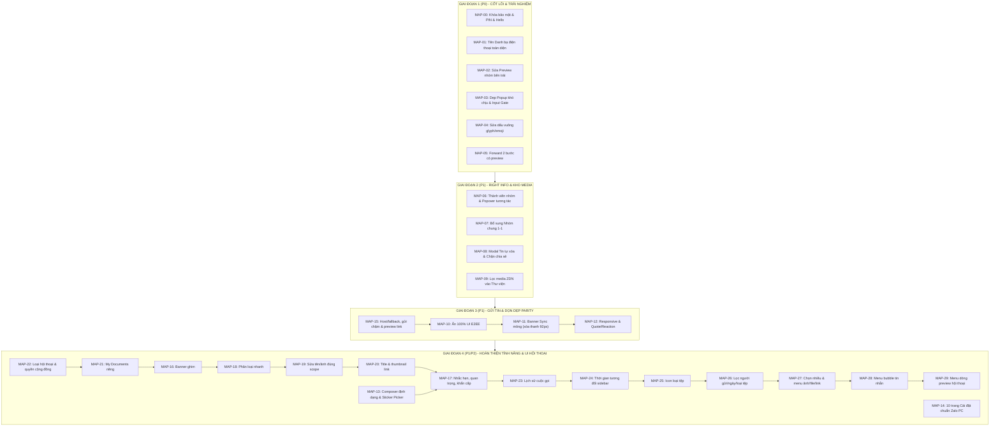

# KẾ HOẠCH HÀNH ĐỘNG & HƯỚNG DẪN KỸ THUẬT TRIỂN KHAI PARITY ZALO PC

> **Ngày lập:** 17/11/2026  
> **Phiên bản Zalo PC tham chiếu:** 26.11.12 (đang chạy trực tiếp trên máy người dùng, đã đăng nhập tài khoản thực tế)  
> **Mã nguồn cơ sở:** `9339a75` (`v0.016-arm`, branch `main`)  
> **Tài liệu phối hợp:** `docs/ZALO_PC_UI_UX_ANTIGRAVITY_HANDOFF_2026-11-17.md`, [hướng dẫn sửa gửi chậm/lỗi mạng](SEND_LATENCY_NETWORK_ANTIGRAVITY_GUIDE_2026-11-18.md), `AGENTS.md`, `docs/ZALO_REFERENCE_ANALYSIS.md`  
> **Bổ sung 18/11/2026:** Đưa **MAP-15: gửi chậm/lỗi mạng** vào **Phase 3**, ưu tiên trước MAP-10–12. Trạng thái cập nhật xem mục 6 và [checklist thực thi](PHASE_3_4_EXECUTION_2026-11-18.md). Các câu “chưa triển khai/chưa sửa mã” trong phần khảo sát bên dưới là baseline lịch sử, không phải trạng thái hiện tại.

---

## 1. MỤC TIÊU & NGUYÊN TẮC BẤT BIẾN CHO AGENT ANTIGRAVITY

## 0.1. Tái-baseline phiên triển khai 18/11/2026

Các trạng thái `COMPLETED_MERGED` trong ma trận GUI cũ chỉ là lịch sử của đợt
16/11 và không thay thế nghiệm thu của phiên này. Sau khi đọc lại mã hiện tại,
kiểm kê độc lập và chạy kiểm tra cục bộ, phạm vi còn lại được chốt như sau:

| Phase | Trạng thái hiện tại | Bằng chứng đã có | Khoảng trống chặn hoàn tất |
| :--- | :--- | :--- | :--- |
| 3 | `SOURCE_AUDIT_CONSENSUS` | MAP-15 và MAP-10–12 đã triển khai; hai auditor GPT-6.1 Sol đồng thuận sau sửa lỗi | Kiểm chứng cuối xem mục 6; native/live latency chưa chạy, không gọi là nghiệm thu thiết bị hoàn tất |
| 4 | `SOURCE_AUDIT_CONSENSUS` | MAP-13/14 và MAP-16–29 có đường xử lý, kiểm tra quyền/isolation và regression; hai auditor đồng thuận sau sửa | Archive là lịch sử SQLite phân trang, không cam kết đủ server; các fork deviation và native/live ghi trong checklist |
| 5 | `VERIFICATION_GATE_PENDING` | Contacts/modals và account/store isolation có nền mã; kết quả kiểm chứng snapshot cuối xem checklist | Audit tích hợp Phase 1–4, target isolation, modal input gate, late responses, DNS/chat regression và native acceptance chưa hoàn tất |

Kế hoạch thực thi tuần tự mới: (1) đóng các lỗi và fixture có thể chứng minh của
Phase 3 nhưng giữ mutation fail-closed khi giao hàng chưa rõ; (2) hoàn thiện
Phase 4 theo thứ tự MAP-22 → MAP-21 → MAP-16 → MAP-18 → MAP-19 → MAP-20 →
MAP-17 → MAP-23 → MAP-24 → MAP-25 → MAP-26 → MAP-27 → MAP-28 → MAP-29; (3)
chạy Phase 5 như cổng audit toàn diện, đối chiếu lại toàn bộ Phase 1–4 và chỉ
đánh dấu mục `native/live verified` khi có bằng chứng tương ứng. Kết quả
`cargo check/test/clippy` của snapshot cuối ghi tại
[checklist thực thi](PHASE_3_4_EXECUTION_2026-11-18.md); chưa build binary/release.

### 1.1. Mục tiêu tối thượng
Đạt độ tương đồng tối đa với **Zalo PC gốc (bản 26.11.12)** về mặt trải nghiệm, bố cục thị giác và tương tác người dùng, đặc biệt giải quyết triệt để các lỗi gây khó chịu:
1. Màn hình khóa cưỡng bức Windows Hello trên mọi máy.
2. Tên bạn bè hiển thị theo tên Zalo lạ thay vì Tên đã lưu theo Danh bạ điện thoại.
3. Preview nhóm bên trái bị "Một thành viên" hoặc chuỗi ID dài ngoằng.
4. Popup/hover nhảy lung tung, modal xuyên thấu, chia sẻ gửi ngay không xác nhận.
5. Danh sách thành viên Right Info không có tên, thiếu menu thao tác (nhắn tin riêng, gọi).
6. Thiếu Nhóm chung ở chat cá nhân 1-1.
7. Thanh đồng bộ (Sync status) dạng panel đáy 92px xám xịt thay vì banner thông báo mỏng.
8. Các tàn dư nút/badge E2EE chưa được ẩn.
9. Ảnh/video từ CDN Zalo (`*.zdn.vn`) bị đẩy nhầm sang mục Liên kết.
10. Gửi tin chậm, thường báo "Không kết nối được mạng. Kiểm tra kết nối rồi gửi lại"; tin chứa link chờ preview quá lâu (MAP-15, Phase 3).

### 1.2. Kỷ luật bất biến (Mandatory Invariants từ `AGENTS.md`)
- **No blocking work on UI thread:** Mọi thao tác I/O, SQLite, hashing, crypto, WinRT biometric probe đều phải chạy qua background worker/task hoặc `WorkerCmd`. UI chỉ render và gửi command.
- **No UI Stubs & No Dropped Payloads:** Mọi nút bấm, popover, modal mới tạo đều phải kết nối end-to-end (`UI -> WorkerCmd -> Network/Store -> GuiEvent -> App State -> Reactive Render`). Tuyệt đối không tạo nút giả chỉ gán `status_msg`.
- **Surgical changes & Karpathy discipline:** Sửa đúng trọng tâm, giữ nguyên kiến trúc Tokio / egui / SQLite, không xóa bỏ các cơ chế phòng vệ mạng hay mã hóa phía dưới.
- **Local compilation verification:** Trước khi kết thúc bất kỳ lượt làm việc nào hoặc commit/push, BẮT BUỘC chạy:
  ```powershell
  $env:PATH = "$env:USERPROFILE\.cargo\bin;$env:PATH"
  cargo check --locked
  cargo test --locked
  cargo clippy --all-targets -- -D warnings
  ```

---

## 2. MA TRẬN CÔNG VIỆC TỔNG THỂ (MASTER MATRIX)

| Mã ID | Hạng mục công việc | Mức độ | File neo chính | Tóm tắt giải pháp kỹ thuật |
| :--- | :--- | :---: | :--- | :--- |
| **MAP-00** | Khóa bảo mật, Mã PIN 4 số & Windows Hello tùy chọn | **P0** | `src/gui.rs`<br>`src/gui/auth_guard.rs`<br>`src/gui/modals.rs` | Đổi mặc định `enable_app_lock: false`. Thêm kiểm tra mờ nút nếu không có Windows Hello. Bổ sung mã PIN 4 số. Thêm phím tắt `Ctrl+L` và icon Ổ khóa 🔒 trên nav rail. |
| **MAP-01** | Ưu tiên Tên Danh bạ điện thoại toàn diện | **P0** | `src/gui/account_state.rs`<br>`src/gui/contacts.rs`<br>`src/chat.rs`<br>`src/gui/workspace.rs` | Ánh xạ triệt để `server_aliases` vào `thread.name`, `self.contacts`, `m.sender` trong chat & group, và header chat. |
| **MAP-02** | Sửa Preview tin nhắn nhóm cột bên trái | **P0** | `src/message_view.rs`<br>`src/gui/workspace.rs` | Xóa bỏ vĩnh viễn "Một thành viên" và chuỗi ID. Viết tầng tra cứu tên người gửi từ Alias -> Danh bạ -> Member Profile -> "Bạn: " theo chuẩn `[Tên]: [Nội dung]`. |
| **MAP-03** | Khắc phục Popup khó chịu & Input Gate cho Modal | **P0** | `src/gui/messages.rs`<br>`src/gui/modals.rs`<br>`src/gui/workspace.rs` | Thu gọn hover action 3 nút sát đáy bubble, loại bỏ `expand(8.0)`. Thêm Input Gate chặn 100% hover, tooltip, click xuyên khi có modal mở. |
| **MAP-04** | Sửa lỗi Dấu vuông Glyph / Emoji | **P0** | `src/gui/theme.rs` | Hoàn thiện font fallback Segoe UI Emoji / Be Vietnam Pro; tách icon UI khỏi văn bản người dùng. |
| **MAP-05** | Hộp thoại Chia sẻ (Forward) 2 bước | **P0** | `src/gui/modals.rs` | Chọn người nhận chỉ cập nhật danh sách chọn; có preview và lời nhắn kèm; bấm nút "Chia sẻ" màu xanh mới gửi. |
| **MAP-06** | Right Info: Danh sách thành viên nhóm | **P1** | `src/gui/workspace.rs` | Tự động dispatch `FetchGroupMembers`; hiển thị avatar tròn, tên thật, tag Trưởng/Phó; click mở Popover: Nhắn tin riêng, Gọi, Xem thông tin. |
| **MAP-07** | Right Info: Bổ sung Nhóm chung cho chat 1-1 | **P1** | `src/gui/workspace.rs`<br>`src/gui/worker.rs`<br>`src/groups.rs` | Tích hợp API `Action::Related` (`/api/friend/group/related`). Thêm Accordion "Nhóm chung (N)", click chuyển ngay sang nhóm. |
| **MAP-08** | Popup Modal cho Tin tự xóa & Chặn chia sẻ | **P1** | `src/gui/workspace.rs`<br>`src/gui/policy_panel.rs` | Chuyển cài đặt từ subview drawer sang Floating Modal Window chuẩn Zalo PC với Radio buttons (Không bao giờ, 1, 7, 30 ngày) và Lưu/Hủy. |
| **MAP-09** | Phân loại Thư viện Media & Liên kết | **P1** | `src/gui/workspace.rs`<br>`src/store.rs` | Nhận diện link CDN Zalo (`*.zdn.vn`, `*.zadn.vn`) và đuôi ảnh/video -> đưa vào "Ảnh/Video" (lưới thumbnail 3 cột), không để lọt sang "Liên kết". |
| **MAP-10** | Ẩn hoàn toàn tính năng & nút bấm E2EE | **P1** | `src/gui/workspace.rs`<br>`src/gui/modals.rs` | Xóa bỏ/ẩn 100% nút "Chuẩn bị E2EE", "Mã an toàn", badge thử nghiệm E2EE trên giao diện (giữ engine giải mã ngầm). |
| **MAP-11** | Chuẩn hóa Thẻ đồng bộ (Sync Banner) | **P1** | `src/gui/workspace.rs` | Xóa `TopBottomPanel::bottom("main_sync_status")` 92px. Chuyển thành Banner mỏng (~34px) đầu Sidebar/Header; tự ẩn khi hoàn tất. |
| **MAP-12** | Responsive, Trả lời (Reply) & Thả cảm xúc | **P1** | `src/gui/workspace.rs`<br>`src/gui/messages.rs` | Ngăn drawer bóp nghẹt chat; dải quote chuẩn có vạch xanh + nút hủy; picker 6 cảm xúc 👍❤️😆😮😢😠 neo đúng bubble. |
| **MAP-13** | Trình soạn thảo 2 chế độ & Kho Sticker/Emoji/GIF | **P2** | `src/gui/workspace.rs`<br>`src/gui/stickers.rs` | Chế độ thường & định dạng (`Ctrl+Shift+X`); picker 3 tab hợp nhất neo cạnh nút mở picker. |
| **MAP-14** | Hoàn thiện 10 trang Cài đặt chuẩn Zalo PC | **P2** | `src/gui/modals.rs` | Đồng bộ 10 trang: Chung, Tài khoản & bảo mật, Riêng tư, Đồng bộ & sao lưu, Quản lý dữ liệu, Giao diện, Thông báo, Tin nhắn, Cuộc gọi, Tiện ích. |
| **MAP-15** | Sửa gửi chậm, host/fallback, timeout & preview link — **Phase 3** | **P1** | `src/endpoints.rs`<br>`src/session.rs`<br>`src/service_resolver.rs`<br>`src/outgoing.rs`<br>`src/chat.rs`<br>`src/gui/worker.rs` | Ưu tiên service map hợp lệ; preview có tổng budget đề xuất 2s rồi text fallback; failover có phân loại, đối soát ACK/echo trước retry kết quả chưa rõ; timeout riêng cho text, không áp lên upload. Chưa triển khai; đọc hướng dẫn bằng chứng 18/11 trước khi sửa. |

---

## 3. HƯỚNG DẪN KỸ THUẬT CHI TIẾT TỪNG HẠNG MỤC (CHO AGENT THỰC HIỆN)

### [MAP-00] Khóa bảo mật, Mã PIN 4 số & Windows Hello tùy chọn (P0)
- **Vấn đề cần giải quyết:** 
  1. `src/gui.rs:877` đang set `enable_app_lock: true` mặc định.
  2. `src/gui.rs:1555` gọi `AppLockGuard::with_initial_lock(is_logged_in && enable_app_lock)` khiến app luôn bị khóa ngay khi mở.
  3. Cài đặt không có nút tắt. Không có mã PIN dự phòng.
- **Các bước triển khai:**
  1. Sửa `Settings::default()`: đổi `enable_app_lock: false`. Thêm các trường:
     ```rust
     pub enable_app_lock: bool, // Mặc định false
     pub use_windows_hello: bool, // Mặc định false
     pub app_pin_hash: Option<String>, // Mã PIN 4 số (Argon2id/SHA-256 kèm salt)
     ```
  2. Tại `src/gui/modals.rs` (Trang Cài đặt -> Tài khoản & bảo mật):
     - Thêm mục **"Khóa ứng dụng Zalo"**:
       - Toggle bật/tắt Khóa ứng dụng. Nếu bật lần đầu -> mở Modal yêu cầu tạo mã PIN 4 số.
       - Tùy chọn **"Mở khóa bằng Windows Hello"**:
         - Đọc `self.lock_guard.biometric_available`.
         - Nếu `biometric_available == false`: làm mờ toggle (disable) + tooltip chú thích: *"Thiết bị không hỗ trợ Windows Hello hoặc chưa được thiết lập"*.
         - Nếu `true`: cho phép gạt bật/tắt.
  3. Cơ chế Khóa chủ động:
     - Trong `src/gui.rs::handle_key_events`: Bắt phím tắt `ctx.input(|i| i.modifiers.command && i.key_pressed(egui::Key::L))`. Nếu `enable_app_lock` được bật và đã có mã PIN/Hello -> set `self.lock_guard.lock()`.
     - Thêm icon Ổ khóa 🔒 ở Sidebar trái (nav rail, gần nút Cài đặt hoặc dưới avatar). Click vào -> gọi `self.lock_guard.lock()`.
  4. Sửa Màn hình khóa (`src/gui.rs:5960-6060`):
     - Hiển thị avatar tròn của tài khoản và tên hiển thị.
     - Hiển thị 4 ô nhập mã PIN trực quan (hỗ trợ phím số 0-9, Backspace, Enter).
     - Nếu `use_windows_hello && biometric_available`: Hiển thị thêm nút "Mở khóa bằng Windows Hello".
     - Tuyệt đối không ép khóa khi khởi động nếu người dùng không kích hoạt.

---

### [MAP-01] Ưu tiên Tên Danh bạ điện thoại toàn diện (P0)
- **Vấn đề cần giải quyết:** Tên bạn bè hiện theo tên Zalo lạ thay vì tên đã lưu trong Danh bạ điện thoại. Hiện tại `apply_server_aliases` chỉ gán vào `thread.name` khi `!thread.is_group`.
- **Các bước triển khai:**
  1. Xây dựng hàm Helper tra cứu Tên hiển thị chuẩn:
     ```rust
     pub fn resolve_contact_name<'a>(&'a self, uid: &str, fallback_name: &'a str) -> &'a str {
         if let Some(alias) = self.server_aliases.get(uid) {
             if !alias.is_empty() { return alias.as_str(); }
         }
         fallback_name
     }
     ```
  2. Áp dụng cho:
     - **Tab Danh bạ (`src/gui/contacts.rs`)**: Khi render danh sách bạn bè A-Z, hiển thị `resolve_contact_name(&thread.id, &thread.name)`.
     - **Header Chat (`src/gui/workspace.rs:650-750`)**: Hiển thị tên Danh bạ/Alias.
     - **Tin nhắn nhóm & 1-1 (`src/gui/messages.rs`)**: Khi render tên người gửi `m.sender`, tra cứu UID người gửi trong `self.server_aliases` để lấy tên Danh bạ.
     - Trong modal Thông tin cá nhân (Profile): Dòng chính là Tên Danh bạ, dòng phụ nhỏ: `Tên Zalo: [zaloName]`.

---

### [MAP-02] Sửa Preview tin nhắn nhóm ở cột bên trái (P0)
- **Vấn đề cần giải quyết:** 
  1. Tại `src/message_view.rs:204-214`: Nếu `sender` rỗng hoặc toàn chữ số, code gán cứng `"Một thành viên"`. Nếu chuỗi UID không toàn số, in thẳng ID dài ngoằng.
  2. `preview_with_reactor` không có thông tin context để resolve tên.
- **Các bước triển khai:**
  1. Cập nhật chữ ký hàm hoặc truyền context resolver vào `preview_with_reactor` (hoặc tra cứu từ map profile đã cache trong thread/workspace):
     - Nếu tin do chính mình gửi (`m.is_outgoing == true`): `"Bạn: [Nội dung]"`.
     - Nếu là nhóm (`t.is_group == true`):
       - Lấy `sender_uid`.
       - Tra cứu theo thứ tự: `server_aliases.get(uid)` -> `group_members.get(uid).name` -> `contacts.get(uid).name` -> `m.sender`.
       - Chuẩn hóa text hiển thị: `format!("{resolved_name}: {body}")`.
       - Tuyệt đối loại bỏ chuỗi fallback `"Một thành viên"` và chặn in chuỗi UID dạng số.

---

### [MAP-03] Triệt tiêu Popup khó chịu & Input Gate cho Modal (P0 / UX02, UX05)
- **Vấn đề cần giải quyết:** 
  1. `hover_message_actions` (`src/gui/messages.rs:2660`) bật floating area 124x32px quá nhạy, vùng giữ chuột `expand(8.0)` làm chớp giật và che mất tin nhắn.
  2. Mở Settings hoặc Modal khác thì chuột rê qua phần chat phía sau vẫn kích hoạt hover bubble nền (lỗi xuyên thấu UX02).
- **Các bước triển khai:**
  1. **Thiết kế Input Gate chung cho Modal**:
     - Trong `ZaloGuiApp`, quản lý cờ `is_any_modal_open(&self) -> bool` (true khi Settings, Forward, Profile, Call, AutoDelete modal... đang mở).
     - Trong `src/gui/workspace.rs` và `messages.rs`: Ngay đầu hàm `hover_message_actions` và xử lý mouse hover của tin nhắn, nếu `is_any_modal_open == true` thì **`return None` ngay lập tức**, đồng thời clear mọi active hover ID.
  2. **Thiết kế lại cụm thao tác tin nhắn (UX05)**:
     - Giảm kích thước toolbar, đặt 3 nút icon (Trả lời, Chia sẻ, Thêm) nằm gọn gàng ở sát đáy cạnh bong bóng chat (bên phải nếu tin nhận, bên trái nếu tin gửi).
     - Thêm grace delay (chỉ hiện khi chuột dừng ổn định > 150ms).
     - Nút Reaction (cảm xúc) đặt riêng ở góc dưới bubble, không gộp chung vào thanh action bar.

---

### [MAP-04] Sửa lỗi Dấu vuông Glyph / Emoji (P0 / UX01)
- **Vấn đề cần giải quyết:** Nút chức năng hoặc tên người dùng chứa emoji/icon hiển thị ô vuông (tofu).
- **Các bước triển khai:**
  1. Kiểm tra pipeline font trong `src/gui/theme.rs`: Đảm bảo `Segoe UI Emoji` được nạp đúng thứ tự ưu tiên sau font chữ tiếng Việt (`Be Vietnam Pro`).
  2. Tách bạch hoàn toàn: Icon hệ thống phải vẽ bằng Painter vector hoặc font Lucide chuyên dụng (`draw_lucide_icon`), tuyệt đối không dùng emoji hệ điều hành để làm icon chức năng. Văn bản người dùng không bị lọc bỏ hay thay đổi ký tự emoji.

---

### [MAP-05] Hộp thoại Chia sẻ (Forward) chuẩn 2 bước (P0 / UX03)
- **Vấn đề cần giải quyết:** Hiện tại click vào 1 người trong Forward dialog là lệnh `WorkerCmd::Forward` bị bắn đi ngay.
- **Các bước triển khai:**
  1. Sửa `render_forward_dialog` trong `src/gui/modals.rs`:
     - Bổ sung state `selected_targets: HashSet<String>`.
     - Click vào một hàng liên hệ/nhóm chỉ đánh dấu tick checkbox (thêm/bớt vào `selected_targets`), **không gửi tin**.
     - Bổ sung khung xem trước (Preview) nội dung tin nhắn sắp chia sẻ và một ô `TextEdit` nhập tin nhắn kèm ("Nhập lời nhắn...").
     - Nút "Hủy" (đóng dialog, không gửi gì) và nút "Chia sẻ" (xanh dương, chỉ enabled khi `!selected_targets.is_empty()`). Khi bấm "Chia sẻ", mới dispatch gửi tin đến từng đích đã chọn.

---

### [MAP-06] Right Info: Danh sách thành viên nhóm (P1 / UX16)
- **Vấn đề cần giải quyết:** Right Info nhóm chỉ hiện chữ "Thành viên", không có avatar/tên thật, click không có tác dụng.
- **Các bước triển khai:**
  1. Trong `src/gui/workspace.rs` (khi vẽ Right Info của group):
     - Tự động dispatch `WorkerCmd::FetchGroupMembers` nếu nhóm chưa có dữ liệu trong `self.group_members`.
     - Render danh sách preview 4-5 thành viên: Avatar tròn, Tên hiển thị thật (ưu tiên alias), tag huy hiệu nhỏ (Trưởng nhóm / Phó nhóm).
     - Chuyển `Sense::hover()` sang `Sense::click()`.
  2. Bổ sung Popover tương tác khi click thành viên:
     - Nổi context menu nhỏ:
       - 💬 **Nhắn tin riêng**: Chuyển ngay sang thread 1-1 với người đó.
       - 📞 **Gọi thoại** / 📹 **Gọi video**.
       - 👤 **Xem thông tin**: Mở modal Profile.
       - *(Nếu tài khoản là Trưởng/Phó nhóm)*: Bổ sung "Chặn", "Xóa khỏi nhóm".

---

### [MAP-07] Right Info: Bổ sung Nhóm chung cho chat 1-1 (P1 / UX13)
- **Vấn đề cần giải quyết:** Khung chat 1-1 thiếu mục Nhóm chung.
- **Các bước triển khai:**
  1. Kết nối với `src/groups.rs` (`Action::Related` - endpoint `/api/friend/group/related`).
  2. Thêm `WorkerCmd::FetchCommonGroups { user_id }` và cache `common_groups_cache: HashMap<String, Vec<CommonGroupItem>>`.
  3. Thêm Accordion **"Nhóm chung (N)"** trong Right Info 1-1:
     - Hiển thị preview 2-3 nhóm chung gần nhất (Avatar nhóm, Tên nhóm, số thành viên).
     - Click vào một nhóm -> chuyển `selected_thread` sang nhóm đó ngay lập tức.

---

### [MAP-08] Popup Modal cho Tin tự xóa & Chặn chia sẻ (P1)
- **Vấn đề cần giải quyết:** Tin tự xóa đang là text tĩnh hoặc bắt nhảy subview drawer khó thao tác.
- **Các bước triển khai:**
  1. Trong Right Info -> mục "Thiết lập bảo mật": Bấm vào dòng "Tin nhắn tự xóa" -> NỔI FLOATING MODAL WINDOW giữa màn hình.
  2. Giao diện Modal:
     - Tiêu đề: *Tin nhắn tự xóa*
     - Radio options: ⚪ Không bao giờ (Tắt), ⚪ 1 ngày, ⚪ 7 ngày, ⚪ 30 ngày.
     - Nút "Hủy" và nút "Lưu". Khi bấm "Lưu", gửi `WorkerCmd::SetAutoDeleteDuration`.
  3. Dòng "Chặn sao chép, tải về, chuyển tiếp": Bấm vào -> Nổi modal xác nhận Bật/Tắt bảo vệ nội dung.

---

### [MAP-09] Phân loại Thư viện: Link `*.zdn.vn` và ảnh CDN vào Thư viện Ảnh/Video (P1 / UX17)
- **Vấn đề cần giải quyết:** Link ảnh/video từ Zalo CDN bị gom nhầm sang mục "Liên kết đã chia sẻ".
- **Các bước triển khai:**
  1. Viết bộ nhận diện URL Media (`is_media_url`):
     - Kiểm tra phần mở rộng: `.jpg`, `.jpeg`, `.png`, `.gif`, `.webp`, `.mp4`, `.mov`.
     - Kiểm tra domain máy chủ CDN Zalo: chứa `zdn.vn` hoặc `zadn.vn` hoặc path chứa `/media/`.
  2. Khi bóc tách tin nhắn đưa vào kho lưu trữ:
     - Nếu khớp `is_media_url` -> Đưa vào danh sách **`media_items` (Ảnh/Video)** kèm thumbnail preview.
     - Chỉ các URL trang web thông thường mới đưa vào **`link_items` (Liên kết)**.
  3. Trong Drawer Ảnh/Video: Render lưới ảnh thumbnail vuông 3 cột chuẩn Zalo PC.

---

### [MAP-10] Ẩn hoàn toàn tính năng & nút bấm E2EE (P1)
- **Vấn đề cần giải quyết:** Zalo PC gốc đã bỏ E2EE, client không nên để lộ các nút thử nghiệm E2EE.
- **Các bước triển khai:**
  1. Xóa/ẩn toàn bộ các nút bấm và nhãn E2EE:
     - Nút "Chuẩn bị E2EE" / "Gỡ yêu cầu E2EE" trong Right Drawer (`workspace.rs`).
     - Nút "Xem Mã an toàn (Safety Number)".
     - Badge "🧪 E2EE thử nghiệm..." ở Header hoặc Drawer.
     - Tab/mục E2EE trong Settings modal.
  2. Giữ nguyên logic giải mã ngầm trong `src/crypto/` để nếu có tin nhắn cũ vẫn hiển thị được bình thường.

---

### [MAP-11] Chuẩn hóa Thẻ đồng bộ (Sync Banner) (P1 / UX19)
- **Vấn đề cần giải quyết:** Xóa bỏ thanh đáy `TopBottomPanel::bottom("main_sync_status")` cao 92px xám xịt.
- **Các bước triển khai:**
  1. Gỡ bỏ hoàn toàn `TopBottomPanel::bottom("main_sync_status")`.
  2. Tạo component `render_sync_banner(ui)` mỏng (~34px) đặt trên đầu Sidebar (dưới ô tìm kiếm) hoặc dưới Header chat.
  3. Banner có nền xanh nhạt hoặc vàng cam nhạt, icon xoay 🔄, text ngắn gọn: *"Đang đồng bộ tin nhắn... (X%)"* kèm nút đóng `✕`.
  4. Khi hoàn thành: Hiện *"Đồng bộ thành công"* trong 3 giây rồi **tự động biến mất hoàn toàn**.

---

### [MAP-12] Responsive, Quote Reply & Reaction Picker (P1 / UX04, UX06, UX07)
- **Các bước triển khai:**
  1. **Responsive (UX04)**: Khi cửa sổ hẹp, Right Info phủ dạng overlay lên vùng chat thay vì bóp méo khung chat.
  2. **Quote Reply (UX07)**: Dải trích dẫn mỏng ngay trên ô soạn thảo gồm: Vạch xanh đứng, tên người gửi, trích đoạn tin nhắn, thumbnail ảnh (nếu có) và nút `✕` để hủy reply.
  3. **Reaction Picker (UX06)**: Picker 6 cảm xúc chuẩn (👍, ❤️, 😆, 😮, 😢, 😠) neo ngay góc dưới bong bóng chat, bấm vào là gửi reaction ngay.

---

### [MAP-13 & MAP-14] Trình soạn thảo định dạng, Picker Sticker & Cài đặt 10 trang (P2 / UX08, UX09, UX21)
- **Các bước triển khai:**
  1. Hỗ trợ phím tắt `Ctrl+Shift+X` để mở chế độ soạn thảo rich text có thanh format ở đáy.
  2. Hợp nhất Picker 3 tab: Sticker, Emoji, GIF neo cạnh nút mặt cười.
  3. Cấu trúc lại modal Cài đặt thành 10 trang chuẩn theo tài liệu Handoff mục 4.G.

---

### [MAP-15] Sửa gửi chậm, lỗi mạng, host/fallback, timeout và link (P1 — Phase 3)

- **Nguồn chi tiết bắt buộc:** [SEND_LATENCY_NETWORK_ANTIGRAVITY_GUIDE_2026-11-18.md](SEND_LATENCY_NETWORK_ANTIGRAVITY_GUIDE_2026-11-18.md). Tài liệu có sổ bằng chứng N01–N02/F01–F06/P01–P05/L01–L02, hash/offset bundle PC 26.11.12, thiết kế, ca kiểm thử và UNKNOWN. Mục này tích hợp công việc vào Phase 3, không thay thế các giới hạn bằng chứng trong tài liệu đó.
- **Trạng thái ban đầu:** Chưa triển khai; chưa sửa mã/cấu hình. Kiểm tra lại working tree, binary và HEAD trước khi bắt đầu; giữ nguyên thay đổi của các agent khác.
- **Bằng chứng chính:**
  - Trong lần khảo sát, host chat mặc định `tt-chat-wpa.chat.zalo.me` lỗi DNS lặp lại; legacy và group host kết nối HTTPS được nhưng 404 ở `/` **không chứng minh API gửi hợp lệ**.
  - Fork ưu tiên canonical REST host sau service discovery; POST connect/timeout không chuyển fallback ở nhánh `Session::send` đang đọc. Client mặc định connect 10s / tổng request 35s.
  - Fork chờ parselink rồi có thể scrape OpenGraph trước gửi. PC có preview cache và ngân sách chờ preview lúc gửi mặc định 2s, có thể bị cấu hình server ghi đè.
  - PC có Domain Manager và retry queue có điều kiện; rotation cooldown 5s, revert main khi lấy active domain sau 5 phút; nhánh switch rõ đã đọc là HTTP 4xx/5xx. Không suy DNS fail chắc chắn kích hoạt switch hoặc copy retry mutation mù.
  - Lần test live bị PC crash; chưa xác nhận tin test text đã giao, chưa gửi test link. Chưa có active host/config effective hoặc benchmark live PC/fork.

**Các task Phase 3, thực hiện theo thứ tự (điều kiện yêu cầu; trạng thái hiện tại xem mục 6):**

| Task | Công việc / file neo | Điều kiện hoàn tất và bằng chứng |
| :--- | :--- | :--- |
| MAP-15.1 | Trace routing + diagnostics typed: `session.rs`, `service_resolver.rs`, `endpoints.rs`, `transfer_diagnostics.rs` | Xác định một nguồn chọn candidate có thẩm quyền; service map hợp lệ không bị host chết cố định ghi đè; có phase timings và error class không lộ secrets; test restore/account switch/map invalid. |
| MAP-15.2 | Preview bounded: `outgoing.rs`, `chat.rs`, composer/worker liên quan | Cache/debounce preview khi soạn; lúc Send tổng chờ đề xuất 2s; hết budget gửi text qua route rõ, không vòng lại Link; không chờ scrape bổ sung; một intent/mutation, giữ mentions/quote và E2EE fail-closed. |
| MAP-15.3 | Failure classification + bounded failover/reconciliation: `session.rs`, `outgoing.rs`, worker/store liên quan | Lỗi chắc chắn trước gửi mới failover có giới hạn; timeout có khả năng đã giao phải đối soát client identity/ACK/echo trước resend; late echo không nhân tin hoặc đảo Sent thành Failed. Không phân loại mọi `is_connect()` là an toàn replay. |
| MAP-15.4 | Timeout và trạng thái người dùng | Tách queue/policy/preview/attempt/ACK budget; chọn timeout text từ số đo và fixture, không thay toàn cục cho upload. Lỗi auth/policy/rate limit/host/DNS/unknown được phân biệt; group permission guard vẫn giữ. |
| MAP-15.5 | Nghiệm thu fixture → native → live | Giả lập DNS fail, HTTP 401/403/404/429/5xx, reset sau gửi, preview treo và echo muộn; không test bằng sửa DNS/hosts thật. Ghi số mutation và timings trước/sau. Live phải đối soát tin test Henry cũ trước; không đánh dấu đã đo nếu PC tiếp tục crash. |

**Rào chắn triển khai:** Không đổi toàn bộ host sang một legacy host; không tăng timeout để che lỗi; không retry mọi POST; không bỏ group permission hoặc downgrade E2EE. Không log nội dung/link thật, UID, cookie, params hoặc keys. Unit/compile pass không đồng nghĩa live interoperability. Các phần thiếu bằng chứng ghi riêng UNKNOWN; không chặn việc độc lập đã đủ bằng chứng.

---

## 3.1. PHASE 4 — MAP-16–29: HOÀN THIỆN TÍNH NĂNG VÀ UI HỘI THOẠI

Hướng dẫn chi tiết, bằng chứng và điều kiện nghiệm thu: [Khoảng trống UI/UX bổ sung](ZALO_PC_UI_GAPS_FOLLOWUP_2026-11-18.md). Người dùng đã duyệt chuyển MAP-16–23 và bổ sung MAP-24 vào **Phase 4**. Đây là yêu cầu/baseline khảo sát; trạng thái triển khai và giới hạn kiểm chứng hiện tại xem mục 6, không suy native/live từ sự tồn tại của code.

| ID | Hạng mục | Phase đã duyệt | Điểm bắt buộc |
| :--- | :--- | :--- | :--- |
| MAP-16 | Banner ghim hội thoại | 4 / P1 | Hợp nhất hai nhánh banner; pin server chưa tải vẫn hiện; dedup/count/thread isolation. |
| MAP-17 | Nhắc hẹn, quan trọng, khẩn cấp trong composer | 4 / P1, mở rộng MAP-13 | Ba flow riêng; không đồng nhất starred cá nhân với priority gửi đi; payload chưa xác minh. |
| MAP-18 | Phân loại nhanh dưới tên/avatar | 4 / P1 | Dùng chung nguồn nhãn với sidebar, có trạng thái và backend thật. |
| MAP-19 | Hover sửa tên/ảnh đúng scope | 4 / P1 | Alias riêng cá nhân khác tên/ảnh nhóm dùng chung; quyền sửa avatar cần xác minh. |
| MAP-20 | Title/thumbnail của link Right Info | 4 / P1, mở rộng MAP-09 | Sửa renderer bỏ qua title; dùng metadata/cache và fallback, không chặn gửi. |
| MAP-21 | Drawer My Documents riêng | 4 / P1 | Mô tả lưu trữ, quota theo backend, dọn dẹp và kho nội dung; đáy/menu chuột phải PC còn chưa xác minh. |
| MAP-22 | Cộng đồng khác Group | 4 / P1 | Metadata có thẩm quyền và role/capabilities; không nhận diện qua tên/số thành viên. |
| MAP-23 | Khôi phục lịch sử cuộc gọi | 4 / P1 | Hiện bị xóa lúc bootstrap và lọc lúc render; tìm lỗi cũ trước khi gỡ, phục hồi cả store/unread/preview/dedup. |
| MAP-24 | Thời gian preview hội thoại ở sidebar | 4 / P1 | Hiển thị phút/giờ/ngày đến hết 7 ngày; quá 7 ngày dùng dd/MM, khác năm hiện tại dùng dd/MM/yyyy. |
| MAP-25 | Icon đặc trưng theo loại tệp | 4 / P1 | PDF, Word, PowerPoint, Excel, CAD và fallback; dùng chung bubble/drawer/kho tệp. |
| MAP-26 | Bộ lọc kho Link, Ảnh/Video, File | 4 / P1 | Người gửi + ngày gửi cho cả ba tab; File thêm loại PDF/Word/PowerPoint/Excel/CAD; lọc kết hợp trên dữ liệu phân trang. |
| MAP-27 | Chọn nhiều và menu thao tác ảnh/file/link | 4 / P1 | Xóa riêng/thu hồi tách biệt; xem tin gốc, lưu máy, copy, chia sẻ theo loại và quyền; batch có kết quả từng mục. |
| MAP-28 | Menu chuột phải bubble tin nhắn | 4 / P1 | Reply/forward/copy theo loại, ghim, đánh dấu, chọn nhiều, chi tiết, submenu và xóa/thu hồi theo quyền. |
| MAP-29 | Menu chuột phải dòng preview hội thoại | 4 / P1 | Ghim hội thoại, phân loại, chưa đọc, thêm vào nhóm khi phù hợp, mute, ẩn, xóa hội thoại, báo xấu. |

**Thứ tự Phase 4:** MAP-22 → MAP-21 → MAP-16 → MAP-18 → MAP-19 → MAP-20 → MAP-17 → MAP-23 → MAP-24 → MAP-25 → MAP-26 → MAP-27 → MAP-28 → MAP-29 → nghiệm thu tổng thể. MAP-13/14 vẫn thuộc Phase 4; MAP-17 mở rộng MAP-13. MAP-22 cung cấp loại/quyền cho các luồng còn lại; MAP-15 giữ nguyên Phase 3. Trạng thái hiện tại xem mục 6.

### [MAP-24] Thời gian tương đối trong danh sách hội thoại bên trái (P1 — Phase 4)

**Nguồn yêu cầu:** người dùng mô tả hành vi Zalo PC; chưa đo lại trực tiếp các mốc chuyển thời gian. Áp dụng timestamp tin cuối của mỗi dòng hội thoại, không đổi timestamp trong bubble hay Right Info.

| Tuổi tin cuối | Nhãn yêu cầu |
| :--- | :--- |
| Từ 1 phút đến dưới 1 giờ | `N phút`, ví dụ `41 phút` |
| Từ 1 giờ đến dưới 1 ngày | `N giờ`, ví dụ `3 giờ`, `5 giờ` |
| Từ 1 ngày đến hết mốc 7 ngày | `N ngày`, ví dụ `1 ngày`, `3 ngày`, `7 ngày` |
| Quá 7 ngày, cùng năm hiện tại | `dd/MM`, ví dụ `09/11` |
| Quá 7 ngày, khác năm hiện tại | `dd/MM/yyyy`, ví dụ `03/05/2025` |

**Triển khai và nghiệm thu:** Dùng một formatter chung cho các loại hội thoại và các danh sách dùng chung dòng preview; giữ timestamp gốc để sắp xếp. Tính theo múi giờ cục bộ, cập nhật nhãn khi thời gian trôi dù không có tin mới; không I/O trên UI thread. Xác minh PC cách làm tròn, dưới 1 phút, ranh giới ngày/đúng 7 ngày và timestamp tương lai trước khi chốt thuật toán; không tự coi `floor = 7` là còn trong 7 ngày khi tuổi tin đã vượt mốc. Kiểm thử với clock cố định: 59/60 phút, 23/24 giờ, ngay trước/đúng/ngay sau 7 ngày, giao thừa và đổi múi giờ. Nhánh khác năm chỉ áp dụng sau ngưỡng 7 ngày: tin mới qua giao thừa vẫn hiện tương đối. Timestamp thiếu/sai có fallback rõ, không hiển thị số âm. Chưa sửa code hoặc xác nhận live các ranh giới này.

### [MAP-25] Icon đặc trưng theo loại tệp (P1 — Phase 4)

- **Yêu cầu người dùng:** thay icon tài liệu chung bằng icon phân biệt loại tệp tại bubble, preview danh sách nếu có, Right Info, Kho lưu trữ và menu loại tệp.
- **E1 PC 26.11.12 / 18-11:** Henry > Right Info > File và Kho lưu trữ > Files có icon PDF đỏ với chữ PDF; menu Loại có icon nét riêng PDF, W, P, X cho PDF/Word/PowerPoint/Excel. Các lần quan sát My Documents trước đó cũng thấy Word xanh dương và PowerPoint cam. CAD là yêu cầu bổ sung của người dùng, chưa thấy trong menu PC vừa quan sát.
- Dùng bảng phân loại chung cho icon và MAP-26: PDF; Word (`doc`, `docx`); PowerPoint (`ppt`, `pptx`); Excel (`xls`, `xlsx`); CAD (`dwg`, `dxf`); nhóm khác có icon fallback. Bổ sung extension khác khi có nhu cầu/evidence, không nhận dạng theo substring tùy tiện. Chuẩn hóa hoa/thường, tên Unicode, URL có query và metadata MIME/filename; quy tắc ưu tiên/xung đột phải rõ và kiểm thử. Phân loại UI không chứng nhận nội dung tệp an toàn.
- Dùng vector/asset có nguồn và giấy phép phù hợp, không dùng emoji hoặc glyph chữ làm icon duy nhất gây dấu vuông. Một resolver dùng chung mọi vị trí, rõ ở DPI/theme khác nhau. Không tải file chỉ để chọn icon; UI không làm I/O.
- Nghiệm thu PDF/Office/CAD/ZIP/loại lạ, tên dài, extension viết hoa, thiếu tên/MIME, không có extension; icon và filter đồng nhất. Chưa sửa mã.

### [MAP-26] Bộ lọc Kho lưu trữ theo người gửi, ngày và loại tệp (P1 — Phase 4)

**Bằng chứng trực tiếp PC 26.11.12 / 18-11, hội thoại Henry:**

| Tab | Điều khiển quan sát được |
| :--- | :--- |
| Ảnh/Video | Người gửi, Ngày gửi; ảnh dạng lưới và nhóm ngày. Không thấy ô tìm kiếm trong tab này. |
| Files | Tìm kiếm File; Loại, Người gửi, Ngày gửi; danh sách nhóm ngày, icon loại tệp, tên, dung lượng và trạng thái lưu trữ. |
| Links | Tìm kiếm link; Người gửi, Ngày gửi; danh sách nhóm ngày với thumbnail hoặc icon fallback, title/domain. |

Đã mở dropdown Người gửi ở Links: có ô tìm kiếm và danh sách avatar/tên. Đã mở Ngày gửi: có “Gợi ý thời gian” và “Chọn khoảng thời gian”, trường “Từ ngày”, “Đến ngày” với icon lịch. Chưa mở submenu gợi ý/lịch nên chưa xác minh preset, cách tính biên ngày hoặc thao tác chọn nhiều. Đã mở Loại ở Files: chỉ thấy PDF, Word, PowerPoint, Excel; **CAD là phần mở rộng được người dùng yêu cầu, không ghi thành parity PC đã xác minh**. Mới quan sát cấu trúc điều khiển, chưa kiểm chứng kết quả truy vấn khi kết hợp nhiều bộ lọc.

**Công việc Antigravity:**

1. Tạo trạng thái filter theo thread/tab, chống rò kết quả khi chuyển hội thoại; cả ba tab có Người gửi + Ngày gửi; Files thêm Loại và CAD. Tái sử dụng resolver MAP-25. Tiếp tục xác minh PC cơ chế chọn/xóa/reset và preset trước khi chốt tương tác.
2. Kết hợp search + sender + date + type theo giao điều kiện, lọc sender bằng ID ổn định (hai người cùng tên Henry không được gộp); tên/avatar chỉ là hiển thị. Khoảng ngày dùng múi giờ cục bộ, xác định rõ bao gồm trọn ngày cuối và kiểm tra từ ngày không lớn hơn đến ngày.
3. Truy vết worker/API/store cho từng tab; bộ lọc phải áp dụng đúng phạm vi dữ liệu và pagination, không lọc vài dòng đang render rồi báo hết. Đổi filter reset cursor và hủy/bỏ response cũ theo request identity; load-more giữ filter; đếm kết quả phải đúng hoặc ghi rõ chỉ số đã tải. Không tự suy server hỗ trợ params lọc chỉ từ UI PC.
4. Loading/empty/error/retry rõ ràng; nhãn đang chọn và cách bỏ lọc dễ thấy; dropdown đóng đúng, bàn phím dùng được, không click xuyên modal; cửa sổ hẹp không làm mất bộ lọc. Không thêm bộ lọc giả chỉ cập nhật toast.
5. Nghiệm thu mỗi điều kiện và kết hợp, hai sender trùng tên, file nhiều đuôi, ranh giới ngày/tháng/năm/múi giờ, không có kết quả, dữ liệu chưa tải, phân trang, đổi tab/thread khi request còn chạy. Unit/fixture không thay nghiệm thu native. Chưa sửa mã hoặc gọi API thử.

### [MAP-27] Chọn nhiều và menu chuột phải ảnh/file/link (P1 — Phase 4)

**E1: quan sát trực tiếp PC 26.11.12 ngày 18/11, Henry > Kho lưu trữ.** Đã mở menu, vào chế độ Chọn, chọn một tệp rồi Hủy; không chạy xóa/thu hồi, copy, tải xuống, chia sẻ hoặc lưu My Documents. Nhãn hiện trong menu không chứng minh backend cho phép thao tác thành công.

| Loại / chế độ | Điều khiển đã quan sát |
| :--- | :--- |
| Ảnh | Copy; Chia sẻ; Chọn nhiều; Lưu vào My Documents; Xem tin nhắn gốc; Lưu về máy; Xóa chỉ ở phía tôi; Xóa ở cả người nhận (Thu hồi). |
| File PDF mẫu | Chia sẻ; Chọn nhiều; Lưu vào My Documents; Xem tin nhắn gốc; Hiển thị trong thư mục; Xóa chỉ ở phía tôi; Xóa ở cả người nhận (Thu hồi). File mẫu có sẵn trên máy nên menu này không chứng minh tất cả file luôn có “Hiển thị trong thư mục”; chưa xác minh menu file chưa tải hoặc Copy file. |
| Link mẫu | Copy; Chia sẻ; Chọn nhiều; Lưu vào My Documents; Xem tin nhắn gốc; Mở bằng trình duyệt; Xóa chỉ ở phía tôi. Không thấy Thu hồi trên link mẫu; không suy mọi link đều cấm thu hồi. |
| Chọn nhiều | Nút “Chọn” góc trên phải chuyển sang “Hủy”; xuất hiện vòng chọn cạnh item. Chọn tệp hiện số lượng `1 File` và thanh tác vụ dưới đáy với icon chia sẻ, tải xuống, thùng rác, Hủy. Mới chọn một file, chưa xác minh tooltip, tập nhiều mục hoặc hành vi batch. |

**Yêu cầu thực hiện:**

1. Nút Chọn và menu Chọn nhiều vào cùng chế độ selection; checkbox/vòng chọn, count và thanh tác vụ cố định. Dùng identity message + attachment khi một tin có nhiều tệp; không dùng index đang render. Thay đổi filter/tab/thread phải có quy tắc selection rõ và không thao tác nhầm item bị ẩn; xác minh PC hành vi giữ/xóa selection. Không tuyên bố hỗ trợ chọn xuyên tab trước khi kiểm chứng.
2. Dựng menu theo loại nội dung, trạng thái tải, ownership, thời hạn và quyền server; dùng chung action với menu bubble để tránh sai scope. Có icon/menu chuột phải và cách mở bằng bàn phím, vị trí menu không tràn cửa sổ; mở menu chặn action hover nền theo MAP-03.
3. **Xóa chỉ ở phía tôi khác Thu hồi ở người nhận.** Hai command/flow riêng với mô tả phạm vi và xác nhận rõ; không đánh dấu đã xóa/thu hồi khi chưa có kết quả có thẩm quyền. Thu hồi phải giữ semantics tombstone/event của protocol, xử lý push/echo và dedup; không xóa DB để giả thu hồi. Truy vết store/archive/sync để xóa riêng không tái xuất hiện ngoài ý muốn; không tự suy xóa trên một máy hay toàn bộ thiết bị khi chưa có evidence. Batch trả kết quả từng mục, báo thành công một phần và chỉ retry mục phù hợp, không replay mutation mù.
4. **Xem tin nhắn gốc:** từ item trở về đúng thread/message; tải khoảng lịch sử quanh message nếu chưa có, cuộn và highlight sau khi dữ liệu đến. Tin gốc bị xóa/thu hồi/không truy cập được phải có trạng thái rõ; album phải định vị đúng tin cha. Không chỉ chọn thread rồi báo toast.
5. **Lưu về máy:** qua worker/download thật, chọn đích theo flow hiện có, tên Unicode, tránh ghi đè âm thầm, tiến độ/hủy/lỗi; nhiều file phải xử lý trùng tên và lỗi riêng. “Hiển thị trong thư mục” chỉ dùng đường dẫn local đã xác minh tồn tại. Không gọi lưu My Documents thay cho tải local; My Documents là flow server riêng cần đối soát kết quả.
6. **Copy:** phân biệt clipboard ảnh, URL và file theo khả năng thực tế đã xác minh; không copy thumbnail thấp chất lượng thay ảnh gốc mà không chỉ rõ, không copy URL tải có token khi mục tiêu là URL chia sẻ. Clipboard/I/O qua luồng nền phù hợp, UI phản ánh kết quả thực.
7. **Chia sẻ:** dùng MAP-05: chọn người nhận, preview và xác nhận cuối mới gửi; selection không tự phát sinh gửi. Tôn trọng chặn chia sẻ và quyền của từng item; xử lý batch giới hạn/partial failure, không bỏ mất payload.
8. Nghiệm thu ảnh/video/file/link, tin gửi/nhận, một/nhiều attachment, local có/chưa tải, expired/mất quyền, recall quá hạn, selection khi phân trang/filter đổi, late response và reload. Cần kiểm chứng PC bổ sung video, file chưa tải, mixed selection, thứ tự batch và confirm dialogs. Kiểm thử destructive/live chỉ khi người dùng cho phép; không dùng dữ liệu thật để thử xóa trong audit.

**Trạng thái:** kế hoạch và bằng chứng UI; chưa sửa mã, chưa kiểm thử backend mutation. Mục này bổ sung MAP-20/25/26 và phụ thuộc MAP-05, input gate cùng identity/pagination đúng.

### [MAP-28] Menu chuột phải trên bubble tin nhắn (P1 — Phase 4)

**Bằng chứng:** ảnh người dùng số 1 và 3 trong lần bổ sung này (18/11): menu trên một tin chứa link ở Henry. Đây là ảnh UI, chưa xác minh payload hay kết quả thao tác. Khác MAP-27 là menu trong timeline, có Reply, pin/star, details và chọn nhiều tin; không sao chép nguyên menu Kho lưu trữ.

- Thứ tự mẫu: **Trả lời → Chia sẻ → Copy link → Ghim tin nhắn → Đánh dấu tin nhắn → Chọn nhiều tin nhắn → Xem chi tiết → Tùy chọn khác → Xóa chỉ ở phía tôi**. Có icon, đường phân nhóm, thao tác xóa màu đỏ. Submenu Tùy chọn khác trong ảnh 3 có **Lưu vào My Documents**.
- Xây dựng ma trận text/link/ảnh/video/file/sticker/cuộc gọi/system, incoming/outgoing, group/community/self storage, protected/expired/recalled/pending/failed trước khi chốt menu. Các loại chưa có ảnh/capture để UNKNOWN và khảo sát thêm; không giả định tất cả đều có toàn bộ action. Copy text/link/ảnh phải khác payload; xác minh menu gửi đi và điều kiện Thu hồi riêng.
- Right-click trên tin chỉ mở menu, không gửi, không đổi selection, không thả reaction hoặc mở link. Menu nhắm đúng message/attachment và thread kể cả đang cuộn hoặc có cập nhật push. Giữ target ổn định khi con trỏ đi vào submenu; đóng bằng Escape/click ngoài, clamp ở cạnh màn hình, chặn hover/click nền và hỗ trợ bàn phím.
- Tái sử dụng command/permission của MAP-05/16/27: Reply tạo quote đúng identity; Chia sẻ qua xác nhận người nhận; ghim tin khác ghim hội thoại; Đánh dấu tin nhắn khác important/urgent trong composer; chọn nhiều timeline không chỉ chọn các tệp trong drawer. Xem chi tiết phải mở dữ liệu thực; trường thiếu có trạng thái rõ, không bịa delivery/read receipt.
- Xóa riêng/Thu hồi dùng flow phân biệt và kết quả backend theo MAP-27, không chỉ xóa widget. Pin/star/recall và action khác phải cập nhật timeline, drawer, preview và store theo phạm vi thực, xử lý thất bại/late echo.
- Nghiệm thu so thứ tự/nhãn/icon/submenu theo từng mẫu PC; thử menu ở cạnh cửa sổ, cửa sổ hẹp, scroll/push, chuyển thread, modal đang mở và tin chưa tải đủ metadata. Không đánh dấu native/live hoàn tất chỉ vì có menu hoặc compile pass. Chưa sửa mã; chưa thực thi action trong ảnh.

### [MAP-29] Menu chuột phải dòng preview hội thoại bên trái (P1 — Phase 4)

**Bằng chứng:** ảnh người dùng số 2 và 4. “Preview” ở mục này là toàn bộ dòng hội thoại ở sidebar, không phải link card trong bubble. Menu target là dòng được bấm, có thể khác hội thoại đang mở: ảnh 4 mở menu tại dòng Mama trong khi header vẫn là Henry.

| Mẫu ảnh | Mục quan sát được theo thứ tự |
| :--- | :--- |
| Henry / ảnh 2 | Ghim hội thoại; Phân loại (submenu); Đánh dấu chưa đọc; Tắt thông báo (submenu); Ẩn trò chuyện; Xóa hội thoại; Báo xấu. |
| Dòng Mama / ảnh 4 | Các mục tương tự, có thêm **Thêm vào nhóm** giữa Đánh dấu chưa đọc và Tắt thông báo. Điều kiện xuất hiện chưa xác minh; không suy do tên, friendship hay self-chat. |

- Giữ đúng thread ID của dòng right-click làm target tất cả action, không lấy selected/open thread hiện tại. Right-click không tự đánh dấu đã đọc hoặc đổi hội thoại trừ khi hành vi PC được xác minh rõ; menu mở không kích hoạt action của dòng bên dưới.
- Ghim/Bỏ ghim phản ánh trạng thái thực, khác MAP-16 ghim message. Phân loại dùng chung nguồn nhãn với MAP-18. Đánh dấu chưa đọc/có thể đã đọc theo trạng thái thực; xử lý badge và sync đúng semantics, không bịa số unread.
- Submenu mute/phân loại, thời hạn và trạng thái bật lại cần xem PC thêm trước khi chốt; không tự điền preset. Thêm vào nhóm mở picker/flow thật, giữ đúng người và kiểm tra quyền; không gửi lời mời ngay khi mở menu. Ẩn trò chuyện phải đi qua cơ chế hiện có; không thay bảo mật/PIN hoặc giả ẩn bằng bỏ dòng render.
- **Xóa hội thoại khác Xóa một tin, Thu hồi và Rời nhóm/cộng đồng.** Xác định phạm vi lịch sử/sync theo evidence, hiển thị xác nhận rõ; không tự rời hoặc xóa đối với mọi người. Báo xấu phải mở form thật, không gửi báo cáo khi chỉ mở menu. Các thao tác có tác dụng bên ngoài cần quyền thử từ người dùng khi nghiệm thu.
- Khảo sát menu riêng cho nhóm, cộng đồng, My Documents, pinned/muted/hidden/unread và contact khác trạng thái; dùng capability matrix MAP-22. Chưa coi hai ảnh cá nhân là bằng chứng cho toàn bộ loại hội thoại.
- Nghiệm thu target khác hội thoại đang mở, menu khi danh sách reorder do tin mới, lọc/tìm kiếm, right-click avatar/tên/preview, cửa sổ hẹp và modal input gate. Sau thành công trạng thái menu/list/header/drawer đồng bộ, lỗi không để UI báo thành công giả. Chưa sửa mã sản phẩm.

## 4. THỨ TỰ TRIỂN KHAI PHÂN KỲ (EXECUTION ROADMAP)



---

## 5. QUY TRÌNH NGHIỆM THU CHO ANTIGRAVITY KHI HOÀN THÀNH MỖI GÓI

Bất kỳ Agent Antigravity nào triển khai gói việc phải thực hiện đúng 3 bước kiểm tra trước khi báo cáo người dùng:

1. **Kiểm tra Toolchain & Linter nội bộ:**
   ```powershell
   $env:PATH = "$env:USERPROFILE\.cargo\bin;$env:PATH"
   cargo fmt --all -- --check
   cargo check --locked
   cargo test --locked
   cargo clippy --all-targets -- -D warnings
   ```
2. **Build Binary kiểm thử thực tế (KHÔNG thực hiện trong phiên này theo yêu cầu “chưa build” của người dùng):**
   ```powershell
   cargo build --bin ctdozlite
   ```
3. **Đối chiếu trực tiếp với Zalo PC:**
   Người dùng đang mở Zalo PC song song trên máy. Agent hướng dẫn người dùng chạy binary test và kiểm tra trực quan các hành vi:
   - Mở app không bị khóa Windows Hello cưỡng bức.
   - Tên hiển thị khớp với tên đã lưu trong Danh bạ điện thoại.
   - Preview nhóm hiển thị đúng tên thành viên `[Tên]: [Nội dung]`.
   - Hover chuột không bị giật popup; mở modal chặn hoàn toàn click xuyên thấu nền.
   - Right Info có thành viên click ra menu nhắn tin, có nhóm chung, thanh sync mỏng gọn, không còn nút E2EE.
   - **Phase 3 / MAP-15:** Đối chiếu text/link riêng; báo phase timings, host/candidate selection đã che thông tin riêng, số mutation và kết quả ACK/echo. Preview treo không giữ gửi vượt budget đã chọn; lỗi chưa rõ không tự resend; không có tin trùng. Chỉ ghi native/live verified sau khi thực hiện thật; các cờ runtime PC, DNS fallback PC và lần test bị crash vẫn UNKNOWN cho tới khi có bằng chứng mới.

## 6. TIẾP QUẢN PHASE 3–5 — 18/11/2026

Người dùng đã giao Codex triển khai tuần tự Phase 3, Phase 4, Phase 5; điều phối subagent nhanh, tham vấn GPT-6.1 Sol khi khó; sau mỗi phase hai auditor GPT-6.1 Sol độc lập rồi phản biện và sửa đến khi đồng thuận. Merge main/push đã được cho phép; chưa build binary/release. Cargo check/test/clippy vẫn chạy. Workflow push main hiện build ARM64 nên các commit phiên này dùng `[skip ci]` để không tự kích hoạt build. Không tạo tag/release.

Kế hoạch này là nguồn chính, khác số phase của overhaul cũ đã ghi hoàn tất ngày 16/11. **Phase 5** tiếp nối phạm vi Danh bạ 4 mục và centered modals trong `ZALO_GUI_UX_OVERHAUL_PLAN.md`, kiểm tra wiring/permission/account isolation, đồng thời nghiệm thu tích hợp các Phase 1–4. Không coi bảng COMPLETED cũ là bằng chứng phiên hiện tại.

| Giai đoạn | Trạng thái phiên tiếp quản | Bằng chứng |
| :--- | :--- | :--- |
| Phase 1–2 | Giữ baseline main; không chứng nhận lại native trong phiên này | Không dùng trạng thái lịch sử để chứng nhận phiên hiện tại |
| Phase 3: MAP-15, MAP-10–12 | SOURCE AUDIT: A/B ĐỒNG THUẬN | Đã bổ sung routing/DNS, timeout từng pha, preview, identity/ACK/echo, UI; kết quả checks cuối và từng mục trong checklist liên kết dưới |
| Phase 4: MAP-13/14, MAP-16–29 | SOURCE AUDIT: A/B ĐỒNG THUẬN | Đã sửa toàn bộ finding xác nhận qua nhiều vòng; ghi rõ fork deviation/settings/archive/format và giới hạn native/live |
| Phase 5: Danh bạ/modal + tích hợp | CHƯA chứng nhận lại toàn bộ | Có kiểm tra tích hợp liên quan Phase 3/4; chưa phải audit toàn bộ Phase 1–5 |
| Audit toàn diện Phase 1–5 | CHƯA HOÀN TẤT | Không thay bằng audit hai phase hoặc tests hiện tại |

Không đánh dấu phase hoàn tất hoặc push trước khi hai auditor đồng thuận và checks được ghi. Phần native/live chưa chạy phải còn ghi chưa xác minh, không thay bằng kết quả compile/unit test.

### Checklist và bằng chứng hiện tại

[PHASE_3_4_EXECUTION_2026-11-18.md](PHASE_3_4_EXECUTION_2026-11-18.md) là checklist theo từng MAP, kết quả kiểm chứng cuối, finding đã sửa và phần nghiệm thu còn lại. Không có binary/release build hoặc live mutation. Source audit đồng thuận không chứng nhận native/live hay toàn bộ Phase 1–5.
