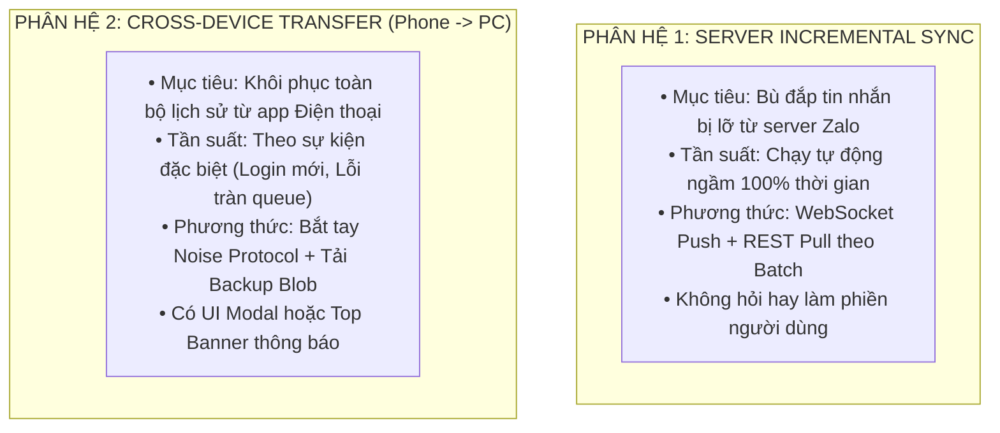
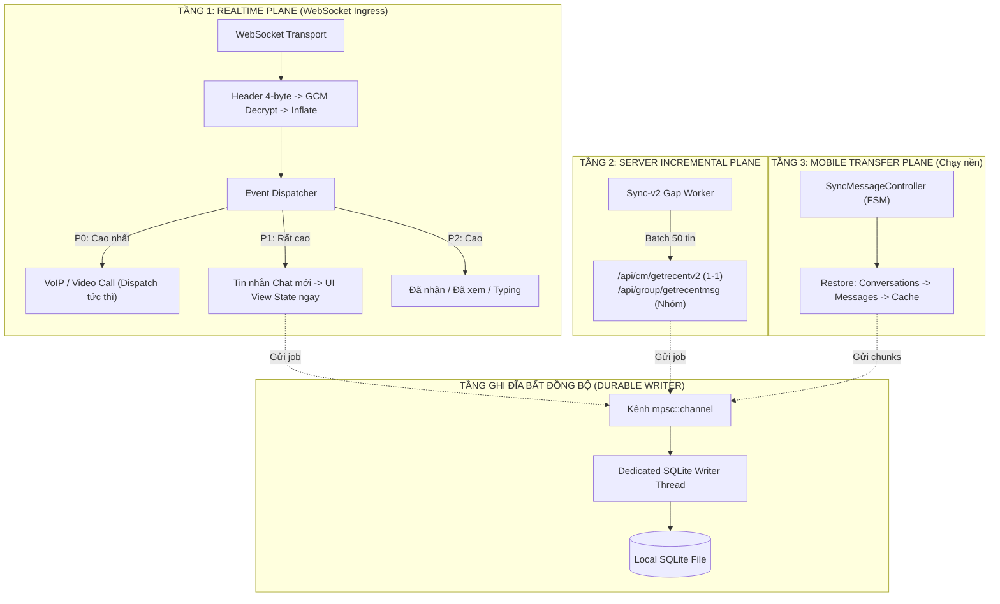
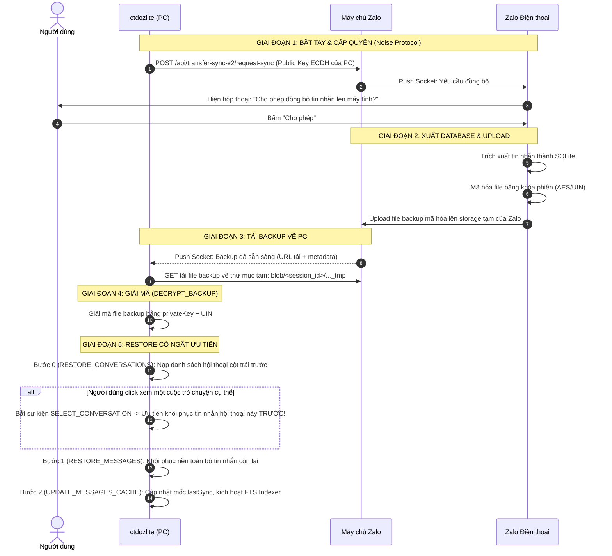
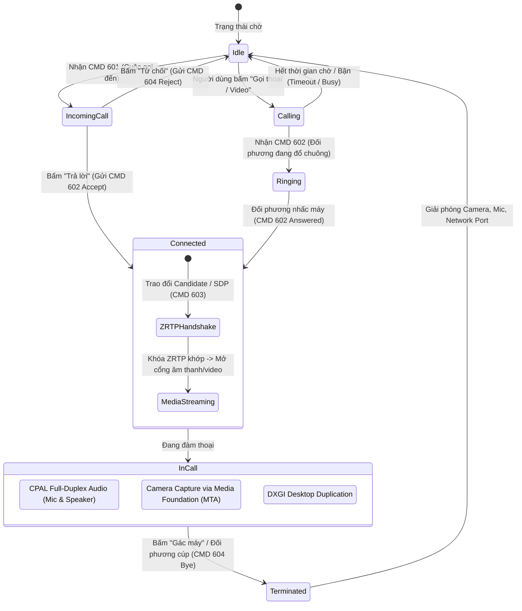
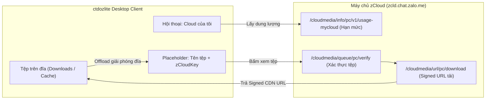

# Báo cáo Chuyên sâu: Phân tích Kiến trúc Zalo Gốc & Giải pháp Tái cấu trúc Hệ thống Đồng bộ, Voice, VoIP và zCloud

> **Ngày thực hiện**: 22/11/2026  
> **Phạm vi đối chiếu**:
> - **Zalo PC 26.11.12**: Trích xuất trực tiếp từ `app.asar` (`compact-app-pc.js`, `sync-v2-sub-worker.js`, `main.js`, `main-startup.js`).
> - **ZaloData**: Cấu trúc thực tế tại `c:\Users\bqqhu\AppData\Roaming\ZaloData` (`config.json`, `database-config.json`, 1.289 database shards).
> - **Zalo Web (chat.zalo.me)**: Runtime webpack & bundle static chunk.
> - **Zalo Android 26.11.01**: Disassemble bytecode Smali từ APKM (`classes3.dex`, `classes5.dex`).
> - **Dự án mục tiêu**: `ctdozlite` (Rust native, Windows 11 ARM64).

---

## MỤC LỤC
1. [Tổng quan & Căn cứ Bằng chứng](#1-tổng-quan--căn-cứ-bằng-chứng)
2. [Tái cấu trúc Toàn diện Hệ thống Đồng bộ Dữ liệu (Data Synchronization)](#2-tái-cấu-trúc-toàn-diện-hệ-thống-đồng-bộ-dữ-liệu)
   - [2.1. Hai thế giới Đồng bộ tách biệt](#21-hai-thế-giới-đồng-bộ-tách-biệt)
   - [2.2. Danh mục 11 Trigger Events & Thời điểm kích hoạt](#22-danh-mục-11-trigger-events--thời-điểm-kích-hoạt)
   - [2.3. Phân luồng Kiến trúc 3 Tầng & Thứ tự Ưu tiên](#23-phân-luồng-kiến-trúc-3-tầng--thứ-tự-ưu-tiên)
   - [2.4. Quy trình Chi tiết từng Kịch bản Đồng bộ](#24-quy-trình-chi-tiết-từng-kịch-bản-đồng-bộ)
3. [Tin nhắn Thoại & AI Chuyển Âm thanh thành Chữ (Voice & AI Transcribe)](#3-tin-nhắn-thoại--ai-chuyển-âm-thanh-thành-chữ)
   - [3.1. Luồng Gửi Tin nhắn Thoại (Outgoing Voice)](#31-luồng-gửi-tin-nhắn-thoại-outgoing-voice)
   - [3.2. Luồng Nhận, Giải mã Native & Waveform Visualizer](#32-luồng-nhận-giải-mã-native--waveform-visualizer)
   - [3.3. Dịch vụ AI Voice-to-Text](#33-dịch-vụ-ai-voice-to-text)
4. [Hệ thống Cuộc gọi Thoại & Video (VoIP Calling Engine)](#4-hệ-thống-cuộc-gọi-thoại--video-voip-calling-engine)
   - [4.1. Báo hiệu Cuộc gọi qua WebSocket (Signalling Command IDs)](#41-báo-hiệu-cuộc-gọi-qua-websocket-signalling-command-ids)
   - [4.2. Khởi tạo Cuộc gọi & Relay Media Protocol 3](#42-khởi-tạo-cuộc-gọi--relay-media-protocol-3)
   - [4.3. Pipeline Audio/Video Native Windows (STA vs MTA Invariant)](#43-pipeline-audiovideo-native-windows-sta-vs-mta-invariant)
5. [zCloud & Cơ chế Quản lý Vòng đời Media (Cloud Media & Offload)](#5-zcloud--cơ-chế-quản-lý-vòng-đời-media)
   - [5.1. Tra cứu Hạn mức Dung lượng (Cloud Quota)](#51-tra-cứu-hạn-mức-dung-lượng-cloud-quota)
   - [5.2. Media Offload & Tải lại theo Nhu cầu (On-Demand Rehydration)](#52-media-offload--tải-lại-theo-nhu-cầu-on-demand-rehydration)
   - [5.3. Đồng bộ Hội thoại "Cloud của tôi"](#53-đồng-bộ-hội-thoại-cloud-của-tôi)
6. [Kế hoạch Triển khai Tái cấu trúc cho `ctdozlite`](#6-kế-hoạch-triển-khai-tái-cấu-trúc-cho-ctdozlite)

---

## 1. Tổng quan & Căn cứ Bằng chứng

Toàn bộ phân tích trong tài liệu này dựa trên **chứng cứ thực tế (E1/E2)** thu thập từ các tệp nhị phân và mã máy nguyên bản của Zalo:

| Thành phần | Đường dẫn & Định danh thực tế | Dạng phân tích | Bằng chứng thu thập |
| :--- | :--- | :--- | :--- |
| **Zalo PC 26.11.12** | `c:\Users\bqqhu\AppData\Local\Programs\Zalo\Zalo-26.11.12\resources\app.asar` | E2 (Static bundle) | Trích xuất `compact-app-pc.js` (21.6MB), `sync-v2-sub-worker.js` (21.9MB), `main-startup.js` |
| **ZaloData** | `c:\Users\bqqhu\AppData\Roaming\ZaloData` | E2 (Schema & Config) | Đọc `config.json`, `database-config.json`, cấu trúc 1.289 file `.db` tại `_production/<uid>/Core/Message/` |
| **Zalo Android 26.11.01** | `c:\Users\bqqhu\Downloads\com.zing.zalo_26.11.01...apkm` | E2 (DEX Disassembly) | Disassemble `classes3.dex` (`AliasManager`), `classes5.dex` (`VoiceToTextController`) |
| **Mã nguồn `ctdozlite`** | `c:\Projects\ZaloLite` | Source Audit | So sánh đối chiếu module `worker.rs`, `phone_sync/`, `call.rs`, `socket.rs`, `zcloud.rs` |

---

## 2. Tái cấu trúc Toàn diện Hệ thống Đồng bộ Dữ liệu

### 2.1. Hai thế giới Đồng bộ tách biệt

Zalo PC chia việc đồng bộ thành hai phân hệ hoàn toàn riêng biệt về bản chất kỹ thuật, giao thức và hạ tầng mạng:



---

### 2.2. Danh mục 11 Trigger Events & Thời điểm kích hoạt

Trong file `sync-v2-sub-worker.0cd2e653e67efaa4bf4b.js` và `main-startup.41abf8e6af2a55551e3b.js`, controller quản lý đồng bộ (`SyncMessageController`) định nghĩa chính xác 11 mã sự kiện kích hoạt:

```javascript
// Enum Trigger Sync chính thức trong Zalo PC:
0: MANUAL                 // Người dùng vào Cài đặt bấm "Đồng bộ ngay"
1: RESUME                 // Khôi phục sau khi Sleep/Hibernate hoặc mạng vừa có lại
2: OVERFLOW               // Offline quá lâu khiến hàng đợi server bị tràn (Offline Overqueue)
3: FIRST_TIME_LOGIN       // Đăng nhập lần đầu trên máy tính mới (kiểm tra cờ z_needSyncMsg)
4: SETTING                // Chạy từ màn hình cấu hình sao lưu
5: LONG_INACTIVE          // Ứng dụng không mở trong thời gian dài (quá hạn cache server)
6: CSC_LIST / 7: CSC      // Customer Support Chat / Official Account
8: SEARCH                 // Tìm kiếm tin nhắn cũ trong thanh search mà DB local không đủ
9: E2EE_MISSING_MESSAGE   // Thiếu khóa mã hóa E2EE (Signal Ratchet Session) từ mobile
10: TRANSFER_WHEN_LOGIN   // Đã xác nhận "Đồng bộ tin nhắn" ngay trên điện thoại khi quét QR
```

#### Quy tắc hiển thị UI của Zalo PC:
1. **Hiện Popup Modal lớn**:
   - `FIRST_TIME_LOGIN`: Sau khi đăng nhập thành công, nếu Local Storage có cờ `z_needSyncMsg = true`, hệ thống chờ 1 giây (`checkSuggestWhenReady`), hiển thị Popup toàn màn hình hỏi người dùng có muốn đồng bộ từ điện thoại không.
   - `TRANSFER_WHEN_LOGIN`: Nếu người dùng tick chọn đồng bộ ngay trên màn hình xác nhận QR của điện thoại, Zalo PC tự động hiển thị màn hình chờ kết nối mà không hỏi lại.
2. **Hiện Top Banner màu vàng/xanh (Không chặn thao tác)**:
   - `OVERFLOW` (Offline Overqueue): Khi máy tính offline quá 7–14 ngày, server gửi cờ `CHECK_OVERFLOW_QUEUE_BY_FLAG`. Vì hàng đợi server đã xóa bớt tin, client hiển thị banner nhẹ phía trên danh sách hội thoại: *"Dữ liệu tin nhắn trên máy tính chưa đầy đủ. Hãy đồng bộ từ điện thoại để xem trọn vẹn"* kèm nút [Đồng bộ ngay].
   - `E2EE_MISSING_MESSAGE`: Khi gặp tin nhắn mã hóa đầu cuối mà PC không có khóa ratchet để giải mã.
3. **Chạy Ngầm Tuyệt Đối (Silent Background)**:
   - `RESUME`: Máy tính wake-up hoặc mạng phục hồi, tự động dùng cursor `last_msg_id` và `gLastSn` kéo tin nhắn lỡ mà không hiện bất kỳ thông báo nào.

---

### 2.3. Phân luồng Kiến trúc 3 Tầng & Thứ tự Ưu tiên

Kiến trúc chuẩn của Zalo PC tách biệt rạch ròi 3 tầng thực thi (Execution Planes) để đảm bảo độ trễ thấp nhất:



> [!IMPORTANT]
> **Thứ tự ưu tiên thực thi**:
> 1. **Ưu tiên P0**: VoIP/Video Call signalling (không bao giờ được trễ).
> 2. **Ưu tiên P1**: Tin nhắn gửi đi (Outgoing) và Tin nhắn đến realtime (Incoming) qua WebSocket $\rightarrow$ Đẩy thẳng lên RAM và UI render ngay lập tức (Optimistic rendering).
> 3. **Ưu tiên P2**: Server Incremental Gap-fill khi mất mạng kết nối lại.
> 4. **Ưu tiên P3**: Mobile Transfer (Tải file backup lớn từ mobile, giải mã, ghi hàng ngàn tin vào SQLite).
> 
> **Khắc phục lỗi fork cũ**: WebSocket loop không bao giờ gọi trực tiếp SQLite hay HTTP resolve tên danh bạ. Mọi thao tác ghi đĩa đều chuyển qua hàng đợi `mpsc::channel` cho một thread SQLite Writer duy nhất đảm nhiệm.

---

### 2.4. Quy trình Chi tiết từng Kịch bản Đồng bộ

#### Kịch bản 1: Đồng bộ Bù đắp từ Server (Server Incremental Sync)
1. WebSocket kết nối thành công, gửi gói tin handshake kèm danh sách `queue_cursors` của các queue (`501`, `521`, `510`...).
2. Server phản hồi tin nhắn mới qua WebSocket push.
3. Nếu client phát hiện `server_seq_id > local_seq_id + 1`: Kích hoạt `SyncV2SubWorker` gọi `/api/cm/getrecentv2` hoặc `/api/group/getrecentmsg` theo batch (mỗi batch 50 tin) kéo lùi từ `server_seq_id` về `local_seq_id`.
4. Ghi gộp vào SQLite trong một Transaction duy nhất và cập nhật cursor bền vững.

#### Kịch bản 2: Đồng bộ Toàn bộ từ Điện thoại (Phone-to-PC Transfer)



---

## 3. Tin nhắn Thoại & AI Chuyển Âm thanh thành Chữ

### 3.1. Luồng Gửi Tin nhắn Thoại (Outgoing Voice)
- **Thu âm**: Client thu âm từ Microphone bằng WASAPI/CPAL (16kHz hoặc 44.1kHz PCM).
- **Trích xuất Waveform**: Trong lúc thu âm, cứ mỗi frame âm thanh ($50\text{ms}$), tính toán biên độ RMS và chuẩn hóa về dải $[0..255]$ để tạo mảng `waveformSamples`.
- **Đóng gói & Gửi API**:
  - Chat 1-1: Gọi POST `/api/message/voicemp3` (query `type=2`, command `11148`).
  - Chat Nhóm: Gọi POST `/api/group/sendmp3` (query `type=11`, command `11169`).
  - Dữ liệu multipart: `fileContent` chứa file âm thanh nén, `params` chứa JSON mã hóa AES-CBC (`{"toid/grid": "...", "clientId": "..."}`).

---

### 3.2. Luồng Nhận, Giải mã Native & Waveform Visualizer
- **Dữ liệu tin nhắn nhận về**:
  ```json
  {
    "msgType": 3,
    "href": "https://voice-w-c1.chat.zalo.me/...",
    "params": {
      "duration": 4200,
      "m4a": "https://...",
      "waveformSamples": [12, 45, 98, 150, 210, 180, 95, 30]
    }
  }
  ```
- **Inline Decoder**: Dùng Windows Media Foundation (`IMFSourceReader`) giải mã stream từ URL/cache thành PCM 16-bit stereo/mono, đẩy sang CPAL buffer để phát lại trực tiếp mà không cần mở media player ngoài.
- **Waveform UI**: Vẽ các thanh dọc (bars) tương ứng với giá trị trong mảng `waveformSamples`. Khi audio phát, thanh quét màu xanh (playback cursor) di chuyển khớp theo thời gian thực. Hỗ trợ click chuột để tua (`seekTo`) và chọn tốc độ phát ($1\times, 1.5\times, 2\times$).

---

### 3.3. Dịch vụ AI Voice-to-Text
1. Client gửi request: POST `/api/aifeatures/voice2text` (command `13394`, service `ai_features`).
2. Payload: JSON mã hóa AES `{"url": voice_href}`.
3. Server phản hồi ngay HTTP 200: `{"error_code": 0, "data": {"req_id": 987654}}`.
4. Client lắng nghe sự kiện push trên WebSocket với `act = "convert_finish"`. Khi `req_id` trùng khớp, lấy chuỗi `text` và cờ `has_more` (nếu true nghĩa là âm thanh quá dài nên văn bản bị cắt ngắn) để hiển thị phụ đề transcript ngay dưới bong bóng voice.

---

## 4. Hệ thống Cuộc gọi Thoại & Video (VoIP Calling Engine)



### 4.1. Báo hiệu Cuộc gọi qua WebSocket (Signalling Command IDs):
- `CMD_CALL_INVITE (601)`: Lệnh báo cuộc gọi đến (Audio/Video).
- `CMD_CALL_RINGING / ACCEPT (602)`: Báo chuông hoặc đối phương chấp nhận cuộc gọi.
- `CMD_CALL_CANDIDATE / SDP (603)`: Trao đổi ICE Candidates và thông số mã hóa bảo mật ZRTP.
- `CMD_CALL_BYE / REJECT (604)`: Ngắt kết nối cuộc gọi.

### 4.2. Khởi tạo Cuộc gọi & Relay Media Protocol 3:
- Gọi REST `/api/voicecall/request` (command `416`) để lấy Session Call ID và địa chỉ Relay Server.
- Protocol 3 sử dụng `sub_cmd = 2` (`0x008DAF8C`) hướng dẫn client kết nối qua máy chủ trung chuyển Relay Server của Zalo khi P2P trực tiếp bị NAT/Firewall chặn.

### 4.3. Pipeline Audio/Video Native Windows (STA vs MTA Invariant):
- **Nguyên tắc sống còn**: CPAL khởi tạo luồng âm thanh trong môi trường **STA (Single-Threaded Apartment)**. Nếu gọi khởi tạo Camera Media Foundation trên cùng thread đó, Windows COM sẽ báo lỗi xung đột apartment.
- **Giải pháp `ctdozlite`**: Camera Media Foundation chạy trên một dedicated thread riêng biệt có cờ MTA (`IMFMediaSource`), nạp frame vào Lock-free Frame Ring Buffer; UI thread chỉ việc lấy frame mới nhất chuyển thành `egui::ColorImage` render GPU 60 FPS mượt mà.

---

## 5. zCloud & Cơ chế Quản lý Vòng đời Media



### 5.1. Tra cứu Hạn mức Dung lượng (Cloud Quota):
- Endpoint: `/cloudmedia/info/pc/v1/usage-mycloud`.
- Tham số: Gắn cookie phiên `zpw_sek`.
- Trả về: `usedQuota`, `totalQuota` (1GB miễn phí hoặc gói VIP 100GB/500GB) và dung lượng phân bổ cho từng loại media.

### 5.2. Media Offload & Tải lại theo Nhu cầu (On-Demand Rehydration):
- Zalo PC tối ưu bộ nhớ bằng cách xóa file nhị phân trong thư mục cache nếu tệp quá hạn (sau 30 ngày) và đã có mặt trên zCloud.
- Client chỉ lưu một placeholder nhẹ gồm tên tệp, dung lượng, thumbnail và `zCloudKey`.
- Khi người dùng click mở lại tệp, client gọi `/cloudmedia/queue/pc/verify` và `/cloudmedia/url/pc/download` để nhận một **Signed Download URL tạm thời** tải tệp trực tiếp từ CDN zCloud về máy.

### 5.3. Đồng bộ Hội thoại "Cloud của tôi":
- Là hội thoại đặc biệt với `toid = my_uid`.
- Đồng bộ qua các endpoint `/api/cm/getrecentv2` và `/api/cm/getpath` giúp người dùng chuyển dữ liệu nhanh giữa điện thoại và máy tính.

---

## 6. Kế hoạch Triển khai Tái cấu trúc cho `ctdozlite`

### 6.1. Dọn dẹp & Loại bỏ Mã nguồn Lỗi thời:
- Loại bỏ các module phân mảnh cũ: `src/phone_sync/legacy.rs`, `src/phone_sync/pipeline.rs`, `src/phone_sync/transfer.rs`, và gộp `src/history_sync.rs`.
- Loại bỏ toàn bộ logic gọi SQLite ghi đĩa trực tiếp bên trong `worker.rs` khi đang nhận frame WebSocket.

### 6.2. Cấu trúc Module Mới đề xuất:
1. **`src/sync/server_gap.rs`**: 
   - Quản lý con trỏ `last_msg_id`, `queue_cursors`.
   - Tự động kéo bù tin nhắn thiếu qua REST API khi online lại.
2. **`src/sync/mobile_transfer.rs`**: 
   - Hiện thực hóa Finite State Machine 6 bước cho Phone Sync.
   - Hỗ trợ sự kiện ưu tiên `SELECT_CONVERSATION`.
3. **`src/store/durable_writer.rs`**: 
   - Kênh `mpsc::channel` nhận các lệnh ghi từ WebSocket và Sync worker.
   - Ghi SQLite theo batch transaction định kỳ $100\text{ms}$.
4. **`src/voice.rs` & `src/gui/inline_voice.rs`**:
   - Hoàn thiện luồng gửi voice MP3 multipart.
   - Hoàn thiện player Media Foundation giải mã M4A/AMR/MP3 và bắt push AI `voice2text`.
5. **`src/zcloud.rs`**:
   - Hoàn thiện UI tra cứu hạn mức zCloud và signed download URL rehydration.

Báo cáo này được xuất làm tài liệu chuẩn hóa toàn bộ kiến trúc giao thức và dữ liệu của Zalo, sẵn sàng phục vụ cho các bước lập trình tiếp theo.
