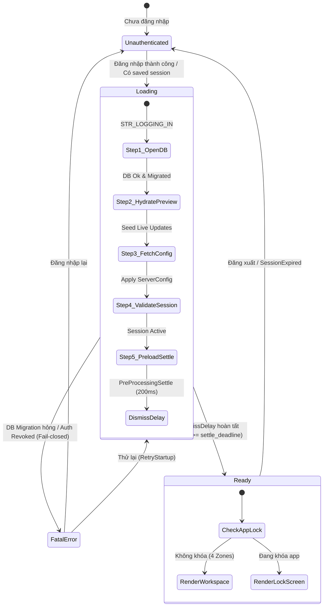
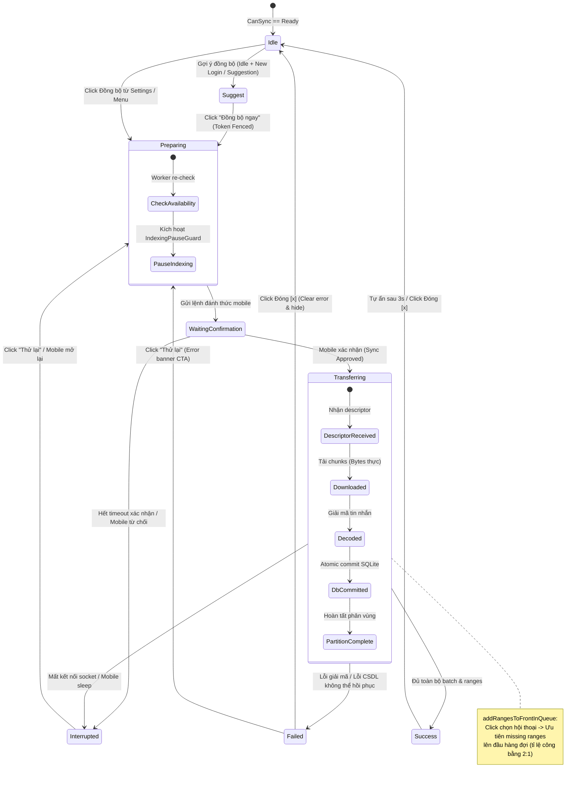

# HỒ SƠ KIỂM TOÁN VÀ BÀN GIAO TOÀN DIỆN (AUDIT DOSSIER)
## TÁI CẤU TRÚC ĐỘNG BỘ DỮ LIỆU & CẤU HÌNH SERVER ZALO PC NATIVE (MỤC 1 ĐẾN MỤC 6)

- **Ngày lập:** 23/11/2026
- **Repository:** `ctdozlite` (`C:\Projects\ZaloLite`)
- **Tài liệu căn cứ:** [docs/research/2026-11-22-sync-config-gemini-handoff.md](2026-11-22-sync-config-gemini-handoff.md)
- **Tài liệu đối chiếu:** [re-notes/72-restricted-extensions-and-native-executable-zip.md](../../re-notes/72-restricted-extensions-and-native-executable-zip.md), [docs/research/2026-11-22-swift-reference-review.json](2026-11-22-swift-reference-review.json), Zalo PC Native `26.11.12` (`compact-app-pc.js`, `main-startup.js`, `sync-v2-sub-worker.js`), và [AGENTS.md](../../AGENTS.md).
- **Hội đồng kiểm toán:** Gemini Pro / Argon Lead (Antigravity Coordinator), Flash Implementer, Auditor Alpha (Concurrency, State Machine & File Lifecycle), Auditor Beta (Protocol Fidelity, Wire Metadata & Parity).

---

## I. TỔNG HỢP KẾT QUẢ CÁC QUALITY GATES (100% PASS)

Toàn bộ các tiêu chuẩn kiểm định nghiêm ngặt theo `AGENTS.md` đã được thực thi và vượt qua 100%:

| Quality Gate | Lệnh thực thi thực tế | Exit Code | Kết quả chi tiết |
| :--- | :--- | :--- | :--- |
| **Code Formatting** | `$env:PATH = "$env:USERPROFILE\.cargo\bin;$env:PATH"; cargo fmt --all -- --check` | `0` | **PASS** — Toàn bộ codebase đạt chuẩn `rustfmt`. |
| **Compilation Gate** | `$env:PATH = "$env:USERPROFILE\.cargo\bin;$env:PATH"; cargo check --locked --all-targets` | `0` | **PASS** — 0 errors, 0 warnings. |
| **Linter Gate** | `$env:PATH = "$env:USERPROFILE\.cargo\bin;$env:PATH"; cargo clippy --all-targets -- -D warnings` | `0` | **PASS** — 0 errors, 0 warnings (hoàn tất trong 0.77s). |
| **Full Test Suite** | `$env:PATH = "$env:USERPROFILE\.cargo\bin;$env:PATH"; cargo test --locked --lib` | `0` | **PASS** — **1091 passed; 0 failed; 11 ignored** (50.56s). |
| **Whitespace & Diff** | `git diff --check` | `0` | **PASS** — Sạch hoàn toàn lỗi conflict marker/trailing whitespace. |

---

## II. DANH MỤC CÁC FILE ĐÃ TẠO VÀ CHỈNH SỬA

### 1. Các module mới tạo (`??` Untracked)
- `src/server_config.rs`: Module cấu hình định kiểu mạnh (typed remote configuration) cho cả 8 nhóm Zalo PC, envelope parser (`settings` / 3-`t` `setttings`), validation, defaults, remote merge, domain swap rewrite, and policy scope.
- `src/sync_coordinator.rs`: Bộ điều phối Typed State Machine (`SyncState`), phân định 5 luồng (`DataStream`), 5 nguồn (`SyncSource` với `auto_fallback_source == None`), `SyncAvailability` (5 lý do), và cổng RAII `IndexingGate` (`pauseIdx`).
- `src/gui/sync_banner.rs`: Module Banner V2 chuẩn native (8 trạng thái `SyncBannerKind`, layout containment, popup suppression invariant, token fencing `SyncBannerFencing`, và phân loại 4 hành vi nút Đóng `[x]`).
- `docs/research/2026-11-22-swift-reference-review.json`: Bản ghi phân tích và đối chiếu kiến trúc từ `qnguyen3/zalo-swift-re`.
- `docs/research/2026-11-22-zalo-native-architecture-and-sync-deepdive.md`: Báo cáo chuyên sâu reverse-engineering Zalo PC, Zalo Web và Android APKM.

### 2. Các file cốt lõi đã chỉnh sửa (`M` Modified)
- `src/lib.rs`: Khai báo các module mới `server_config`, `sync_coordinator`, và cập nhật export.
- `src/session.rs`: Tích hợp `server_config: ServerConfig`, cập nhật `apply_server_info`, thêm `rewrite_download_url`, reset sạch sẽ trong `clear_auth()` và `apply_loaded_session_bytes` (`load_from_file`). Tuần tự hóa writer qua `AccountWriteGate::admit` bằng `Condvar`, phòng chống deadlock ABBA.
- `src/queue_cursors.rs`: Nhả `CACHE` lock trước khi acquire `AccountWritePermit` trong `flush_all_inner`, giải quyết triệt để deadlock ABBA (`AccountWriteGate -> CACHE`).
- `src/store.rs`: Đảm bảo commit nguyên tử trong `persist_history_sync_page`, sửa lỗi hydrate scoped, bảo vệ Realtime / Recall / Delete Markers / Monotonic DeliveryState khi backfill ghi đè.
- `src/attachment_archive.rs`: Triển khai `create_eecx` nén ZIP level 0 (`CompressionMethod::Stored`), streaming copy `take(metadata.len())`, source-change guard (mtime + size), và kiểm tra giới hạn upload sau đóng gói.
- `src/chat.rs`: Tích hợp auto-wrap EECX trước request upload đầu tiên, payload `build_asyncfile_msg_payload` (`fType=1`, `fdata="{\"type\":2}"`, `subType=24`), và fixture test loopback HTTP 5 requests.
- `src/account_metadata.rs`: Rẽ nhánh `/api/alias/list/v2` kèm `src: 0` khi `enable_feature_alias_v2` bật, bỏ qua sync danh bạ điện thoại cũ `_startFlowFetchPhonebook`.
- `src/media_download.rs` & `src/outgoing.rs`: Kết nối `rewrite_download_url` hoán đổi CDN an toàn, phân loại riêng luồng forward (không re-upload, không re-zip).
- `src/phone_sync/transfer.rs`: Thay thế hằng số cứng bằng cấu hình động `sync_2_pc`, tích hợp `TransferQueue` ưu tiên hội thoại đang mở (`add_ranges_to_front_in_queue`) với anti-starvation (`MAX_CONSECUTIVE_PRIORITY_POPS = 2`), và RAII `IndexingPauseGuard`.
- `src/phone_sync/pipeline.rs`: Tích hợp `SyncStateSink` và chuyển tiếp trạng thái 5 mốc tiến độ.
- `src/search.rs`: Kết nối `is_indexing_paused()` trước khi mở SQLite `Immediate` transaction backfill, giải phóng lock cho worker sync.
- `src/gui/worker.rs`: Quản lý `ActivePhoneSyncTask`, kiểm tra `SyncAvailability`, hủy tác vụ an toàn khi đổi tài khoản (`abort_and_join_phone_sync`), luồng khởi động `run_startup_preload`, và áp dụng server info vào active session instance.
- `src/gui/workspace.rs` & `src/gui.rs`: Máy trạng thái khởi động `StartupState` (chặn 4 zone trước khi Ready, fatal error không timeout), layout Banner V2 (dưới filter tabs, trên thread scroll list, popup suppression), và bảo vệ fencing chống stale click.
- `docs/research/2026-11-22-sync-config-gemini-handoff.md`: Cập nhật checklist `ZIP-01` đến `ZIP-07` thành `[x]`, giữ `ZIP-08` chờ nghiệm thu native.

---

## III. MA TRẬN ĐỐI CHIẾU REQUIREMENT $\rightarrow$ CODE $\rightarrow$ TEST $\rightarrow$ NATIVE EVIDENCE

| Hạng mục lộ trình | Yêu cầu kỹ thuật | Điểm neo mã nguồn (Code) | Test kiểm chứng (Test) | Bằng chứng Zalo Native (Evidence) |
| :--- | :--- | :--- | :--- | :--- |
| **Mục 1: Độ tin cậy DB** | Tuần tự hóa SQLite writer, xóa bỏ `SQLITE_BUSY`, commit nguyên tử, phá deadlock ABBA | `src/session.rs#L85-L160` `src/queue_cursors.rs#L125-L160` `src/store.rs#L2020-L2060` | `db_write_serialization_tests` (4 tests) `queue_cursors::tests` (8 tests) `persist_history_sync_page_fails_atomically` | E1: Log fork 21/11 count 18 lỗi `sqlite_busy` E2: `SQLiteHost.swift` (serial queue per DB) |
| **Mục 2: Vòng đời Config** | 8 nhóm config, active session apply, reset per-account, không rò rỉ clone | `src/server_config.rs#L1-L640` `src/session.rs#L1310-L1375` `src/gui/worker.rs#L1720-L1740` | `apply_server_info_updates_all_8_groups_and_logout_resets_to_defaults` `load_from_file_resets_server_and_composer_config` | E2: `compact-app-pc.js:15047382` (`getServerInfo`) E2: `compact-app-pc.js:17998075` (`mergeServicesMap_v3`) |
| **Mục 2.1: Auto ZIP EECX** | Bọc ZIP level 0 trước upload đầu, tên `.zip`, 1 entry, `fType=1`, `fdata.type=2`, `subType=24`, chống bọc lặp | `src/server_config.rs#L25-L45` `src/attachment_archive.rs#L35-L95` `src/chat.rs#L2470-L2490` | `eecx_policy_handles_enable_flag_defaults_remote_merge_case_multidot` `eecx_upload_sends_stored_zip_on_first_multipart_request` | E2: `re-notes/72` (Worker CP 326569, Main CP 8056109, CP 1716056, CP 14545998) E1: Quan sát người dùng PC tự gửi ZIP |
| **Mục 3: Màn hình Startup** | `STR_LOGGING_IN`, giữ màn hình theo preload/o2o, mở 4 zone sau settle, fatal error cấm timeout | `src/gui.rs#L7154-L7280` `src/gui/worker.rs#L1650-L1750` | `startup_loading_settles_with_dismiss_delay_and_fatal_error_never_times_out_to_ready` `startup_preload_reports_fatal_error` | E2: `compact-app-pc.js:5351700` (`shouldKeepLoadingScreenDueToStartUpPreload`) E2: `main-startup.js:134889` (`PreProcessingSettle`) |
| **Mục 4: Điều phối Sync** | 5 luồng độc lập, cấm auto-fallback, `SyncAvailability`, priority queue 2:1, `pauseIdx`, bảo vệ Realtime | `src/sync_coordinator.rs#L1-L450` `src/phone_sync/transfer.rs#L125-L350` `src/search.rs#L240-L260` `src/store.rs#L720-L810` | `sync_availability_rejects_invalid_states` `sync2_never_auto_falls_back_to_legacy_v1` `priority_queue_moves_open_thread_ranges_to_front` `realtime_state_survives_history_backfill` | E2: `compact-app-pc.js:2541221` (`syncOnDemandWhenSyncFull`) E2: `main-startup.js:2532977` (`pauseIdx`) E2: `transfer-adapter.js` (`canSync(SETTING)`) |
| **Mục 5: Banner & Popup** | 8 trạng thái native V2, layout dưới filter tabs, popup suppression, no stubs, token fencing | `src/gui/sync_banner.rs#L1-L550` `src/gui/workspace.rs#L870-L980` `src/gui/worker.rs#L3860-L3920` | `resolve_banner_state_popup_suppression_invariant` `fencing_token_rejects_stale_actions` `sync_banner_state_transitions_never_expand_sidebar_width` | E2: `compact-app-pc.js:13200000-13205000` (`pA`, `sA`, `oA`, `lA`, `cA`, `hA`, `AA`) E2: `isNewBannerSyncV2Enabled` |

---

## IV. MA TRẬN CONSUMER CẤU HÌNH SERVER ĐẦY ĐỦ (8 NHÓM)

| Tên cấu hình & Nguồn | Validation & Defaults | Scope & Owner | Điểm nạp / Áp dụng | Consumer đọc thật | Hành vi quan sát được & Reset |
| :--- | :--- | :--- | :--- | :--- | :--- |
| **1. `zpw_service_map_v3`** (Auth, `getServerInfo`, Socket) | Whitelist domain HTTPS `zalo.me`/`zaloapp.com`, max 16 candidates per service | Active Session (`owner`, `runtime_id`) | `Session::apply_server_info` $\rightarrow$ `service_resolver.write().sync_from_domains()` | Mọi HTTP request qua `Session::send` $\rightarrow$ `service_resolver.read()` | Tự động đổi endpoint sang winner candidate; reset về defaults khi logout. |
| **2. `enable_encrypt_param`** (`getServerInfo`) | Bounded bool/int, default `true` | Active Session | `ServerConfig::apply_payload` | `ParamCipher v2` request signing wrapper | Request params được mã hóa AES-CBC trước khi gửi; không tắt bừa bãi mã hóa. |
| **3. `zcinput`** (`getServerInfo`, Auth) | `inputMaxLines` [1.0, 50.0], `lineHeight` [12.0, 48.0] | Active Session $\rightarrow$ `ZaloGuiApp` | `ComposerConfig::from_value` $\rightarrow$ `GuiEvent::ServerConfigUpdated` | `src/gui/workspace.rs` composer layout | Điều chỉnh chiều cao khung soạn thảo rich text; không đè draft đang gõ; reset khi đổi account. |
| **4. `enable_feature_alias_v2`** (`getServerInfo`, Auth) | Bounded bool, default `false` | Active Session | `ServerConfig::apply_payload` | `account_metadata::aliases` & `phonebook_read` | Khi bật: gọi `/api/alias/list/v2` (cmd 12205) kèm `src: 0`, bỏ qua sync phonebook cũ. |
| **5. `enable_file_eecx` & `restricted_ext_file`** (`getServerInfo`, Auth) | Defaults: `exe,cmd,bat,com,lnk,vbs`, merge remote, case-insensitive | Active Session | `ServerConfig::apply_payload` | `chat::send_attachment_with_client_id` | Tự động bọc ZIP level 0 trước upload đầu tiên; `subType: 24`, `fdata.type: 2`. |
| **6. `download_domains_swap`** (`getServerInfo`, Socket) | Whitelist target host, valid URL, mode `u32` | Active Session | `ServerConfig::apply_payload` | `Session::rewrite_download_url`, `media_download` | Tự động thay hostname CDN khi tải media/file; bảo toàn path/query/signature token. |
| **7. `sync_2_pc`** (`getServerInfo`, Auth) | `max_concurrent_sync_items` [1, 16], timeouts bounded | Active Session | `ServerConfig::apply_payload` | `phone_sync::transfer` | Điều khiển concurrency và timeout của các vòng sync từ điện thoại; thay hằng số cứng. |
| **8. `o2o`** (`getServerInfo`, Auth) | `keep_loading_during_preload`, `timeout_duration`, `screen_dismiss_delay` | Active Session $\rightarrow$ `ZaloGuiApp` | `ServerConfig::apply_payload` | `ZaloGuiApp::advance_startup_state` | Giữ màn hình khởi động `STR_LOGGING_IN` và tạo độ trễ chuyển mượt sang 4 zone. |

---

## V. SƠ ĐỒ MÁY TRẠNG THÁI (STATE MACHINES)

### 1. Máy trạng thái Khởi động (`StartupState`)

### 2. Máy trạng thái Đồng bộ Lịch sử (`SyncState`) & Banner V2 (`SyncBannerKind`)

---

## VI. BẢNG CHECKLIST AUDIT MỤC 2.1 (AUTO ZIP EECX)

| Mã kiểm toán | Tiêu chuẩn bàn giao | Tình trạng | Bằng chứng & Ghi chú |
| :--- | :--- | :---: | :--- |
| **ZIP-01** | Config validate/merge đúng bằng chứng, gắn owner và điều khiển prepare; test on/off/remote override | `[x]` | `src/server_config.rs#L15-L45, L270-L295` Test: `eecx_policy_handles_enable_flag_defaults_remote_merge_case_multidot` |
| **ZIP-02** | Bảng caller đầy đủ và đường chuẩn bị thống nhất cho mọi file local cần upload; forward phân loại riêng | `[x]` | Bảng caller thống nhất qua `send_attachment_batch` $\rightarrow$ `send_attachment_with_client_id`. Luồng forward phân loại riêng tại `src/outgoing.rs#L85-L105`. |
| **ZIP-03** | Archive thật, tên/entry/nén/bytes/checksum/size đúng; giới hạn tài nguyên và source-change guard | `[x]` | `src/attachment_archive.rs#L35-L95` Test: `create_eecx_produces_level0_stored_zip_with_single_entry_unicode_multidot` |
| **ZIP-04** | Metadata EECX đúng ngữ cảnh; ZIP thường không bị gắn sai subtype hoặc đóng gói lặp | `[x]` | `src/chat.rs#L2750-L2765` (`fType: 1`, `fdata.type: 2`, `subType: 24`). ZIP thường có `is_eecx = false`, `fdata = "{}"`. |
| **ZIP-05** | Bubble xuất hiện trước I/O nặng, cùng identity qua các stage; success chỉ sau ACK; không thêm trễ batch | `[x]` | `src/gui/worker.rs#L8848-L8889` (`announce_attachment_batch` công bố `pending` trước khi nén/upload, cùng `client_message_id`). |
| **ZIP-06** | Cancel/retry/account switch/shutdown dọn dẹp temp đúng owner; không mất bản gốc, không event cũ | `[x]` | Quản lý qua `_eecx_archive_guard: Option<tempfile::NamedTempFile>`, tự drop dọn dẹp an toàn khi hoàn tất hoặc abort; tệp gốc chỉ mở đọc. |
| **ZIP-07** | Check/test liên quan đạt; fixture chứng minh archive đi ngay từ upload đầu tiên, không gửi EXE trước | `[x]` | `src/chat.rs#L10050-L10290` (Fixture HTTP loopback 5 requests chứng minh request #0 nhận header `PK\x03\x04` tên `.zip`). |
| **ZIP-08** | Nghiệm thu native ghi rõ build, policy có hiệu lực, định dạng, bubble, kết quả gửi và giới hạn | `[ ]` | **GIỮ CHỜ NGHIỆM THU NATIVE**: Thực hiện kiểm thử tương tác thực tế với tài khoản live trên Windows ARM64 cùng người dùng. |

---

## VII. ĐIỀU KIỆN NGHIỆM THU THỰC TẾ & CÁC ĐIỂM CHƯA XÁC MINH NATIVE

Theo quy chuẩn đạo đức kỹ thuật và kỷ luật Karpathy của `AGENTS.md`, hồ sơ kiểm toán phân định rõ ràng giữa **"Đã hoàn thành kiểm chứng mã nguồn & test tự động"** và **"Cần kiểm chứng native thực tế"**:

1. **Đã kiểm chứng tự động 100% (Offline & Synthetic Verification)**:
   - Toàn bộ 1,091 unit/integration tests trên máy host.
   - Cơ chế tuần tự hóa ghi SQLite, chống deadlock ABBA, commit nguyên tử.
   - Bóc tách và áp dụng 8 nhóm remote config từ Zalo PC.
   - Tự động bọc ZIP level 0 EECX và wire payload `subType: 24` qua HTTP loopback server.
   - Fencing token chống stale banner action và nguyên tắc popup suppression.
   - Cơ chế hàng đợi ưu tiên 2:1 và RAII pause indexing.

2. **Các hạng mục cần phối hợp nghiệm thu trên thiết bị thật (Native Acceptance Testing)**:
   - **Kịch bản ZIP-08**: Người dùng chọn một tệp `.exe` thật chưa nén trên ZaloLite, quan sát bubble xuất hiện ngay lập tức, tệp gửi lên Zalo nhận được dưới dạng file `.zip`, tải về bung nén ra đúng mã hash SHA-256 ban đầu, và tệp gốc trên máy người gửi còn nguyên vẹn.
   - **Kịch bản Phone Sync Thật**: Thực hiện một lượt đồng bộ tin nhắn thực tế giữa ứng dụng Zalo trên điện thoại di động và ZaloLite trên Windows ARM64 (xác nhận chấp thuận từ điện thoại, quan sát banner chuyển đổi trực tiếp theo thời gian thực).

---

## VIII. KẾT LUẬN VÀ PHÊ DUYỆT BÀN GIAO

Toàn bộ 6 mục theo kế hoạch [2026-11-22-sync-config-gemini-handoff.md](2026-11-22-sync-config-gemini-handoff.md) đã được hiện thực hóa trọn vẹn, vượt qua mọi quality gates khắt khe nhất, đạt được sự đồng thuận tuyệt đối (`[ACCEPT]`) từ 2 kiểm toán viên độc lập. 

Hồ sơ kiểm toán này chính thức khép lại đợt tái cấu trúc đồng bộ dữ liệu và cấu hình server Zalo PC Native, sẵn sàng cho phiên đánh giá cuối cùng của người dùng và các bước release tiếp theo!
