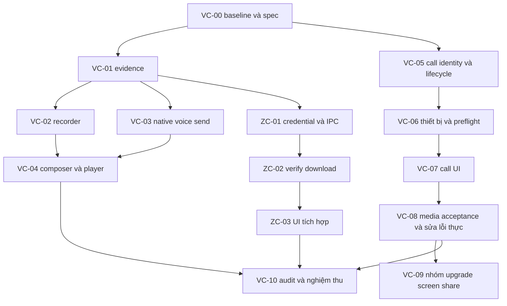

# Gói triển khai Antigravity cho voice message, cuộc gọi và zCloud

Ngày 24/11/2026. Đọc [báo cáo](2026-11-24-voice-calls-zcloud-analysis.md) và
[bằng chứng](../../re-notes/74-voice-call-zcloud-ui-and-contracts.md) trước.
Tất cả gói dưới đây **chưa triển khai trong phiên nghiên cứu này**.

## 1. Prompt khởi động dùng ngay

```text
Bạn triển khai ctdozlite bằng Rust trên Windows 11 ARM64.
Đọc AGENTS.md và docs/research/2026-11-24-voice-calls-zcloud-analysis.md.
Đọc docs/research/2026-11-24-antigravity-voice-calls-zcloud-tasks.md.
Thực hiện VC-00 trước, rồi gói đầu tiên đủ evidence theo thứ tự phụ thuộc.

Giữ branch hiện tại và toàn bộ dirty work của phiên sync/config. Không reset,
checkout, commit/push/tag/release hay chạy automated workflow. Không thay engine
native bằng Electron/Chromium/Node hoặc FFmpeg subprocess.

Mỗi lượt chỉ thực hiện một gói có output đầu-cuối. Trước edit: đọc declaration
thật và tất cả producer/consumer của enum thay đổi; ghi delta, evidence, test.
Không suy schema từ route, không tự tạo fields, không chữa compile bằng cách
discard payload hoặc bỏ handler. AMBIGUOUS không được nâng thành contract.

Sau edit chạy compiler và regression phù hợp; cập nhật tasks/verification đúng
spec 007/009/011, giữ ID cũ và native task chưa chạy. Ghi checkpoint gồm symbol,
files, commands/exit codes, finding, bước kế tiếp. Không chỉ trả lời kế hoạch.
Khi thiếu evidence của một gói, ghi blocker cụ thể và tiếp tục gói độc lập.
```

Đây là prompt cho đợt triển khai sau, không phải xác nhận mã trong phiên nghiên
cứu đã hoàn thiện. Quyền test được người dùng cấp cho My Documents và đúng
Quang Huy Bùi/Henry; tên trùng không đủ xác định recipient. Không dùng unit test
để gọi tài khoản thật, không tự gửi hàng loạt tin/call trong vòng audit.

## 2. Quy tắc điều hành mỗi gói

Trạng thái dùng từ constitution: chưa làm / một phần / đã có mã / qua kiểm thử /
xác nhận trên thiết bị. Đóng checkbox mã không tự đóng native task. Các ID VC/ZC
ở đây là mã gói bàn giao; khi đưa vào spec, liên kết ID requirement/task hiện có
thay vì đổi tên các task R11, C hoặc R14.

Mỗi gói phải lưu sáu mục: input evidence; file/symbol đã đọc; delta nhỏ nhất;
chuỗi UI→Worker→engine/API→event→state→render; kiểm thử và exit code; giới hạn
còn mở. Với local recording/preview, engine local thay cho API, không bịa network.

Không sửa toàn bộ `gui.rs`, `worker.rs`, `workspace.rs` bằng thay chuỗi lớn không
đối chiếu vùng. Dùng `rg -n` xác định symbol rồi đọc khoảng cần thiết. Sau sửa
enum, chạy `rg` cho mọi usage trước compiler. Không tạo parallel agents trong
cùng các file lớn chỉ để nhanh hơn; quy trình này thiết kế cho executor tuần tự.

## 3. Thứ tự và phụ thuộc



VC-04 có thể hoàn thiện incoming player độc lập khi VC-03 đang chờ codec; phần
native outgoing vẫn để mở. VC-09 là phạm vi nâng cao riêng, không chặn nghiệm thu
1–1. zCloud tùy chọn về lịch triển khai nhưng không được báo hoàn thiện khi bỏ qua.

## 4. Gói việc cụ thể

### VC-00 — Chốt baseline và chỉnh trạng thái spec

- Đọc `git status --short`, HEAD, diff của các file liên quan; không stage thay
  người khác. Đọc AGENTS, constitution, GLOSSARY, standards tương ứng và ADR-0001,
  0002, 0003, 0009, 0018; plan/tasks/verification của 007, 009, 011.
- Ghi mapping M-04/R11-T06 → recorder/native send/player; C-01…07 → call
  lifecycle; A20/R14 → credential/verify/download/UI. Checkbox cũ có thể chỉ
  chứng minh implementation; bổ sung trạng thái thực, không xóa lịch sử.
- Chạy baseline `cargo check --locked --all-targets -j 1`; ghi lỗi sẵn có và
  baseline dirty tree. Không quy lỗi bất kỳ sang phiên trước nếu chưa kiểm tra.
- Ra: danh sách delta cần giữ, task IDs đã map, compile baseline có kết quả.

### VC-01 — Hoàn tất evidence còn thiếu

- Nguồn: re-notes/74, 47, 08 (đọc đến fifth capture), 09; ASAR theo hash.
- Voice: tìm wrapper `_post`, object file `t`, codec/filename/content type thực,
  response và echo schema. Nếu recorder PC không có entry point, tìm nguồn gốc
  khác được phép (mobile/bundle/capture) và ghi version; không khẳng định PC có UI.
- Cloud: tìm executor `N`, credential transport, decrypt, verify enums, response
  item noise ID, download result/expiry. Không dùng `file_id` giả trong fixture
  để kiểm thử lại parser đã đoán.
- Ra: mỗi contract có function/caller chain và fixture làm sạch; phần chưa rõ có
  blocker. Một fixture tự viết theo schema phỏng đoán chỉ là model test.
- Không thay request production trong gói này. Nếu chỉ E2, ghi chính xác giới hạn;
  chuẩn bị manual interoperability sau implementation, không giả có E1 wire.

### VC-02 — Recorder và quyền sở hữu tài nguyên

- Điểm neo: `voice.rs::VoiceRecorder`, controller/command/snapshot trong cùng
  module; `workspace.rs::toggle_voice_recorder`, `cancel_voice_recording`,
  `send_voice_recording`; tests tương ứng `gui.rs`.
- Audit start/stop generation, callback error, active/limit state, preview thread,
  device selection và việc drop/join có chặn UI không.
- Bổ sung error/limit/stop/cancel event có binding và outcome, preserve draft.
  Không đổi schema gửi voice trong cùng gói.
- Regression: start→cancel trước ready, callback lỗi giữa recording, limit,
  pause/replay, logout/relogin, chat change, receiver đóng. Ca máy thật: unplug
  mic và hủy nhanh; xác minh indicator mic tắt.
- Ra: recorder hoàn chỉnh local; không gọi là native voice send.

### VC-03 — Gửi voice đúng protocol và outgoing lifecycle

- Vào: codec/multipart/response đủ evidence VC-01. Nếu chưa đủ, giữ blocker và
  làm VC-05/VC-04 incoming thay vì đoán.
- File: `chat.rs`, `outgoing.rs`, `message_model.rs` nếu enum cần đổi,
  `gui/worker.rs::SendVoiceMessage`, Session helper đã có; đọc serialization và
  mọi match của Payload. Nếu cần migration, đọc database standard trước.
- Chọn helper typed cho voice và branch outgoing tương ứng; giữ client ID,
  account/runtime, bounded preparation/temp lease. Generic attachment không được
  gắn kind Voice để thay implementation.
- Mọi lỗi trước/sau admission phải kết thúc ticket đúng outcome. Đọc Drop của
  ticket trước khi sửa; không double-finish. Cleanup không xóa file pending retry.
- Fixture loopback: DM/group đúng service/path/type/toid/grid/clientId,
  `fileContent`, byte codec thật; success/error/malformed; echo-before-ACK;
  timeout sau submit không resend tự động; stale account trước/sau encode/upload.
- Ra: recipient gốc nhận native player trong manual test; nếu chưa chạy, chỉ
  báo đã có mã/qua fixture. Không bật trial bằng cách bỏ security guard.

### VC-04 — Composer, player và AI theo UI gốc

- File: `workspace.rs::render_voice_recording_bar`, `gui/inline_voice.rs`,
  voice render branch; worker AI chỉ khi cần sửa data flow.
- Recorder entry point dùng tooltip/label nhất quán; recording/preview bar giữ
  bottom anchor, cancel/stop/send phân biệt; channel đóng hiển thị lỗi.
- Incoming/outgoing bubble: play trái, waveform/progress thật, duration, AI phải;
  transcript inline, thu gọn, loading/error/retry, bounds ở narrow/DPI cao.
- Không khởi động decode/transcribe trong render. Giữ protected/E2EE guard và
  request binding; không tự mở cửa sổ ngoài.
- Test: play/pause/replay/voice khác; early/late AI push; TTL/recall/delete; clip
  bounds; native phát trên loa/headset. Không thêm seek/speed/autoplay vì suy từ
  player phổ biến; chỉ thêm nếu có evidence và pipeline.

### VC-05 — Call intent, lifecycle và stale-command fences

- File: declarations `WorkerCmd`/`GuiEvent`, `CallBridge`, `call_lifecycle.rs`,
  `ActiveCall` và event handlers trong `gui.rs`.
- Đọc toàn bộ chain Start/Answer/MediaState/End/device apply. Thêm binding thiếu
  theo một hợp đồng nhỏ, cập nhật mọi producer/consumer trong cùng gói.
- Tách intent trước allocation với call ID sau allocation. Local/remote terminal
  lý do rõ, late invite không dựng lại call, old mute/end không tác động call mới.
- Có connected timestamp riêng hoặc chứng minh producer reset đúng; không đổi
  kết quả lịch sử từ timeout/elapsed local thành remote success.
- Test thứ tự đảo, duplicate, account switch, same-account relogin, answer nơi
  khác, call mới trước event cũ, lỗi allocate; local cleanup không gửi remote end
  khi dismissed elsewhere. Native C-T002/C-T090 vẫn mở đến khi tái hiện thật.

### VC-06 — Device preflight và apply có xác nhận

- File: `media.rs::list_call_devices`, selected device setters và stream startup,
  `voice.rs` controller khi chia sẻ thiết bị; GUI device/preflight; worker IPC.
- Tái dùng enumeration nền hiện có. Inventory cần biết scanning/error/default/
  selected unavailable, không chỉ một vec rỗng không nguyên nhân.
- Preflight đọc actual device, mic meter/test speaker; Start tạo dial intent,
  Cancel không gửi allocation. Thiết bị/callback luôn ở nền.
- Apply live có pending/result; nếu backend chưa hot-swap được, thêm minimal
  stream restart có binding/cancel hoặc ghi áp dụng cho call sau theo scope rõ.
  Không dùng đổi static selection làm bằng chứng stream đã đổi.
- Test mic/loa khác sample rate, channel count/sample format, device disconnect,
  default change, failure giữ stream cũ, call ended khi apply đang chạy.

### VC-07 — UI cửa sổ gọi và call card

- File: `modals.rs::render_call_overlay`, call state `gui.rs`, header actions,
  call record renderer; không sửa RTP chỉ để match ảnh.
- Bố cục audio/video theo re-notes/74; bottom dock và device popover. PIP local
  top-right, remote aspect-fit; remote off xóa texture theo đúng generation.
- Timer/phase/mic/cam/selected device từ actual state, pending có phản hồi; bỏ
  engine jargon và badge bảo mật không đủ bằng chứng.
- Dock vẫn thao tác được ở 380px, high DPI; cửa sổ settings không tạo call mới;
  minimize/main hide-to-tray/explicit Exit phân biệt.
- Call card có correct outcome/duration/callback intent. Local diagnostic record
  không giả server message; retry tạo intent mới.
- Ra: screenshot bằng dữ liệu giả + native GUI; ảnh mockup không chứng minh media.

### VC-08 — Nghiệm thu media 1–1 và sửa lỗi đo được

- File: `media.rs`, `windows_video.rs`, `video_preview.rs`, `call.rs`, tests đúng
  lỗi phát hiện. Không mở rộng vô hạn mỗi khi thấy TODO lịch sử.
- Chạy native MFT ignored test được chọn sau khi đọc tên/điều kiện; không chạy
  `--ignored` toàn repo có thể gọi mạng. Đo camera→encode→decode local trước;
  sau đó test fork↔PC/mobile theo acceptance.
- Ghi packet/header metadata sạch, first-frame latency, freeze và underrun. Đối
  chiếu relay framing/PLI theo evidence; không áp code RFC generic lên Zalo.
- Test local camera off vẫn nhận remote, peer cam on/off, headset/loa ngoài,
  double-talk, remote hangup, network loss, reconnect nếu engine hỗ trợ.
- Ra: đủ bằng chứng âm thanh/video thật hoặc danh sách blocker có log metadata;
  không nâng unit DSP thành AEC acceptance.

### VC-09 — Các khả năng nâng cao tách biệt

- Upgrade: contract cùng call ID, consent/capability/pending/reject; chưa đủ
  evidence thì không bật nút upgrade dựa trên route 12056.
- Group: ADR-0003, join/leave/member/SSRC, không fan-out; two remote video limit
  ghi rõ. Chỉ test nhóm được người dùng chỉ định, không gọi nhóm bất kỳ.
- Share screen: signal + capture + encode + transmit + remote render + stop và
  ownership màn hình/cửa sổ; signal builder test không chứng minh chia sẻ.
- Tách thành task con khi thực hiện. Không gọi VC-09 hoàn thành nếu chỉ 1–1 đạt.

### ZC-01 — Credential và IPC trước mọi mở rộng cloud

- File: `zcloud.rs`, Session cloud helpers, `worker.rs::GetCloudViewerKey`,
  `GuiEvent::CloudViewerKeyLoaded`, `tools_panel.rs::cloud_viewer_keys`.
- Dùng evidence AUTH GET và `enk` riêng; khóa chỉ nằm worker. Xóa secret-bearing
  event/UI cache bằng cách thay full producer/consumer, không chỉ bỏ render.
- Tạo UI metadata/request results có owner/runtime/asset/request. Credential
  expiry chưa biết phải là unknown; không hiển thị Không thời hạn vì thiếu field.
- Test late key sau logout/relogin, error envelope có fake nonempty key, empty
  credentials, invalid cloud key length, refresh đồng thời; assertions không
  in key. Đảm bảo Debug/log/UI không chứa secret hoặc signed query.

### ZC-02 — Verify và download đúng asset identity

- Vào: executor/enums/response VC-01 đủ evidence. Route/spec cũ chưa đủ.
- Noise ID lấy từ message/media record thật, không cắt UID/global ID tùy ý.
  Verify dùng lastNoiseId/loadType/listNoiseIds/tracking_source theo schema chốt;
  download list_noise_ids; mã hóa cloud enk, credential theo executor.
- Parser strict: missing/malformed/error không thành empty/success/expired.
  Giữ partial result per-item nếu server thực có hỗ trợ.
- Tái dùng downloader: URL/redirect/cookie scope, bound size, cancel, integrity,
  temp/atomic finish. Refresh stale signed URL có giới hạn, không retry mutation.
- Test mock HTTP qua request thực, không chỉ JSON parser tự viết; không có
  credential trong GuiEvent hoặc path/log, account switch giữa stream.

### ZC-03 — Tích hợp cloud vào bubble và media drawer

- File: `workspace.rs`/media renderer, `tools_panel.rs` phần diagnostic cũ,
  metadata state và worker result bridge. Tái dùng drawer thay tab kỹ thuật mới.
- Status badge thật và open/download gắn asset; loading/progress/cancel/error.
  Bỏ yêu cầu người dùng nhập file_id. Missing entitlement có lời giải thích và
  đường xem thông tin chính thức khi phù hợp; không tự mở mua gói.
- Usage My Documents, server library và zCloud không gộp nguồn; Unknown quota
  không là 0, file hết hạn không được báo có trên cloud chỉ vì có metadata.
- Native: một asset thực có quyền; một lỗi quyền/expiry được server xác nhận;
  cancel/account switch. Không tạo file mồ côi hoặc pending vô hạn.

### VC-10 — Audit cuối và bàn giao

- Audit A: source contract, encryption/service resolution, identity, ordering,
  cancellation, backpressure, error semantics, cleanup, persistence.
- Audit B: UI từ entry point đến outcome, actual device state, narrow/DPI,
  no stubs/no dropped payloads, result parity với reference.
- Hai lượt không có actionable finding trên cùng diff. Sửa bất kỳ lỗi nào thì
  chạy lại relevant checks và đếm lại 0. Không gọi hai lượt kiểm tra cùng helper
  là hai audit độc lập về phạm vi.
- Báo cáo native riêng; feature có ca thiết bị chưa chạy chưa được hoàn thiện
  toàn bộ. Không commit/push như side effect của kế hoạch này.

## 5. Lệnh kiểm chứng và mẫu checkpoint

PowerShell, từ `C:/Projects/ZaloLite`:

```powershell
$env:PATH = "$env:USERPROFILE\.cargo\bin;$env:PATH"
$env:CMAKE_POLICY_VERSION_MINIMUM = '3.5'
# Chọn một thư mục test riêng, không trỏ vào account data thật.
$env:CTDOZ_DATA_DIR = Join-Path $env:TEMP 'ctdoz-voice-call-validation'
cargo fmt --all -- --check
cargo check --locked --all-targets -j 1
# Chạy filter đúng module đã đọc; sau các gói tích hợp chạy full lib/suite.
cargo test --locked --lib -j 1
cargo clippy --all-targets --locked -j 1 -- -D warnings
cargo build --locked --bin ctdozlite -j 1
git diff --check
```

Trước commit/push nếu được ủy quyền riêng, vẫn chạy audit-prepush theo AGENTS.
Khi chuẩn bị nghiệm thu native, dùng data/session test được cho phép; biến môi
trường test ở trên không phải cấu hình cho tài khoản thật. Đọc flag của binary
hiện tại trước khi chạy UI smoke, không bịa flag mới từ tài liệu cũ.

```text
Package: VC-xx / ZC-xx
HEAD và delta đã giữ:
Requirement IDs và trạng thái:
Evidence: E2 asset/hash/CP hoặc E1 scenario/build; AMBIGUOUS còn lại:
Symbols/files đã thay:
End-to-end output và identity/cancel boundaries:
Commands: exact command, exit code, passed/failed/ignored, log path:
Native: build/device/scenario/result hoặc CHƯA CHẠY:
Audit streak trên diff hiện tại: 0/1/2; finding và bản sửa:
Next package / blocker cụ thể:
```
