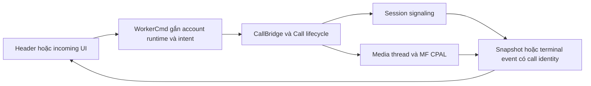

# Hoàn thiện tin nhắn thoại, cuộc gọi và zCloud theo Zalo PC

Ngày 24/11/2026, Asia/Saigon. Đối tượng thực hiện: Antigravity với Gemini 3.8 Flash.

Cần hoàn thiện ba trải nghiệm đầu-cuối: gửi/nhận tin thoại đúng loại trên Zalo gốc,
gọi thoại/video 1–1 có thiết bị và trạng thái đáng tin cậy, và mở/tải nội dung
zCloud từ hội thoại. Ưu tiên voice message rồi cuộc gọi 1–1; zCloud là nhánh mở
rộng sau khi sửa mô hình credential/identity. Gọi nhóm và chia sẻ màn hình được
nghiệm thu riêng, không dùng để trì hoãn hoàn thiện cuộc gọi 1–1.

Đây là kế hoạch và báo cáo nghiên cứu; chưa triển khai mã ứng dụng. Baseline đọc:
HEAD `f33f43a4c0b7e27d15d36393ad0556728b3d547f`, working tree có delta sync/config
chưa commit. Antigravity phải đọc lại HEAD và diff lúc bắt đầu; không reset hoặc
ghi đè delta đó. Không tự commit, push, tag, nâng version hoặc chạy workflow.

## 1. Bộ tài liệu thực hiện

1. Báo cáo này: quyết định phạm vi, phân tích khoảng trống và thiết kế đề xuất.
2. [Bằng chứng PC/Web mới](../../re-notes/74-voice-call-zcloud-ui-and-contracts.md):
   phiên bản/hash, điểm neo bundle, UI đã quan sát và giới hạn kết luận.
3. [Các gói việc cho Flash](2026-11-24-antigravity-voice-calls-zcloud-tasks.md):
   thứ tự triển khai, file, điều kiện vào/ra và prompt dùng ngay.
4. [Ma trận nghiệm thu](2026-11-24-voice-calls-zcloud-acceptance.md):
   kiểm thử mã, fixture, GUI và thiết bị thật.

Nguồn chuẩn hiện có vẫn là [spec 007](../../specs/007-call-multidevice/spec.md),
[spec 009](../../specs/009-rich-media-messaging/spec.md) và
[spec 011](../../specs/011-history-server-media-zcloud/spec.md).
Không tạo một bộ trạng thái hoàn thành cạnh tranh với các spec này. Gói đầu tiên
sẽ cập nhật đúng plan/tasks/verification liên quan, giữ nguyên ID đã có. Không đổi
default feature trong `.specify/project.json` chỉ vì đang làm nhiều miền.

## 2. Đã quan sát trực tiếp điều gì

Zalo Web đã đăng nhập, Zalo PC 26.11.12, My Documents và đúng liên hệ kiểm thử
do người dùng chọn đã được mở. Đã thực hiện một cuộc gọi thoại và một cuộc gọi
video trên PC gốc, kết thúc cả hai; timeline ghi 42 giây và 18 giây. Cuộc gọi video
hiện hình ảnh thay đổi trực tiếp. Chưa đo chất lượng âm thanh hai chiều.

Người dùng gửi thêm một voice thử 4 giây: player hoạt động trong bubble,
progress đổi khi phát, kết thúc hiện replay; bấm AI hiện transcript ngay bên dưới
waveform và có chevron thu gọn. Không lưu nội dung voice, transcript hoặc ảnh camera
vào repo. Đây là xác nhận UI của client gốc, không phải nghiệm thu fork.

| Bề mặt | Quan sát PC gốc | Hệ quả cho fork |
|---|---|---|
| Trước gọi | Dialog kiểm tra micro/loa, mức mic thật, test loa, selector, Hủy/Bắt đầu gọi | Có bước chuẩn bị thiết bị; chỉ gọi mạng khi người dùng xác nhận Start |
| Gọi thoại | Cửa sổ riêng, avatar nền mờ, timer, dock ở đáy, mic/camera có chevron | Tránh biến cửa sổ gọi thành bảng chẩn đoán kỹ thuật |
| Gọi video | Video chính giữ tỷ lệ, preview góc trên phải, camera picker có preview | Tách trạng thái local/remote, không kéo giãn hình hoặc hiện frame cũ |
| Kết thúc | Card phân biệt thoại/video, thời lượng, Gọi lại | Lịch sử call là outcome có identity, không chỉ một toast |
| Voice nhận | Play/pause/replay, waveform, duration, AI mở inline | Giữ phát trong timeline; không dựng waveform ngẫu nhiên |
| Cloud | Nhãn Đã có trên zCloud ngay trong bubble tệp | Người dùng mở/tải từ tệp, không nhập file_id hoặc nhìn credential |

Trong phiên Web khảo sát chưa thấy nút gọi/ghi âm. Menu composer PC đã mở cũng
chưa thấy recorder. Vì vậy recorder là **Fork deviation** về entry point cho đến
khi tìm được UI gốc tương ứng; player, AI và bố cục gọi có căn cứ parity trực tiếp.
Không lấy sơ đồ toolbar trong tài liệu GUI cũ làm bằng chứng nút ghi âm gốc tồn tại.

Chưa khảo sát incoming call gốc, busy/no-answer, đổi thiết bị thật, upgrade,
screen share, nhóm hoặc tải cloud thành công. Các mục đó nằm trong nghiệm thu sau.

## 3. Khoảng trống trong mã hiện tại

Điểm neo là tên symbol; số dòng chỉ hỗ trợ tìm kiếm vì working tree đang thay đổi.

| Miền | Có sẵn | Khoảng trống đã đọc được | Xử lý |
|---|---|---|---|
| Recorder | `src/voice.rs::VoiceRecorder`, controller nền, capture CPAL, RMS, preview, WAV/resample; binding trong `workspace.rs` | Device stream callback chủ yếu log lỗi; cần kiểm tra lỗi được đẩy về recorder UI. Giới hạn 5 phút/64 MiB là policy local | Hoàn thiện terminal state/error/cancel, không viết lại capture |
| Gửi voice | `WorkerCmd::SendVoiceMessage`, outgoing ticket, temp file account-scoped | Handler ở `worker.rs` tạo WAV và `Payload::Attachment`, gọi generic outgoing send rồi gắn `MessageKind::Voice` | Đây chưa phải native voice send. Không báo đã parity chỉ từ enum UI |
| Player/AI | `gui/inline_voice.rs`, MF decode, CPAL, owner/runtime/thread/message/request; `chat::submit_voice_to_text` | Thiết bị/codec/server AI thật của fork chưa nghiệm thu đầy đủ; thiếu đối chiếu bố cục inline với UI mới quan sát | Giữ lớp đang có, hoàn thiện trạng thái và acceptance |
| Call lifecycle | `call.rs`, `call_lifecycle.rs`, CallBridge; spec 007 có anti-replay, accepted elsewhere | Ca nhận ở điện thoại chưa được đóng bằng E1 của fork; command media state chưa mang call identity | Audit producer → bridge → engine, fence intent trước await và tại lúc apply |
| Call media | Opus, RTP/RTCP, native MF camera H.264 encode/decode, thiết bị mic/speaker/camera, group SFU | Chất lượng, hotplug, A/V sync và double-talk chưa được xác nhận; energy ducking không phải adaptive AEC3 | Đo và sửa theo lỗi thực, không thay engine bằng WebRTC generic |
| Call UI | `modals.rs::render_call_overlay`, viewport riêng, video/PIP, controls; device enumeration đã nền | Badge ZRTP/thuật ngữ engine trên UI; PIP hiện khác góc PC; các device setters lưu cấu hình chưa chứng minh đổi live stream; `started_at` dùng timer cần audit ngữ nghĩa | Tách session phase/device apply/status; render theo snapshot thật |
| zCloud usage | `fetch_my_documents_usage`, AUTH viewer credential và cloud `enk` riêng | Phần legacy phía dưới cùng module dùng contract khác | Tận dụng usage làm điểm neo, không gộp quota My Documents thành paid plan |
| zCloud mở tệp | `get_cloud_viewer_key`, verify/download helpers, Tools UI | Per-file POST ở zcloud host khác E2 AUTH GET; payload file_ids/checksum khác noise IDs. UI nhập file_id; chưa có đường mở/tải hoàn chỉnh | Chặn mở rộng trên giả định cũ, sửa sau fixture đúng |
| zCloud IPC | `GetCloudViewerKey {file_id}` → `CloudViewerKeyLoaded(key)` | Event không owner/runtime/request; key được đưa vào `tools.cloud_viewer_keys` trên GUI, dù text UI nói nằm worker | Sửa ownership và bỏ credential khỏi GUI trước khi thêm download |

Không kết luận mọi nhánh có nguy cơ đều đã tái hiện lỗi runtime. Ví dụ cần đọc
`outgoing_lifecycle` Drop/finish trước khi quyết định các early return của gửi voice
có làm treo pending row hay không; thêm regression vào biên thật thay vì suy luận.

## 4. Tin nhắn thoại: thiết kế hoàn thiện

### 4.1. Phạm vi và trạng thái

Recorder phải có trạng thái rõ: Idle → Starting → Recording → Stopping → Preview.
Từ Preview có Play/Pause/Replay, Ghi lại, Hủy, Gửi. Sau Gửi chuyển sang outgoing
job độc lập của đúng account/thread; không để việc chọn chat khác đổi người nhận.
Device failure, cạn buffer, timeout hoặc channel đóng phải có outcome, không chỉ log.

UI ghi âm nằm trong vùng composer, giữ draft text/reply đang có. Timer và mức âm
lấy từ capture thật. Hủy dừng mic, preview và xóa dữ liệu tạm thuộc draft; không
gửi mạng. Khi đổi account/logout thì dừng ngay; hành vi đổi chat giữ hay hủy draft
phải theo policy hiện có, không tự đổi trong một gói sửa protocol. Recorder của
fork phải được mô tả là tiện ích bổ sung khi entry point gốc chưa xác minh.

### 4.2. Đường gửi đúng loại

PC có implementation `sendVoice`, không chỉ route; xem re-notes/74. Cần:

1. Chốt codec/container bằng implementation/capture có căn cứ. Route có tên mp3
   không chứng minh server nhận WAV, Ogg/Opus hay mọi MP3. Không đổi đuôi WAV thành
   `.mp3`, không thêm `duration` vào request vì phỏng đoán.
2. Xác minh wrapper multipart, signing/AES và response/echo. Chuẩn hóa file service
   qua Session và endpoints; tôn trọng cơ chế params hiện có, không tạo reqwest
   client hoặc key mới. Session-AES trong E2 phải được đối chiếu helper thật.
3. Mở rộng outgoing payload có kiểu riêng cho voice nếu cần; đọc exact enum và
   serialization/migration/rehydrate trước khi sửa. Stable client ID được tạo một
   lần, upload/submit/echo dùng cùng intent; timeout sau submit là Unknown khi chưa
   có bằng chứng chưa gửi. Không tự resend mutation để làm test xanh.
4. UI có optimistic bubble ngay khi worker nhận intent; tiến trình/preparing,
   uploading, submitted/uncertain, sent/failed cập nhật cùng row. URL media chỉ đến
   sau upload; thiếu URL ở pending local không phải tệp hết hạn.
5. Người nhận trên PC/mobile phải nhìn thấy player thoại và phát được, không chỉ
   một file WAV. Reload fork phải giữ đúng kind/duration/media identity và không
   nhân đôi echo. Gửi lỗi vẫn giữ bản ghi để retry an toàn hoặc ghi lại, theo policy
   cleanup đã xác định; không xóa file còn được outgoing job tham chiếu.

Nếu codec/response chưa đủ bằng chứng, tiếp tục hoàn thiện recorder/player độc lập
và giữ native send chưa nghiệm thu; không dùng generic attachment fallback âm thầm.

### 4.3. Player và AI

Theo UI thật: nút play tách bên trái; strip waveform/progress ở giữa; thời lượng
bên dưới; AI bên phải; transcript mở bên dưới cùng bubble. Giữ chiều rộng giới
hạn và text wrap, không để transcript dài làm nở sidebar/timeline. Waveform lấy
từ PCM/metadata đã xác minh; nếu chưa có, dùng progress đơn giản trung thực.

Giữ identity đầy đủ đang có trong `inline_voice`. Một player hoạt động tại một
thời điểm; phát voice mới dừng voice cũ. Pending tải, codec lỗi, file hết hạn và
device mất phải phân biệt. Recall/delete/TTL/account change dừng playback và hủy
transcript. AI là action riêng, không tự gửi mọi audio lên AI khi play.

Giữ contract re-notes/47: `{url}` trên `ai_features`, `req_id`, push `err` và
`has_more`; không ghép thêm thread/msg/IMEI. Kiểm tra early push, duplicate,
timeout rồi result muộn, quota/entitlement và nội dung protected/E2EE. Không đưa
file đã giải mã E2EE lên AI bằng cách bỏ guard cũ để làm nút hoạt động.

## 5. Cuộc gọi: hoàn thiện cả lifecycle và trải nghiệm

### 5.1. Ownership và IPC

Đây là cấu trúc đề xuất trên kiến trúc hiện có, không yêu cầu viết engine mới.
Tách dial intent ID cục bộ khỏi call ID server. Mọi command có tác động cần bind
owner/runtime; khi call đã có ID thì bind cả call ID/generation. Kiểm tra các
`StartCall`, `SetCallMediaState`, device apply, answer/end và kết quả async trước
khi apply, không chỉ khi enqueue. Không lấy display name làm identity.

Một call có các phase: preparing, allocating, dialing/ringing, incoming,
connecting, connected, reconnecting nếu thật sự được hỗ trợ, ending, ended/failed.
Không thêm wire retry/reconnect khi chưa có contract. Timer đàm thoại lấy mốc
connected thực; thời gian chờ gọi là số đo khác. Audit `ActiveCall.started_at`
producer để biết hiện có reset tại connected không trước khi kết luận/sửa.

Đã nhận nơi khác phải đóng local ring/UI/media của đúng call mà không gửi
end/reject hủy remote leg. Không suy từ timeout rằng đã nhận ở thiết bị khác.
Giữ terminal-before-invite/replay guards và account isolation của spec 007.

### 5.2. UI gọi theo PC

- Header: phone và video riêng, tooltip tiếng Việt; My Documents không có gọi.
- Preflight: kiểm tra micro/loa; video thêm preview/camera nếu có bằng chứng UI.
  Mức mic thực, test loa, lỗi quyền/thiết bị có hướng dẫn; cancel không cấp phát call.
- Audio stage: avatar lớn giữa nền mờ, tên đối tác, phase rõ; dock đáy với hangup
  nổi bật, mic/camera có selector. Không thêm badge ZRTP/Pure-Rust/codec vào flow
  sản phẩm; chẩn đoán để trong nơi hỗ trợ riêng. Không nói E2EE chỉ từ tên ZRTP.
- Video stage: fit theo tỷ lệ; remote chính, local preview góc trên phải theo
  quan sát PC; chevron camera mở picker kèm preview. Không lặp một texture local
  làm cả remote và PIP; remote camera off phải xóa frame cũ và hiện placeholder.
- Đang đổi thiết bị: control hiện pending; chỉ hiện selection đã áp dụng khi có
  xác nhận worker/engine. Lỗi giữ thiết bị cũ nếu còn dùng được, hiển thị lỗi đúng
  control. Nếu hiện tại chỉ hỗ trợ áp dụng cuộc gọi sau, phải nói rõ và không
  tuyên bố đã đổi live.
- Minimize giữ call; đóng/hangup semantics phải nhất quán và có hồi quy explicit
  tray Exit. Không tự coi đóng main window là hủy call vì main app có hide-to-tray.
- Call card: phân biệt đi/đến, thoại/video, missed/rejected/ended/accepted elsewhere
  theo evidence; Gọi lại tạo intent mới đúng recipient. Local record không giả
  thành message đã được server chấp nhận.

Kích thước quan sát không phải hằng số bắt buộc. Dock/selector phải co giãn ở
380px, 800px và DPI 100/125/150/200%; tránh hai ComboBox rộng 190px + badge ép
vào cửa sổ audio tối thiểu 380px. Dùng layout constraints thay vì tăng min width
để che lỗi.

### 5.3. Media và chất lượng

Giữ native MF + CPAL + Opus theo ADR-0001/0003. `windows_video::capture` hiện có
H.264 encoder thực; không dùng trạng thái synthetic của re-notes/08 cũ để yêu cầu
viết lại. Kiểm tra call site/fallback của hằng NAL fixture trước khi xóa/sửa.

Giữ các sửa wire đã có bằng chứng: RTP có thể tới cả RTP/RTCP socket; relay type
audio RTP/RTCP `0x03/0x05`, video RTP/RTCP `0x0D/0x0F`; H.264 key/delta PT 98/97;
không thay Zalo fragmentation bằng RFC 6184 thuần. Extension ID 5 đã có căn cứ;
việc triển khai TWCC feedback đầy đủ còn cần đối chiếu cấu hình và packet thật.

Đo startup latency, first decoded frame, freeze, dropped frame, decode error,
packet loss/jitter, callback underrun và teardown. Log metadata đã làm sạch,
không RTP payload/audio/camera. Queue có budget; decoder reset theo generation,
PLI/keyframe request bounded; không tạo replay backlog khi device bị ngắt.

`AudioProcessor` hiện dùng energy ducking/noise gate/AGC. Đây không phải adaptive
AEC3; cần test loa ngoài/headset và hai người nói đồng thời. Nếu không đạt, thiết
kế AEC riêng với bằng chứng/ADR và khả năng build ARM64; không thêm dependency
DSP lớn vào gói sửa UI. Không tăng âm lượng hoặc noise gate để che lỗi echo.

### 5.4. Upgrade, nhóm và screen share

Audio→video trên cùng call cần xác minh handshake/capabilities. Route 12056 tồn
tại không chứng minh có thể chỉ POST nó hoặc thay call ID. Giữ cam toggle tách
khỏi upgrade; trạng thái pending/accepted/rejected phải phản ánh đối tác thật.

Nhóm theo ADR-0003: một layer 320×240 đã encode, tối đa 32 audio SSRC và hai remote
video decoder; không quảng bá gallery vô hạn. Không fan-out DM khi allocation
nhóm lỗi. Screen-share signal có sẵn không đồng nghĩa có pipeline capture/send.
Không đưa nút hoạt động giả vào dock; giữ feature chưa khả dụng với lý do cụ thể
cho tới khi đủ đường đi và nghiệm thu.

## 6. zCloud: phạm vi an toàn và UI đúng sản phẩm

Tách ba khái niệm: My Documents là self-thread; Server Media Library là danh sách
media của hội thoại; zCloud là entitlement/storage và khả năng lấy lại media.
Chúng có thể liên kết trên UI nhưng không thay thế nhau.

Trước khi thêm tính năng, sửa đường credential legacy: E2 cho thấy AUTH GET
`getCloudViewerKey()` trả `viewer_key` và `enk` theo account; verify dùng noise IDs,
download dùng `list_noise_ids`, mã hóa bằng cloud `enk`. Không áp nguyên helper
POST per-file hiện có. Phải đọc executor `N` để chốt headers/method/envelope và
refresh; không lấy một đoạn wrapper làm toàn bộ hợp đồng server.

Credential chỉ thuộc worker, zeroize khi khả thi, không gửi qua GuiEvent, không
persist trong SQLite/settings, không Debug signed URL. GUI nhận metadata và opaque
operation ID. Mọi event bind owner/runtime/asset/request; logout thu hồi worker
state và event muộn bị bỏ. Chú ý same-account relogin vẫn là runtime mới.

Mở zCloud từ bubble/media drawer của asset đã có identity server xác minh. Không
nhập file_id thủ công trong flow người dùng; Tools cũ không được coi là UI parity.
Các trạng thái đề xuất: chưa kiểm tra, đang kiểm tra, có trên cloud, không có quyền,
không có trên cloud, đã hết hạn theo server, lỗi tạm thời, đang tải/đã hủy. Không
đổi `error_code != 0` thành NotInCloud/Expired, không đổi response thiếu thành
danh sách rỗng. Không hiện “Không thời hạn” chỉ vì thiếu expiry.

Download: tái dùng URL validation/redirect policy và download manager; signed URL
chỉ gửi tới host được phép, không kèm cookie Zalo tới host ngoài scope. File tạm
account-scoped, budget/cancel rõ, integrity/size theo metadata đã xác minh; rename
nguyên tử khi xong. Refresh URL hết hạn có giới hạn và chỉ là read; không mua plan,
reset cloud hoặc upload tự động để khắc phục lỗi đọc.

Phase cloud đầu tiên: usage thật, status badge và mở/tải asset đã lưu. Upload,
backup toàn bộ, onboarding chuyển plan, subscription/family storage nằm ngoài
đợt này cho tới khi có yêu cầu và evidence tương ứng.

## 7. Gemini 3.8 Flash và cách giảm lỗi thực tế

Tài liệu Google kiểm tra ngày 24/11/2026 xác nhận API model có input 1,048,576,
output 65,536 token; nhận text/image/audio/video/PDF và trả text; thinking
low/medium/high, không hỗ trợ minimal. Đây là giới hạn API, không phải cam kết
context còn dùng được trong bản Antigravity cài trên máy.
[Model documentation](https://aistudio.google.com/docs/models/gemini-3.8-flash).

Model card nêu hallucination, thỉnh thoảng chậm/timeout, high effort có thể dùng
nhiều token, knowledge cutoff không đồng nhất theo miền. Vì vậy API Rust/Windows
và giao thức mới phải tra source hiện tại.
[Google model card](https://deepmind.google/models/model-cards/gemini-3-8-flash/).

Chưa xác minh được một mức context cap cố định cho đúng phiên Antigravity/3.8
Flash đang dùng; không dùng lời đồn 256k hay số benchmark để định cỡ task.
Tài liệu Antigravity hiện có model/effort selector nhưng không chứng minh cấu hình
phiên cài đặt này. [Antigravity models](https://antigravity.google/docs/models).

Biện pháp dưới đây là thiết kế quy trình của dự án, không phải số liệu về lỗi của
Flash:

1. Một prompt = một gói việc có một kết quả quan sát được; thường 2–5 file liên
   quan, nới giới hạn khi cần một thay đổi IPC hoàn chỉnh. Không cắt ngang
   producer/consumer để giả đạt chỉ vì giới hạn file.
2. Cung cấp symbol, đoạn evidence ngắn, declaration thật, input/output và ca lỗi.
   Không đổ nguyên bundle 20MB hoặc toàn bộ `gui.rs` vào context. Gói đọc mục tiêu
   khoảng 8–12k token là budget vận hành đề xuất, không phải giới hạn model.
3. Flash phải liệt kê hiện trạng → delta → test trước khi edit. Không tự phát
   minh field, command, serde variant hay endpoint. Nếu evidence thiếu, ghi
   AMBIGUOUS và chuyển sang gói độc lập; không xóa tính năng để bỏ compile error.
4. Check compiler sau mỗi thay đổi enum/IPC và cập nhật mọi match/fixture cùng
   gói. Giữ task list/checkpoint trên đĩa để tiếp tục sau compaction/timeout.
5. Tách audit contract/lifecycle và audit UI/device. Hai lượt sạch liên tiếp trên
   cùng diff; nếu sửa, đếm lại. Đây là tiêu chí review của đợt triển khai, không
   thay thế native acceptance.
6. Không tự cho rằng Flash yếu nên cần viết engine mới. Dùng lại code đã có;
   tăng độ cụ thể của đầu vào, giảm phạm vi mỗi delta, giữ kiểm chứng đúng rủi ro.

## 8. Kết quả và điều kiện bàn giao

Nghiên cứu đã đọc source và bundle thực, khảo sát UI Web/PC, thử gọi trên client
gốc và quan sát voice/AI. Không chạy Cargo trong đợt báo cáo vì không sửa Rust;
không sao chép kết quả 1.119 test của chat khác thành kết quả hiện tại.

Antigravity bắt đầu từ gói VC-00. Thành công cuối: voice gửi ra thành native
voice trên client gốc; cuộc gọi fork có media hai chiều và teardown đúng; UI phản
ánh trạng thái engine thật; cloud mở/tải được asset có quyền; các task thiết bị
chưa chạy vẫn để mở. Chi tiết và biểu mẫu ở tài liệu nghiệm thu.
