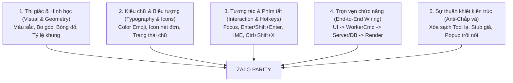
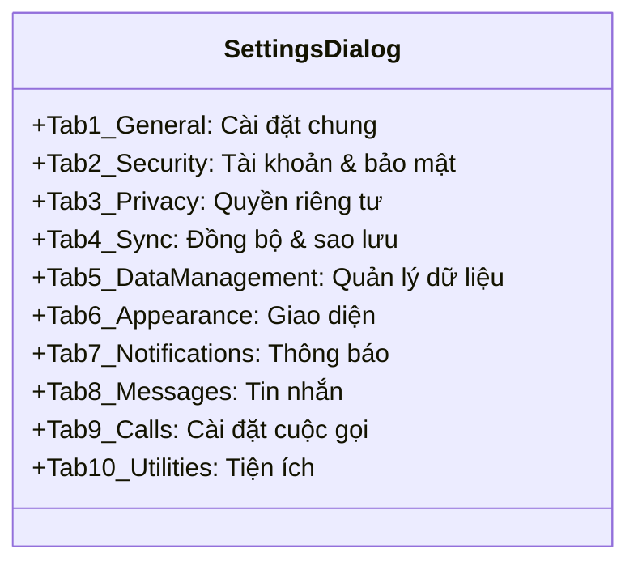

> **Tài liệu tham khảo lịch sử, không phải lệnh triển khai.** Ngày 24/11/2026, người dùng yêu cầu Codex lập phương án riêng. Dùng kế hoạch chính tại `C:/Projects/ZaloLite/docs/research/2026-11-24-codex-ui-ux-settings-implementation-plan.md` và prompt `C:/Projects/ZaloLite/docs/research/2026-11-24-antigravity-settings-parity-execution-prompt.md`. Nội dung bên dưới được giữ để đối chiếu; các khẳng định về command 551, route minh họa, SHA-256, xóa Tools trước migration và 800×800/10 tab bắt buộc chưa được chấp nhận làm chỉ dẫn thực thi.

# TÀI LIỆU TOÀN DIỆN: ĐỐI CHIẾU, AUDIT VÀ TÁI THIẾT UI/UX - CÀI ĐẶT PARITY VỚI ZALO PC & ZALO WEB
**Dành cho các AI Agents tiếp nối: Thẩm định, Phản biện, Hoàn thiện và Triển khai**

---

## 1. XUẤT PHÁT ĐIỂM, BỐI CẢNH & MỤC TIÊU DỰ ÁN

### 1.1. Bối cảnh dự án
- **Dự án:** `ctdozlite` – Ứng dụng Zalo Desktop độc lập, thuần native dành riêng cho Windows 11 ARM64 (và x86_64) viết bằng **Rust**.
- **Công nghệ nền tảng:** Giao diện dựng bằng `egui` (Immediate Mode GUI), kiến trúc bất đồng bộ `tokio` (Worker network/crypto), lưu trữ cơ sở dữ liệu cục bộ SQLite (`rusqlite`). Hoàn toàn không sử dụng Chromium, Node.js, hay Electron để tối ưu hóa bộ nhớ và hiệu năng vi xử lý ARM64.
- **Mục tiêu tối thượng (Non-negotiable Invariant):** 
  > **Mô phỏng giao diện UI/UX và hành vi chức năng sát Zalo gốc nhất có thể (Zalo PC làm chuẩn chính, Zalo Web làm chuẩn phụ trợ).**
  > Bất kỳ AI Agent nào tham gia phát triển đều không được tự ý sáng tạo các thành phần giao diện dị biệt, không được giữ lại các đoạn mã "chắp vá" của upstream, và không được tạo các nút bấm giả lập (stub) không gắn liền với chức năng thực tế.

### 1.2. Cơ sở bằng chứng thực nghiệm (Ground Truth Evidence)
Mọi phân tích, quy chuẩn và thiết kế trong tài liệu này được xác lập trên 4 nguồn bằng chứng thực nghiệm:
1. **Zalo PC Live Inspection (Cổng DevTools 9222):** Đã kết nối trực tiếp qua giao thức Chrome DevTools Protocol (CDP) vào tiến trình Zalo PC chính thức (`Zalo.exe` v26.11.12, PID 26204) đang chạy trên hệ thống. Đã bóc tách trực tiếp kích thước modal (`800px x 800px`), cây DOM, class CSS, màu sắc, font chữ và dữ liệu thực tế của toàn bộ 10 tab Cài đặt.
2. **Mã nguồn Zalo PC Bundle:** Trích xuất từ tệp `app.asar` (`compact-app-pc.*.js`, từ điển ngôn ngữ `lang-vi` gồm 6.475 chuỗi thông báo).
3. **Zalo Web Live (`chat.zalo.me`):** Đối chiếu hành vi thời gian thực trên trình duyệt webview.
4. **Mã nguồn hiện tại của Fork (`c:\Projects\ZaloLite`):** Đã kiểm tra toàn bộ `src/gui/modals.rs`, `workspace.rs`, `tools_panel.rs`, `privacy_panel.rs`, `theme.rs`, `store.rs`.

### 1.3. Nguyên tắc bất biến: Phân định ranh giới Local vs Server Sync chuẩn theo Zalo PC
> **NGUYÊN TẮC BẮT BUỘC (MANDATORY INVARIANT):**
> Khi thiết kế và triển khai bất kỳ tính năng hay cài đặt nào, **tuyệt đối không được đoán mò hoặc làm giả lập (fake)**:
> - Tính năng nào trong Zalo PC là **thuần Local** (lưu trên máy, quản lý ở cấp độ OS/SQLite cục bộ) $\to$ Fork **bắt buộc xử lý thuần Local**, lưu vào SQLite/Settings cục bộ, không gửi payload thừa lên server.
> - Tính năng nào trong Zalo PC là **phụ thuộc Server (Fetch Data / Sync Server)** $\to$ Fork **bắt buộc phải gọi đúng endpoint API / WebSocket frame của Zalo**, đi qua luồng chuẩn (`ParamCipher v2` $\to$ `signkey` $\to$ cookie đính kèm), và cập nhật state phản ứng từ dữ liệu server trả về.

#### Ma trận đối chiếu Local vs Server Sync chuẩn Zalo PC:

| Tính năng / Cài đặt | Phân loại dữ liệu | Cơ chế Zalo PC thực tế | Triển khai tương ứng trên Fork |
| :--- | :--- | :--- | :--- |
| **Khởi động cùng Windows, Khay hệ thống (Tray)** | 🟢 **Thuần Local** | Windows Registry (`HKCU\Software\...\Run`), Electron app tray. | Ghi Windows Registry native, cắm cờ trong `settings.json`. |
| **Thư mục tải file (Download dir)** | 🟢 **Thuần Local** | Lưu đường dẫn vào SQLite `Preferences.db` shard. | Lưu vào `self.settings.download_dir`. |
| **Giao diện (Sáng / Tối / Hệ thống)** | 🟢 **Thuần Local** | Lưu vào `Preferences.db` và `localStorage`. | Lưu vào `self.settings.theme_mode`, cập nhật `ThemePalette`. |
| **Phím gửi tin nhắn (`Enter` vs `Shift+Enter`)** | 🟢 **Thuần Local** | Lưu vào `Preferences.db` (key: `KEY_SEND_MESSAGE`). | Cờ `self.settings.send_on_enter` trong `settings.rs`. |
| **Thiết bị Mic, Loa, Camera cuộc gọi** | 🟢 **Thuần Local** | WebRTC device enumeration + C++ native audio engine. | Windows Audio Session (WASAPI) qua `cpal` / `rodio`. |
| **Dọn dẹp bộ nhớ đệm (Cache cleanup)** | 🟢 **Thuần Local** | Xóa file tạm trong `%LOCALAPPDATA%\ZaloData\Temp\`. | Xóa an toàn cache thumbnail và file tạm trong thư mục dữ liệu. |
| **Khóa ứng dụng màn hình Zalo (Ctrl+L)** | 🟢 **Thuần Local** | Mã PIN 4 số băm SHA-256 + salt lưu trong `SecureLocalstorage.db`. | Hash SHA-256 lưu `self.settings.pin_hash` + Windows Hello native. |
| **Thông tin tài khoản (Tên, SĐT, Avatar, Ngày sinh)** | 🔴 **Fetch Server** | Gọi API `wpa.chat.zalo.me/api/profile/get` lưu cache `Profile.db`. | `WorkerCmd::FetchProfile` $\to$ Cập nhật `self.user_profile`. |
| **Quyền riêng tư (Đã xem, Online, Nhận tin lạ, Chặn)** | 🔴 **Server Sync** | Gọi `wpa.chat.zalo.me/api/privacy/get` và `/update`. | `WorkerCmd::Privacy` (đã có module `crate::privacy`). |
| **Mã PIN cuộc trò chuyện ẩn** | 🟡 **Hybrid (Local + Server)** | Mã PIN băm gửi API `api/conv/hidden/set_pin` để đồng bộ trạng thái ẩn giữa Mobile và PC. | `WorkerCmd::HiddenPin` (đồng bộ danh sách hội thoại ẩn). |
| **Đồng bộ tin nhắn từ điện thoại** | 🔴 **Server Push / Peer Sync** | Kênh WebSocket Push (Cmd 551 / Sync V2) thông báo điện thoại tải lịch sử. | Luồng `WorkerCmd::SyncPhoneHistory` (V2/V1). |
| **Gợi ý Sticker khi gõ text** | 🟡 **Hybrid** | Keyword map cục bộ + API tải gói sticker mới từ sticker server. | Đọc bảng từ khóa sticker từ SQLite, cache sprite sheet. |

---

## 2. NGUYÊN TẮC AUDIT ĐA CHIỀU (BEYOND RIGHT/WRONG)

Khi một AI Agent thực hiện audit hoặc phản biện kế hoạch này, không được dừng lại ở việc kiểm tra "code có build được không" hay "hàm có lỗi không". Việc audit phải được đo lường qua **5 chiều chất lượng (Dimensions of Quality)**:

---

## 3. DANH MỤC CÁC PHẦN "CHẮP VÁ" CẦN XÓA BỎ VÀ TÁI THIẾT

### 3.1. Bản án tử cho `tools_panel.rs` ("Tiện ích hội thoại" - 1.207 dòng code)
- **Hiện trạng sai lệch:** Trên Nav Rail bên trái có icon dấu tích $\checkmark$. Khi bấm vào, Fork bật lên một popup trôi nổi (`egui::Window`) tiêu đề "Tiện ích hội thoại" gồm 10 tab chắp vá: *Tìm lịch sử, Nhập lịch sử, Giao diện & sticker, Hẹn giờ gửi, Tự trả lời, Giao việc & Bình chọn, Tin nhắn nhanh, Thiết bị & Bảo mật, Kho Media Server & zCloud, Doanh nghiệp & LAN*.
- **Thực tế Zalo gốc:** 
  * Zalo PC **không hề có popup này**.
  * Trên Nav Rail của Zalo PC, biểu tượng dấu tích $\checkmark$ là **Zalo To-Do (Giao việc)** – màn hình toàn trang quản lý công việc (Tôi giao, Giao cho tôi, Cần làm).
  * Các tab còn lại trong popup này là những mẩu code thừa từ upstream, cắm cọc lung tung, tạo ra ảo giác tính năng.
- **Hành động tái thiết bắt buộc:**
  1. **Xóa hoàn toàn tệp `src/gui/tools_panel.rs`** và struct `ToolsPanel`.
  2. Xóa bỏ trường `self.tools` trong `ZaloGuiApp`.
  3. Xóa bỏ tất cả các lời gọi đóng mở liên kết chắp vá: `self.tools.open = true`, `self.tools.tab = ...` xuất hiện rải rác trong `modals.rs`, `workspace.rs`, `chat_panel.rs`.
  4. Trả icon $\checkmark$ về đúng chức năng: Khi bấm vào, chuyển sang màn hình **Zalo To-Do** (nếu chưa hoàn thiện API To-Do thì tạm thời ẩn khỏi thanh Nav Rail để giữ độ tinh gọn, tuyệt đối không để popup rác).

### 3.2. Xóa bỏ stub "Truyền tệp LAN"
- **Hiện trạng:** Line 834 trong `tools_panel.rs` chứa stub lừa dối người dùng: `ui.label("Truyền tệp LAN chưa khả dụng: chưa có giao thức Zalo được xác minh.");`.
- **Thực tế:** Zalo PC có tính năng "Tìm đồng nghiệp qua mạng LAN" (`STR_LAN_SEARCH_DESC`) để quét các máy tính cùng mạng nội bộ đăng nhập Zalo, **không có tính năng P2P LAN File Transfer**. 
- **Hành động:** Loại bỏ hoàn toàn khái niệm và nhãn "Truyền tệp LAN".

### 3.3. Xóa bỏ các popup trôi nổi phân mảnh (`hidden_panel.rs`, `backup_panel.rs`)
- **Hiện trạng:** Quản lý mã PIN trò chuyện ẩn bị văng ra popup `hidden_panel.rs`. Nhập backup V2 bị văng ra `backup_panel.rs`.
- **Hành động:** 
  * Tích hợp toàn bộ UI Quản lý mã PIN (Tạo/Đổi/Xóa PIN) trực tiếp vào bên trong Tab **Quyền riêng tư** và Tab **Tin nhắn** của cửa sổ Cài đặt.
  * Tích hợp luồng Nhập backup trực tiếp vào Tab **Đồng bộ và sao lưu**.

---

## 4. CHI TIẾT CÁC THÀNH PHẦN UI/UX CẦN NÂNG CẤP ĐẠT CHUẨN ZALO GỐC

### 4.1. Hiển thị Color Emoji (Khắc phục lỗi Emoji đen trắng)
- **Vấn đề kỹ thuật:** `egui` mặc định chỉ vẽ font vector đơn sắc (Monochrome font glyphs). Khi người dùng đặt tên có emoji (ví dụ: `Bống 🖤`, `Hoa 🌸`) hoặc gửi icon trong tin nhắn, hệ thống vẽ ra glyph đen thô ráp hoặc ô vuông mất thẩm mỹ, trong khi Zalo PC hiển thị emoji đầy màu sắc (Apple/Twemoji style).
- **Giải pháp kiến trúc:**
  * Bổ sung cơ chế nạp **Color Emoji Font** (bộ font OpenType SVG hoặc Google Noto Color Emoji / Twemoji Texture Atlas).
  * Trong hàm render văn bản giàu (`rich text`), phân tách các ký tự Emoji để vẽ texture màu hoặc SVG thay vì ép qua font glyph đen trắng của egui.

### 4.2. Timeline Chat & Message Bubble Parity
1. **Hình dạng và màu sắc Bubble tin nhắn:**
   - Tin nhắn gửi đi (Outgoing): Nền xanh dương nhạt đặc trưng `#e5efff` (Dark mode: `#1b3a5b`), bo góc 12px, góc dưới bên phải bo nhỏ hơn (4px) để tạo "đuôi" tin nhắn.
   - Tin nhắn nhận (Incoming): Nền trắng `#ffffff` (Dark mode: `#272a30`), viền nhẹ `#e7e8ea`, bo góc 12px, góc dưới bên trái bo nhỏ (4px).
2. **Chỉ báo trạng thái tin nhắn (Delivery Status Indicators):**
   - Đang gửi: Icon đồng hồ cát hoặc vòng xoay nhẹ.
   - Đã gửi lên server: `✓ Đã gửi` (xám mờ).
   - Đã nhận trên máy người kia: `✓✓ Đã nhận`.
   - Đã xem: Avatar tròn nhỏ (14x14px) của người nhận đính ngay dưới chân bubble tin nhắn.
3. **Card Tệp tin đính kèm (File Attachment Card):**
   - Khung hình chữ nhật bo góc 8px, nền xám nhạt `#f4f5f7`.
   - Cột trái: Icon tệp tin phân loại theo đuôi:
     * `.zip`, `.rar`, `.7z`: Icon hộp màu vàng cam.
     * `.pdf`: Icon trang tài liệu màu đỏ.
     * `.docx`, `.doc`: Icon màu xanh dương.
     * `.xlsx`, `.xls`: Icon bảng tính màu xanh lá.
   - Cột giữa: Tên tệp in đậm, bên dưới là dung lượng (`3.5 MB`) và thanh tiến trình download nếu đang tải.
   - Cột phải: Nút **"Mở tệp"** (chạy tệp trực tiếp bằng app mặc định Windows) và nút **"Mở thư mục"** (mở Explorer).
4. **Trình phát tin nhắn thoại (Voice Message Player):**
   - Nút Play/Pause tròn màu xanh Zalo (`#0068ff`).
   - Sóng âm Waveform hiển thị dạng 24 vạch thanh dọc tương tác (biên độ cao thấp theo âm lượng thực của file AAC/OPUS).
   - Đổi màu sóng âm từ xám sang xanh theo tiến độ nghe.
   - Nút chỉnh tốc độ phát âm thanh: `1x` $\to$ `1.5x` $\to$ `2x`.
5. **Khung Trích dẫn / Phản hồi (Quote/Reply):**
   - Nằm lồng phía trên nội dung tin nhắn mới, có đường kẻ chỉ màu ở cạnh trái (accent bar 3px).
   - Hiển thị tên người được trích, nội dung tóm tắt hoặc ảnh thumbnail thu nhỏ nếu trích tin media.

### 4.3. Thanh công cụ Soạn thảo (Composer) & Phím tắt
1. **Khắc phục triệt để phím tắt `Ctrl + Shift + X`:**
   - *Nguyên nhân:* Xung đột với phím tắt chuyển mã Unikey/EVKey (`Ctrl + Shift`), và logic trong `workspace.rs` chặn bắt phím nếu text input không strictly focus.
   - *Giải pháp:* Lắng nghe sự kiện phím ở cấp cửa sổ chat (`ctx.input_mut().consume_shortcut`), đồng thời bổ sung **nút bấm biểu tượng chữ `Aa` (Soạn thảo nâng cao)** ngay cạnh thanh công cụ để người dùng luôn mở được dù có xung đột phím tắt bộ gõ.
2. **Cấu hình phím gửi tin nhắn:**
   - Hỗ trợ tùy chọn trong Cài đặt: `Enter để gửi tin nhắn` (Shift+Enter xuống dòng) HOẶC `Shift+Enter (hoặc Ctrl+Enter) để gửi` (Enter xuống dòng).

---

## 5. THIẾT KẾ TÁI THIẾT TOÀN DIỆN CỬA SỔ CÀI ĐẶT (SETTINGS)

### 5.1. Thông số kỹ thuật đo đạc từ Zalo PC Live (Port 9222)
- **Kích thước cửa sổ Modal:** Cố định `800px x 800px`, căn giữa màn hình.
- **Nền & Viền:** Nền trắng `#ffffff` (Dark mode: `#181a1f`), viền mỏng bo góc `8px`.
- **Phân chia 2 cột:**
  - **Cột trái (Setting Navigation):** Chiều rộng cố định `200px`. Nền `#f4f5f7` (Dark: `#202227`). Tiêu đề `Cài đặt` to, đậm (18px). Danh sách 10 mục menu, mỗi mục cao 40px, padding `10px 14px`, bo góc item `6px`. Item được chọn có nền xanh nhạt `#e5efff`, chữ và icon màu xanh Zalo `#0068ff`.
  - **Cột phải (Setting Content):** Chiều rộng `600px`. Cuộn dọc mượt mà. Tiêu đề mục to (16px), các thẻ phân nhóm bo góc 8px viền `#e7e8ea`.

### 5.2. Đặc tả chi tiết 10 Tab Cài đặt chuẩn Zalo PC

#### Tab 1: Cài đặt chung (`STR_GENERAL`)
- **Ngôn ngữ:** Dropdown chọn `Tiếng Việt` hoặc `English`. Thay đổi áp dụng ngay không cần khởi động lại.
- **Khởi động & ghi nhớ:**
  - Toggle `Khởi động Zalo khi mở máy` (Tương tác trực tiếp Windows Registry `HKCU\Software\Microsoft\Windows\CurrentVersion\Run`).
  - Toggle `Ghi nhớ tài khoản đăng nhập lần trước`.
- **Hành vi khi đóng cửa sổ:**
  - Radio chọn: `Thu nhỏ về khay hệ thống (System Tray)` hoặc `Thoát ứng dụng`.
- **Thư mục lưu file:**
  - Nhãn hiển thị đường dẫn hiện tại (ví dụ: `C:\Users\...\Downloads\Zalo Received Files`).
  - Nút `Thay đổi` (gọi Windows File Dialog) và nút `Mở thư mục`.
- **Đăng xuất:**
  - Toggle `Xóa lịch sử trò chuyện khi đăng xuất`.

#### Tab 2: Tài khoản và bảo mật (`STR_SETTINGS_ACCOUNT_AND_SECURITY`)
- **Thông tin tài khoản:** Avatar tròn, Tên hiển thị, Số điện thoại (`09xxxx`), Ngày sinh.
- **Khóa màn hình Zalo (App Lock):**
  - Mô tả: `Khóa màn hình Zalo của bạn bằng Ctrl + L, khi bạn không sử dụng máy tính.`
  - Toggle Bật/Tắt khóa ứng dụng.
  - Nút `Tạo mã khóa` / `Đổi mã khóa` / `Xóa mã khóa`.
  - Mở rộng Windows Native: Toggle `Mở khóa bằng Windows Hello` (vân tay, khuôn mặt).
- **Bảo mật 2 lớp (2FA):**
  - Toggle `Bảo mật 2 lớp` (Yêu cầu xác thực OTP trên thiết bị di động khi đăng nhập máy lạ).

#### Tab 3: Quyền riêng tư (`STR_SETTINGS_PRIVACY`)
- **Cá nhân:**
  - Toggle `Hiện ngày sinh` (Tùy chọn: Đầy đủ / Chỉ ngày tháng / Ẩn).
  - Toggle `Hiển thị trạng thái truy cập (Online)`.
- **Tin nhắn & Cuộc gọi:**
  - Toggle `Hiện trạng thái "Đã xem"`.
  - Dropdown `Cho phép nhắn tin`: `Tất cả mọi người` / `Bạn bè`.
  - Dropdown `Cho phép gọi điện`: `Tất cả mọi người` / `Bạn bè`.
  - Nút mở `Danh sách tài khoản đã chặn`.
- **Trò chuyện ẩn (Tích hợp từ `hidden_panel.rs` vào đây):**
  - Mô tả: `Đặt mã PIN cho các cuộc trò chuyện riêng tư để tránh người khác nhìn thấy trên máy của bạn.`
  - Nút `Cài đặt mã PIN` / `Đổi mã PIN` / `Đặt lại mã PIN`.
- **Nguồn tìm kiếm:**
  - Toggle cho phép tìm thấy bạn qua: `Số điện thoại`, `Mã QR`, `Nhóm chung`.

#### Tab 4: Đồng bộ và sao lưu (`STR_SYNC_AND_BACKUP_CONFIGURATION`)
- **Đồng bộ tin nhắn:**
  - Mô tả: `Đồng bộ tin nhắn từ điện thoại sang Zalo PC`.
  - Nút nổi bật: `Đồng bộ ngay` (Kích hoạt luồng Sync V2 tới điện thoại).
  - Hiển thị: Thời gian đồng bộ gần nhất, trạng thái `Các hội thoại đã được đồng bộ đầy đủ`.
- **Sao lưu tin nhắn:**
  - Nút `Sao lưu tin nhắn` (Xuất file sao lưu tin nhắn văn bản cục bộ).
  - Nút `Khôi phục tin nhắn` (Nhập dữ liệu sao lưu).

#### Tab 5: Quản lý dữ liệu (`STR_RESOURCE_MANAGE` - Tái thiết hoàn toàn)
- **Thống kê dung lượng thực tế (Storage Accounting):**
  - Tính toán trực tiếp dung lượng thực tế trên ổ cứng:
    * 🟦 **Tin nhắn media:** Dung lượng ảnh, video, voice, tài liệu tải về.
    * 🟧 **Bộ nhớ đệm (Cache):** Dữ liệu tạm, thumbnail ảnh.
    * 🟩 **Dữ liệu hệ thống:** Kích thước cơ sở dữ liệu SQLite (`messages.db`, `threads.db`).
- **Dọn dẹp dung lượng:**
  - Nút `Dọn dẹp bộ nhớ đệm` (Xóa cache tạm, giải phóng dung lượng an toàn).
  - Tùy chọn tự động dọn dẹp media sau: `30 ngày` / `60 ngày` / `Không bao giờ`.

#### Tab 6: Giao diện (`STR_SETTINGS_THEME`)
- **Chế độ giao diện (Theme Mode):**
  - 3 Card minh họa trực quan: `Sáng` (Light), `Tối` (Dark), `Hệ Thống` (System).
- **Hình nền chat:**
  - Toggle `Sử dụng Avatar làm hình nền chat mặc định`.
- **Cỡ chữ hiển thị:**
  - Thanh trượt tỉ lệ font scale (`100%`, `110%`, `125%`).

#### Tab 7: Thông báo (`STR_CONFIG_NOTI`)
- **Thông báo tin nhắn mới:**
  - Card laptop minh họa: 2 Radio `Bật` / `Tắt`.
- **Xem trước tin nhắn:**
  - Toggle `Hiển thị nội dung tin nhắn trên thông báo` (Tắt đi để ẩn nội dung và người gửi khi có thông báo pop-up).
- **Âm thanh thông báo:**
  - Toggle `Phát âm thanh khi có tin nhắn & thông báo mới`.
  - Nút `Thử âm báo` (Phát chuông `ding.wav` ngay lập tức).
- **Nhắc tên:**
  - Toggle `Thông báo khi có người nhắc tên (@mention)`.

#### Tab 8: Tin nhắn (`STR_SETTING_MSG`)
- **Phím gửi tin nhắn:**
  - Radio chọn: `Enter` gửi tin nhắn (Shift+Enter xuống dòng) HOẶC `Shift+Enter / Ctrl+Enter` gửi tin nhắn (Enter xuống dòng).
- **Gợi ý soạn thảo:**
  - Toggle `Hiện gợi ý Sticker phù hợp với nội dung đang soạn`.
  - Toggle `Hiện gợi ý Link khi dán liên kết vào ô soạn tin`.
- **Tin nhắn nhanh:**
  - Toggle `Bật tính năng Tin nhắn nhanh`.
  - Nút `Quản lý tin nhắn nhanh` (mở danh sách phím tắt `/`).
- **Chia mục Ưu tiên và Khác:**
  - Toggle `Tách riêng trò chuyện không ưu tiên sang mục Khác`.
- **Định dạng file Excel dán vào chat:**
  - Radio chọn: `Dạng hình`, `Dạng chữ`, `Luôn hỏi`.

#### Tab 9: Cài đặt cuộc gọi (`STR_VIDEO_CALL_SETTINGS`)
- **Microphone (Đầu vào âm thanh):**
  - ComboBox danh sách Microphone trên máy.
  - **Thanh đo âm lượng Micro (VU Meter thời gian thực):** Thanh xanh nhấp nháy theo âm thanh người dùng nói vào mic để kiểm tra tín hiệu.
- **Loa / Tai nghe (Đầu ra âm thanh):**
  - ComboBox danh sách Loa.
  - **Nút "Kiểm tra loa":** Phát đoạn nhạc chuông Zalo chuẩn qua thiết bị đã chọn để xác nhận âm thanh phát ra tốt.
- **Camera (Hình ảnh):**
  - ComboBox danh sách Camera.
  - **Khung xem trước Video (Camera Preview 16:9):** Hiển thị live stream từ webcam.
- **Lọc tạp âm:**
  - Toggle `Tự động khử tiếng vang (AEC) và lọc tiếng ồn`.

#### Tab 10: Tiện ích (`STR_UTILITIES`)
- **Phím tắt chụp màn hình (Desktop Screen Capture):**
  - Phím tắt chụp kèm cửa sổ: `Ctrl + Alt + S`.
  - Toggle `Ẩn cửa sổ Zalo khi chụp màn hình`.
  - Toggle `Tự động mở trình chỉnh sửa ảnh sau khi chụp`.
- **Tra cứu phím tắt Zalo:**
  - Bảng danh sách các phím tắt tiêu chuẩn (`Ctrl+F`, `Ctrl+N`, `Ctrl+L`, `Esc`, `Ctrl+Shift+X`).
- **Dịch tin nhắn AI:**
  - Toggle `Bật tính năng gợi ý dịch tin nhắn tự động`.

---

## 6. NHỮNG RÀO CẢN KỸ THUẬT & CÂU HỎI MỞ ĐỂ CÁC AI AGENT PHẢN BIỆN

Khi AI khác đọc tài liệu này, cần chú ý phân tích và phản biện 4 thách thức kỹ thuật lớn sau:

1. **Thách thức Render Color Emoji trong `egui`:**
   - *Vấn đề:* `egui` sử dụng thư viện rasterizer font `epaint` chỉ hỗ trợ glyph monochrome (alpha mask). 
   - *Câu hỏi phản biện:* Liệu nên dùng giải pháp parse chuỗi và vẽ `egui::Image` (texture atlas SVG của Twemoji) hay can thiệp vào `FontDefinitions` để patch font rasterizer? Phương án dùng Texture Atlas SVG có ưu điểm vượt trội là hoạt động trên mọi GPU mà không phụ thuộc font hệ thống Windows.
2. **Thách thức Thanh đo Mic (VU Meter) và Nút Test Loa trong `egui`:**
   - *Vấn đề:* `egui` chạy vòng lặp render frame liên tục. Việc đọc biên độ RMS của Microphone và phát âm thanh chuông loa phải hoàn toàn bất đồng bộ (non-blocking) qua `cpal` hoặc `rodio` ở background thread, chỉ gửi giá trị float `0.0..1.0` về UI thread.
   - *Câu hỏi phản biện:* Cấu trúc kênh truyền `crossbeam` hay `Arc<AtomicU32>` nào là nhẹ nhất để UI lấy biên độ mic mà không làm drop FPS của app?
3. **Thách thức Bắt phím tắt khi có Bộ gõ tiếng Việt (IME EVKey / Unikey):**
   - *Vấn đề:* Tổ hợp `Ctrl + Shift` mặc định của Unikey/EVKey dùng để đổi chế độ E/V sẽ nuốt mất sự kiện phím trước khi app nhận được.
   - *Câu hỏi phản biện:* Ngoài việc hỗ trợ nút bấm `Aa` trên giao diện, ta có nên cho phép người dùng tùy biến phím tắt mở khung soạn thảo nâng cao (ví dụ: `Ctrl + E` hoặc `F2`) để tránh hoàn toàn xung đột với bộ gõ quốc dân?
4. **Thách thức Thống kê dung lượng Cache mà không nghẽn ổ đĩa:**
   - *Vấn đề:* Nếu duyệt đệ quy cây thư mục `downloads` và tính dung lượng SQLite trong hàm render UI, ứng dụng sẽ bị khựng (lag).
   - *Giải pháp đề xuất:* Đưa việc tính toán dung lượng vào một `WorkerCmd::CalculateStorageSize`, chạy một lần khi mở Tab 5 (Quản lý dữ liệu) và cập nhật qua event.

---

## 7. BẢNG TIÊU CHÍ NGHIỆM THU PARITY (ACCEPTANCE CRITERIA)

Một AI Agent chỉ được coi là hoàn thành nhiệm vụ khi đáp ứng trọn vẹn bảng tiêu chí sau:

| Hạng mục | Tiêu chí đạt chuẩn (Pass) | Tiêu chí không đạt (Fail / Reject) |
| :--- | :--- | :--- |
| **Giao diện Cài đặt** | Đúng 10 tab chuẩn Zalo PC, kích thước 800x800px, đầy đủ 2 cột, không có nút nào nhảy sang popup ngoài. | Kích thước lệch, thiếu tab, hoặc còn nút bấm mở `tools_panel.rs`. |
| **Độ sạch mã nguồn** | File `tools_panel.rs` bị xóa sổ hoàn toàn; không còn stub "Truyền file LAN". | Còn sót `tools_panel.rs` hoặc còn stub giả lập. |
| **Hiển thị Emoji** | Emoji trên tên hội thoại và tin nhắn hiển thị màu sắc sinh động như Zalo. | Emoji hiển thị đen trắng hoặc dạng text thô. |
| **Cuộc gọi & Thiết bị** | Tab Cuộc gọi có VU meter nhấp nháy theo tiếng mic và nút Test chuông loa kêu được. | Chỉ có dropdown chọn tên thiết bị dạng tĩnh. |
| **Tin nhắn & Phím tắt** | Có cài đặt đổi phím gửi `Enter` vs `Shift+Enter`; có nút mở soạn thảo `Aa` không phụ thuộc hotkey. | Thiếu cài đặt phím gửi; phím tắt bị kẹt khi gõ tiếng Việt. |
| **Kiểm tra biên dịch** | Chạy `cargo check --locked` đạt 0 error, 0 warning trên môi trường Windows 11 ARM64. | Có lỗi biên dịch hoặc gãy liên kết thư viện. |
